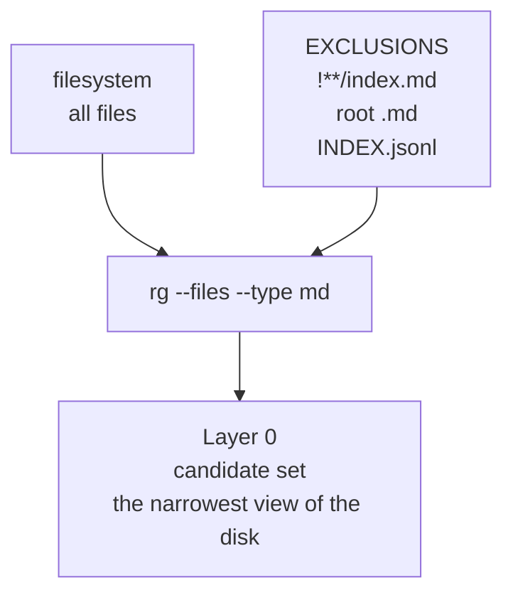
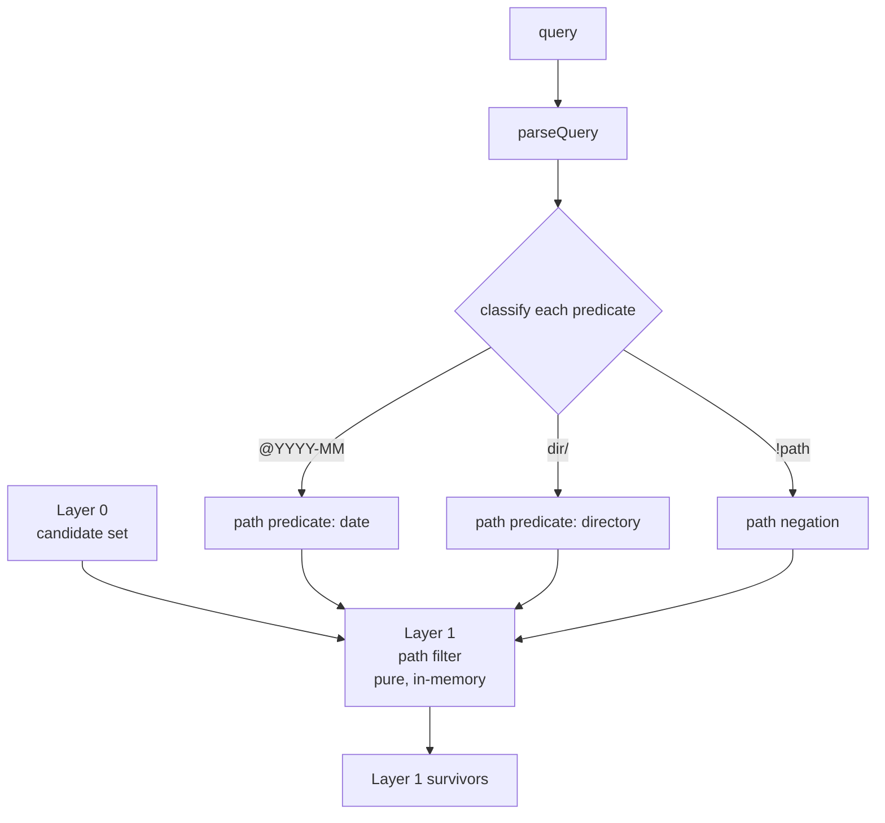
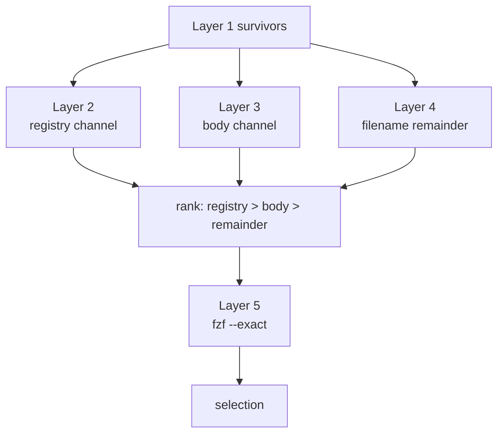
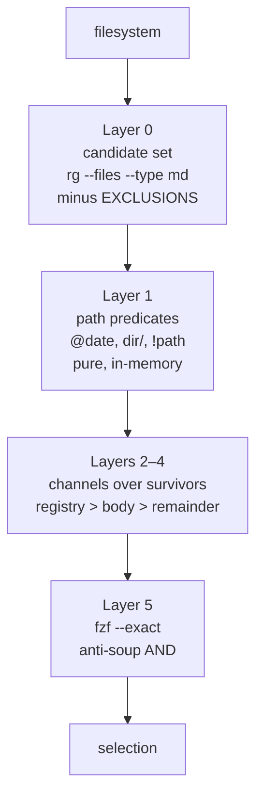

# Brief: The onion search grammar — staged filtering, path/content separation

**Date:** 2026-09-07
**Status:** Done — shipped 2026-09-24 (td-d95cf3). The design call the brief left
open: @date landed as GLOBAL scope (the contract tests' reading — the smoke query
dates every clause), not the clause-AND of the grammar sketch; per-clause dates
park on the elision ladder. The 7 red-by-design tests went green in one flip.
**Lineage:** dialog session (okudagram framing riff → concordance smoke
test → four-defect finding → onion architecture). Successor to
BRF-CONCORDANCE-PREFILTER (607e187), which landed `|`, `!`, and case at
the silo's seam but revealed the seam itself was wrong: the pipeline was
monolithic, and the grammar was forced to do path, content, and exclusion
in one parser because there was nowhere else to put them. This brief
gives each operator a layer.

## Objective

Rebuild the launcher's query pipeline as a **staged filter (the onion)**:
the candidate set is materialised once and narrowed in successive layers,
each layer owning one concern and knowing nothing of the layers below
it. Path predicates (`@date`, `dir/`, `!path`) filter the candidate set
*before* any content `rg` runs; content predicates run `rg` over the
narrowed set only; ranking and fzf's `--exact` refinement compose at the
end. The grammar routes predicates to layers; the layers do not parse.

The license is the scale: the repo is not large (~200 markdown files),
so materialising the candidate set and narrowing in memory is *cheaper*
and *more testable* than asking `rg` to do path filtering, content
matching, and exclusion in one regex per keystroke. Same trade-off the
origin doc made (whole-document re-render is cheap because the domain is
bounded), at a different layer.

## The four defects the smoke test found (the lessons learned)

The smoke test query `!(briefs/) (debriefs/|decisions/|docs/|playbooks/|advisories/) 2026-08` returned 113 silent-garbage entries, exit 0 — no crash, just wrong. Root-cause: one monolithic pipeline, four compounding defects, none catchable in isolation because there was no isolated stage to test.

1. **`|` splits inside parentheses.** `parseQuery` splits on every `|`
   regardless of parens. `(debriefs/|decisions/|…)` was *meant* as one
   OR-group; the parens became literal characters glued to the first and
   last alternative. The grammar has no grouping operator; `(` and `)`
   are treated as content. The intent was impossible to express.
2. **`!` negates a bare word, not a path.** `!(briefs/)` parsed as one
   exclude term — the literal string `(briefs/)`, parens included. The
   exclude then runs `rg --files -g '*\(briefs/\)*'` (a glob against a
   literal with parens), which matches nothing real. **26 `briefs/`
   entries leaked in** — the exclusion silently matched zero files. `!`
   is word-prefixed, so `!(briefs/)` is "exclude the word `(briefs/`",
   not "exclude the path `briefs/`".
3. **The exclude set is built by content match too.** `launcher.ts:329`
   runs `rg -l -- <term>` to exclude any doc that *mentions* the
   negated term. With term = `(briefs/)`, that's a regex against a
   literal-paren string — matches nothing. Even if the glob had worked,
   the content-mention exclusion is a second, coarser net that would
   over-exclude (any doc mentioning `briefs/` in its body dies). Two
   exclusion mechanisms doing different jobs, neither right for
   "exclude this directory."
4. **`2026-08` became a content substring of the last alternative**
   (`"advisories/) 2026-08"`), not a standalone path/date predicate. So
   it's searched as body text inside the `advisories/` alternative only,
   and the other four alternatives get no date filter at all. The
   path/content ambiguity the prior smoke test flagged is unresolved in
   the code, and the query fell through it.

**The one root cause:** the grammar and the channels and the exclusion
were one undifferentiated mass, so every new operator had to be
understood against the whole pipeline at once. The onion gives each
operator a home layer, and the grammar gets simple in proportion.

## The onion — what each layer owns, and what it must not know

```
Layer 0 — the candidate set (all markdown, exclusions applied)
  ↓  rg --files --type md, minus EXCLUSIONS. One rg call. Cache per query.
Layer 1 — path predicates (@date, dir/, !path)        [pure, in-memory]
  ↓  narrows the candidate set. No rg. Property-testable.
Layer 2 — registry channel (callsign-anchored, tier INDEX.jsonl)
  ↓  ranks survivors; reads INDEX.jsonl as data, not corpus.
Layer 3 — body channel (content match, evidence line)
  ↓  rg over the Layer-1 survivors only. One rg, narrow input.
Layer 4 — filename remainder (everything left, no evidence)
  ↓  the complement of {2,3} within Layer 1.
Layer 5 — fzf --exact (the anti-soup AND, in-fzf refinement)
  ↓  fzf's job, unchanged.
```

**The key inversion:** Layer 1 runs *before* any `rg` content search,
and it narrows the input to Layer 3. Today, the body channel runs `rg`
over the whole corpus and the exclude check discards matches *after* rg
returned them. In the onion, `!briefs/` removes every `briefs/` path
from the candidate set *before* Layer 3's rg runs — so rg never searches
briefs, and the exclusion can't leak (defect 2 gone). And `@2026-08`
removes every path not matching `2026-08` before Layer 3 — so the date
is a path predicate by construction, not a content substring that
glued onto the last alternative (defect 4 gone).

## The grammar, restated for the onion

Because the layers are separated, the grammar routes predicates to
layers rather than doing everything in one parser:

```
query     := clause ("|" clause)*
clause    := predicate (" " predicate)*        // AND within a clause
predicate := pathpred | contentpred | negate
pathpred  := "@" date | "/" dir | dir "/"        // path-shaped → Layer 1
contentpred := word | phrase                     // content → Layer 3
negate    := "!" pathpred | "!" contentpred      // ! → same layer as its operand
```

- **`|`** is OR at whatever layer its operands live. A clause of mixed
  predicates ANDs *across* layers: `@2026-08 decisions/ elision` =
  (path matches 2026-08) ∧ (path in decisions/) ∧ (content matches
  elision). The first two narrow at Layer 1; the third narrows at
  Layer 3 over the survivors.
- **`@date`** — a token starting `@` is a path predicate matching
  `YYYY-MM` or `YYYY-MM-DD` against the filename. Held to those two
  shapes only: a sigil with one shape is a predicate; a sigil with any
  shape is a second grammar inside the grammar. Ship `@YYYY-MM`, let
  dogfood ask for more (elision ladder).
- **`dir/`** — a token ending in `/` is a path predicate
  (matches that directory). A bare word is content
  (`decisions` finds docs *about* decisions, including in other dirs).
  Teachable, matches the `/briefs` intuition. The alternative — infer
  from whether it matches a real directory — is magic, and magic is
  where defect 4 came from. State the rule, don't infer it.
- **`!`** splits: `!briefs/` (path-shaped) is a Layer 1 exclude;
  `!colours` (content) is a Layer 3 exclude-by-result. Two mechanisms,
  two layers, two semantics, two tests. No cross-contamination (defect 3
  gone).
- **No grouping operator.** The grouped `(a|b)` the smoke test reached
  for dissolves into flat OR of path predicates at Layer 1 —
  `debriefs/ | decisions/ | docs/` — because path predicates and
  content predicates are at different layers and don't compete for the
  same parser. Grouping is ceremony if flat OR covers every real query.
  Add it only when a real query can't be written flat.

### The smoke test query, rewritten

```
!briefs/ @2026-08 debriefs/ | decisions/ | docs/ | playbooks/ | advisories/
```

Flat OR of path predicates, no parens, no grouping operator, every
predicate at its home layer. Uglier than the parenthesised original,
but expressible and *testable* — each predicate is a pure function over
the candidate set.

## The search grammar (mermaid)

For later reuse in a playbook or explainer. Split one diagram per
concern — the same discipline the onion applies to the pipeline: each
diagram owns one thing, no diagram does the whole job. The roll-up
composes them.

### Layer 0 — the candidate set

One `rg` call; the only stage that touches the filesystem. Every later
layer sees this set, never the raw disk.



### Layer 1 — path predicates (pure, in-memory)

The routing stage: `parseQuery` classifies each predicate, and path
predicates narrow the candidate set before any content search. No `rg`
here; each predicate is `path => boolean`.



### Layers 2–4 — the channels (run over survivors only)

The three ranking channels all take Layer 1's survivors as input. They
never see excluded paths; `rg` runs over a narrowed set, not the corpus.



### The onion — roll-up

The composition: each layer's output is the next layer's input. The
shape is the architecture — staged narrowing, one concern per layer.



## Scope / non-goals

- **Not a SQL engine.** The onion is staged *filtering*, not relational
  joins. Each layer narrows; no layer cross-references another. The
  candidate set is a list, not a table.
- **Not grouping `(…|…)` in v1.** Flat OR of path predicates covers
  every real query the smoke test surfaced. Add grouping only when a
  real query can't be written flat — same ladder discipline as `@date`
  shapes.
- **Not smart-case.** Case-insensitive across all channels (landed
  607e187). The uppercase escape hatch stays parked until dogfood
  clears its gate (filter-model doc §4b).
- **Not a config surface for exclusions.** `EXCLUSIONS` is a
  documented constant array, not a user knob. The registry-index
  regression is fixed by *construction* (indexes in the exclusion list,
  no later layer sees the raw filesystem), not by a per-query toggle.
- **Not changing fzf's role.** fzf `--exact` stays the anti-soup AND
  refinement (Layer 5). The onion's job is to make the entry list fzf
  receives correct *before* fzf runs; fzf's contract is unchanged.

## The registry-index regression — fixed by construction

The smoke test found a real regression: `CORPUS_EXCLUSIONS` excludes
`**/index.md` but the registry channel reads `INDEX.jsonl` directly as
a data source, bypassing that exclusion. The two channels disagree
about whether registry artifacts are documents. The onion fixes this at
Layer 0: `EXCLUSIONS` is the explicit, documented array of glob patterns
(`!**/index.md`, the root `.md` files to hide, `INDEX.jsonl` stated as
non-corpus), and **no later layer sees the raw filesystem** — every
layer sees the candidate set Layer 0 handed it. `INDEX.jsonl` powers
Layer 2 as *data*, never appears as a *result*; `index.md` is excluded
from the candidate set consistently. The architecture, not the glob,
makes the decision.

## Risk / open questions

- **`dir/` vs `dir` disambiguation.** The rule (trailing `/` = path,
  bare = content) is teachable but must be *documented in the reading
  path*, not inferred. A reader who types `decisions` expecting a path
  filter will get content search. The cure is the hint line, not
  inference — same posture as the shite-filter doc's `[02]` bound
  ("undiscoverability, not capability").
- **Path-predicate globs vs regexes.** `dir/` is a prefix match;
  `@YYYY-MM` is a filename match. Are these globs or regexes? Globs are
  teachable; regexes are powerful but a second grammar. Start with
  globs (prefix for `dir/`, exact-shape for `@date`); promote to regex
  only if dogfood asks.
- **Layer 1 performance.** Materialising ~200 paths and filtering in JS
  per keystroke is cheap at this scale. The license is the repo size.
  If the corpus ever grows 10×, Layer 1 may need to push path predicates
  into rg's `-g` globs instead of filtering in JS. State the bound in
  the brief so the day it breaks is the day someone reads the bound,
  not the day someone discovers the regression.
- **Property tests, not example tests.** The 10 tests at 607e187 are
  example tests; they proved the grammar works for the cases they
  covered, not that it covered the cases readers reach for. The onion's
  layers are pure functions over the candidate set — property-testable.
  `parseQuery` round-trips; `@` and `/` tokens classify as path
  predicates; `!` on a path-token excludes by path not content. A
  property test would have caught all four defects because it would
  have asked "what does `!` do to a non-word token?" — and the answer
  was "nothing sensible."

## How

1. **`parseQuery` v2** (`src/launcher.ts`): classify each predicate as
   path or content, return `{ pathPredicates, contentPredicates,
   pathNegations, contentNegations, structure: clause[] }`. Pure,
   property-testable. The classification is the routing.
2. **Layer 0** — `candidateSet(cwd)`: `rg --files --type md` minus
   `EXCLUSIONS` (the documented constant). Cache per query (the list
   doesn't change within a keystroke).
3. **Layer 1** — `applyPathPredicates(set, preds, negs)`: pure
   in-memory filter. Each predicate is `path => boolean`. Returns the
   narrowed set. No rg.
4. **Layer 2/3** — run over the narrowed set only. The body channel's
   `rg` takes the narrowed paths as input (rg can read a path list from
   stdin or a temp file), not the whole corpus. Content negation
   filters rg's output after.
5. **`EXCLUSIONS`** — promote `CORPUS_EXCLUSIONS` to the explicit
   documented array; add `INDEX.jsonl` (stated as non-corpus, even
   though `--type md` already filters it — for honesty, not behaviour).
6. **Tests** — property tests for `parseQuery` classification and
   Layer 1 filtering; the smoke test query becomes a regression test
   asserting the four defects stay fixed.

## Why it earns its place

1. **Closes the four defects with one architectural change.** The onion
   doesn't patch the grammar; it gives each operator a home layer, and
   the grammar gets simple in proportion. Four bugs → one root cause →
   one fix.
2. **Makes the pipeline testable.** Today's `rankedShortlistEntries` is
   one function doing parse + path-filter + content-search + exclude +
   rank. The onion splits it into pure layers, each property-testable.
   The smoke test found defects the example tests couldn't because there
   was no isolated stage to test.
3. **Fixes the registry-index regression by construction.** The
   candidate set is pre-cleaned at Layer 0; no later layer sees the raw
   filesystem. Indexes can't leak because they're not in the input.
4. **Licenses the scale honestly.** The repo is not large; staged
   in-memory filtering is cheaper *and* more testable than one clever
   rg. State the bound; the day it breaks is the day someone reads the
   bound, not the day someone discovers the regression.

## Related

- `briefs/2026-09-06-brief-concordance-prefilter.md` — the predecessor.
  Landed `|`, `!`, case; revealed the monolithic pipeline.
- `docs/2026-09-04-filter-model.md` — the filter states (shelf/dive),
  the grammar in reserve (tier filters, state filters). This brief
  lands the path/content separation the filter model mused on.
- `docs/2026-09-05-frame-as-shite-filter.md` — the shite-filter posture
  the onion serves: assume shite, narrow in stages, declared intent at
  each.
- `docs/2026-09-05-search-as-shite-filter.md` — the search-level
  instance.
- `src/launcher.ts` — `parseQuery`, `rankedShortlistEntries`,
  `CORPUS_EXCLUSIONS`, `registryRows`. The code this brief restructures.
- `advisories/ADV-READER-SIDE-FILTER.md` — the reader-side filter
  principle this brief operationalises at the path/content seam.
