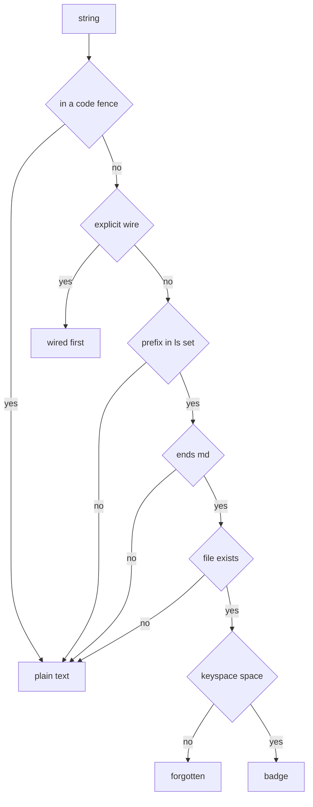

# Brief: Document Links — Gopher Hypertext in the Reader

**Date:** 2026-08-26
**Status:** Ready (small-medium; reader surface, src work)
**Depends on:** render engine link handling (`src/wrap.ts` OSC 8 path);
follows `2026-08-26-brief-ssh-blog-feed.md` (v1) — links are what turn
the feed into a *site*.

## What

Relative markdown links between documents become in-reader navigation —
the gopher model, not the web model. A post links to another post; the
reader can follow it without leaving the session.

1. **Detect & number.** At render time, collect relative links
   (`./other-post.md`, `../folder/doc.md`) in visible order. Beneath the
   document (or in the hints row when toggled), print a numbered menu:
   `1. The Gloam Footer Story   2. Palette Census` — muted, link-text
   colour for titles.
2. **Digits follow — unified double-digit keyspace (amended 2026-08-30).**
   Jump tokens and link numbers share one space: **11–99**, assigned in
   visible order, starting at 11 per ADR-021's offset. No single-digit
   case exists — a lone digit always buffers (the spaced double-tap
   behavior, 62213eb), so there is no `1`-vs-`11` disambiguation policy to
   write. The keybuffer as shipped is already this behavior; the link
   numberer just fills the same map. Documents with >89 links: the tail is
   unfollowable, the hints line says so — an honest limit, an authoring
   problem, not a paging feature. (Supersedes the original 1–9 spec,
   written before the double-tap jump work landed.)
   Resolution is relative to the current document's directory; the served
   root bounds it (a link outside the root is rendered but not
   followable — it is web-bound, and OSC 8 still carries it for terminals
   that want to hand it to a browser).
3. **Inferred vectors — optimistic, prefix-derived, debuggable by
   inspection (added 2026-08-31).** Explicit links are not the only
   paths in the corpus: documents reference each other with *bare
   path-shaped strings* (`decisions/025-mnemonic-namespace-model.md`,
   `briefs/index.md`) with no link syntax at all. At render time these
   get optimistic vectors, under four deterministic rules:
   (a) the **prefix set is derived from an `ls` of the silo root** —
   folder names plus root documents; the structure is the config, no
   declarations, self-maintaining; (b) a candidate is a token-bounded
   string starting with a known prefix and ending `.md`, **existence-
   verified** before painting (optimism with a bouncer); (c) **explicit
   wins** — `%%okuda-rhs%%` wires claim their numbers first, inference
   numbers only unwired references, markdown links outrank bare paths;
   (d) **keyspace cap**: visible order to 99, the rest forgotten, the
   hints row states the cap. Code fences are skipped (paths quoted as
   text must not badge — the same fence-collision class as the mermaid
   scan, one solution serving both). The affordance stays the menu
   (item 1); inline bracket badges are a later paint refinement under
   ADR-026's direction.

   **Debuggable by inspection** is the requirement that makes optimism
   safe: the inference is deterministic and explainable from the text
   alone — a badge implies (prefix in the `ls` set) ∧ (ends `.md`) ∧
   (file exists) ∧ (keyspace space); no badge implies the same four
   negations. No hidden state, no learning, no model. A wrong guess
   resolves to the shipped silent no-op — and if a badge is missing or
   wrong, the four rules read off the line answer why.

   The gates, drawn — and the diagram is the complexity canary: if
   four gates can't render, the inference is over-complicated and the
   fallback is the review.

4. **Navigation stack.** Following a link pushes; a bound key (proposal:
   `u`, unbound today) pops back to the previous document at the previous
   scroll — the anchor machinery (`reanchoredScroll`) already preserves
   position across re-render; reuse it across documents. `u` from the
   first document is a no-op.
5. **The loop joins in.** In the launcher/feed loop, quitting the reader
   (`q`) returns to the picker, as today; `u` walks back through followed
   links *inside* the reader session. Two layers, two back keys, no
   confusion: `q` exits the document, `u` unwinds within it.

## Why

Gopher's soul: numbered links, no chrome, reading as traversal. The
SSH feed (v1) is a file listing with a good reader; links make it a
navigable hypertext — "an ssh endpoint where we get links to other
documents might be fun" was the actual request, and it is the fun part.
Also the honest division: OSC 8 serves the *web* links (terminals hand
them to browsers); digits serve the *local* links (the session owns
them). Two link species, two affordances, no conflict.

## Constraints

- **Reader-only surface; `render.ts` gains a pure helper** (collect
  relative links from the token stream) — the streaming renderer stays
  untouched: it emits the same OSC 8 sequences as today. The numbered
  menu is TUI chrome, not document content.
- **Served-root bounding** is a *viewer* concern (the feed config pins
  the root); the reader takes a `resolveLink` hook or a root option —
  decide in implementation, keep the sandbox story unchanged.
- **Keymap discipline:** the hints line reads `11-99 go · u back` when a
  document has links; absent otherwise — chrome appears only when it acts.

## Out of scope

- Link *authoring* conventions for blog-posts (the palette revisit and
  link-style pass is the separate parked work — scrappy editing gets its
  own pass when the feed exists to serve the posts).
- Numbered links beyond the keyspace (>89) — an authoring problem, not
  a reader problem — the cap is stated in the hints row.
- Web links via digits (OSC 8 already owns those; terminals hand them to
  browsers — including on iPad clients that support it).

## Verification

- Unit: inference rules (prefix set from ls, fence skip, existence
  gate, explicit-first precedence, keyspace cap — each rule tested
  against a line that should badge and a line that shouldn't);
- Unit: link collection (relative vs absolute vs web); digit decode;
  `u` stack push/pop; anchor preservation across document switches.
- Sandbox: follow a link between two posts over the feed; `u` returns to
  the exact scroll position; `q` from any depth exits to the picker.
- iPad dogfood: digits and `u` on the Bluetooth keyboard over Echo.
