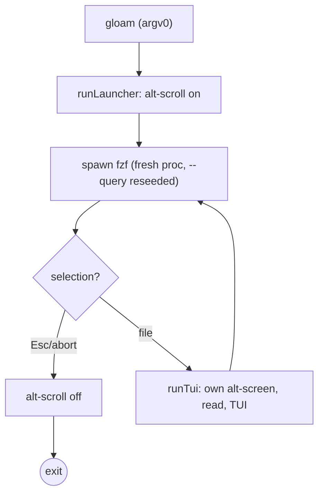
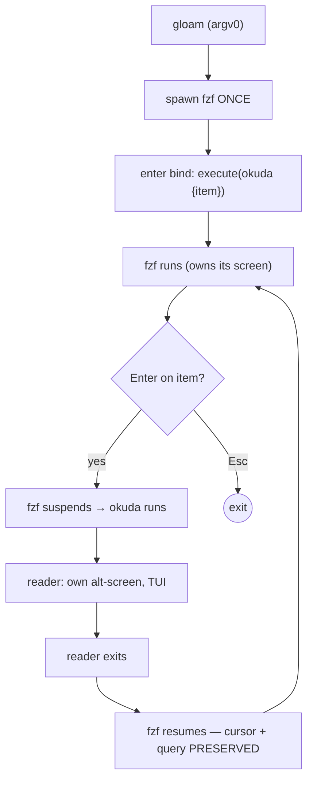
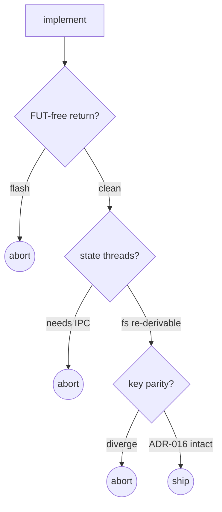

# Brief: fzf owns the loop (cursor-preserve experiment)

**Date:** 2026-08-29
**Status:** Aborted (2026-08-30) — gate 1 passed, but the fix for the
**real gate (Bun's passive stdin freeze under fzf `execute`) was heavier
**than the disease: a `bun:ffi` + `/dev/tty` active-poll reader running in
**every TUI session for a feature behind an env flag. Reverted; ADR-023
**marked Aborted; debrief logged. The analysis below stands — spawn-per-round
**structurally cannot preserve the cursor; only fzf-owns-the-loop can.
**Branch:** feat/gloam-launcher
**Context:** dogfood nit on the gloam browse → read → browse loop.
Select a file in fzf → read it in okuda → quit back to fzf: the
picker has reset its cursor to the top file. The typed *query*
survives (reseeded via `--query`), but the *highlight* does not.
Read enough docs in a session and the reset accumulates into "why
do I avoid the launcher."

## The finding

`pickFile` spawns a **fresh** fzf process each round. fzf has no
`--start-at-item` flag; a new process always highlights the top
item. The reseeded `--query` was the clever half — the filter
survives. The cursor was the half we didn't fix because the
spawn-per-round shape can't fix it. The cursor lives in fzf's
process state, and we throw that state away every round.

## The two shapes, side by side

### Current — launcher drives, spawn-per-round

The loop is in `runLauncher`. fzf is ephemeral. Cursor state is
lost at `C` every round. The reader owns the alt-screen per call
(`tui.ts:444` / `:614`) — so the return edge `G → C` crosses to
primary screen: a flash of unstyled terminal (the **FUT**,
`BRF-LAUNCHER-FUT`, open).

### Proposed — fzf drives, reader is an `execute` guest

The loop is in **fzf**. fzf suspends around the reader and resumes
the *same process* — cursor, query, highlight, scroll offset all
survive for free. The reseed ceremony retires. The reader is
invoked as a subprocess (`okuda {item}`), not an in-process call.

## What changes, what doesn't

- **The reader's one-document contract** (`okuda <file>`) is
  unchanged — `execute` invokes exactly that. ADR-016's
  argv[0] dispatch still holds: `gloam` spawns fzf; `okuda` reads.
- **Key-grammar parity (ADR-016)** still ships with the build —
  the binds live on the one fzf invocation. Arguably simpler: one
  spawn, one bind set, no per-round reseed.
- **fzf absence = clean error** — `runLauncher` still gates on
  `which("fzf")` before spawning. Holds.
- **Session-scoped state** (callsign resolver, silo badge,
  `td-bdfce0`) is launcher-side today, passed to `runTui` as
  options. Under `execute`, the reader subprocess re-derives them
  from the filesystem (`detectRoot()`, the registry index) per
  read — not per session. This is a perf nuance (an index load per
  read), not an invariant: all of it is filesystem-derived and
  re-runnable. Acceptable; flag for the debrief.

## The invariant gate — abort if any fails

This is an **experiment**, not a plan. The epic is gated: implement,
measure each invariant, abort and keep spawn-per-round if any
falls. Three gates, hardest first:

### Gate 1 — FUT-free return edge (the hard one)

This is where it lives or dies. `BRF-LAUNCHER-FUT` made the
**session** own the alt-screen precisely to kill the FUT on *both*
edges — the fix is open, not landed, so today the return edge
flashes primary screen regardless. Under fzf-owns-the-loop the
model inverts: fzf owns its screen, suspends for the reader, the
reader does its own alt-screen enter/exit, fzf resumes and
redraws.

The open question: does fzf's resume redraw cleanly cover whatever
the reader's `EXIT_ALT` leaves behind, or is there a visible
primary-screen frame between reader-exit and fzf-redraw? fzf does
clear-and-redraw on resume, but the timing of `EXIT_ALT` → fzf
repaint is the thing only a manual test settles. **If there's a
flash we can't suppress, abort.** This gate subsumes part of the
open FUT brief — if it passes, the FUT scoping fix may take a
different shape (or retire); if it fails, FUT still needs its own
resolution and this experiment is closed.

### Gate 2 — state threading

The reader subprocess must land with callsign + silo badge intact
without IPC. All of it is fs-derived; the question is whether
re-deriving per read is acceptable (it is) and whether the reader
entry point cleanly accepts a "you're a guest, re-derive root"
mode. Low risk; the abort is "we'd need IPC," which we won't build.

### Gate 3 — key-grammar parity

Mechanical: the binds on the single fzf invocation match the
reader's verb set. ADR-016's contract test (`GLOAM_FZF_BINDS`)
still pins it. Low risk; included for completeness.

## The epic workflow (experimental)

This is not a "land it" epic. The td epic is shaped as:

1. **Spike.** Smallest possible change: one fzf invocation with an
   `enter:execute` bind invoking `okuda {item}`; no callsign/silo
   threading yet — just the loop and the cursor-preserve proof.
   Manual test of gate 1. **Branch point:** if gate 1 flashes,
   abort here, close the epic, keep spawn-per-round.
2. **Thread state** (only if 1 passes). Re-derive root + callsign
   + silo in the reader entry; retire the launcher's per-session
   resolver.
3. **Retire the reseed.** Remove `--print-query` / query reseed —
   fzf keeps its own query now. Remove `pickFile`'s round shape.
4. **Reconcile with `BRF-LAUNCHER-FUT`.** If gate 1 passed cleanly,
   the FUT scoping fix may be moot (fzf manages the handoff) or
   may still be needed for the launch edge. Decide and amend the
   FUT brief in the same change.
5. **Debrief** — experimental epics debrief whether they shipped
   *or* aborted. An abort with a recorded gate-failure is a
   successful experiment.

Steps 2–4 only run if 1 passes. The epic carries an explicit abort
path; "we tried, gate 1 failed, kept spawn-per-round" is a closed
epic, not a failed one.

## Scope / non-goals

- **Not reinventing fzf.** fzf stays a soft runtime dep; we use its
  `execute` bind, not an in-process matcher.
- **Not IPC.** If state threading needs IPC, that's the abort.
- **Not the streaming fallback.** No fzf there, ever.
- **Not a screen abstraction layer.** One `execute` bind, one
  reader entry mode. No framework.

## Risk / open questions

- **Gate 1 timing.** Only a manual test settles it. The spike's
  entire job is to answer this one question.
- **`execute` and the alt-screen.** fzf's `execute` runs the
  command with fzf suspended; whether the reader's own
  alt-screen enter/exit interacts cleanly with fzf's suspend
  state is the untested assumption. `execute(...)` vs
  `execute(... {+})` (reload) variants may matter — spike decides.
- **Esc semantics.** Today `esc:cancel` in the picker exits the
  loop. Under `execute`, Esc inside the reader quits the reader
  back to fzf (unchanged); Esc in fzf exits fzf (unchanged). The
  two-Esc shape is the same, but worth confirming it doesn't feel
  different when fzf is the loop driver.

## Related

- `src/launcher.ts` — `pickFile`, `runLauncher` (the loop that
  retires or transforms)
- `src/tui.ts` — `runTui`, alt-screen ownership (`:444`, `:614`)
- `briefs/2026-08-28-brief-launcher-fut.md` — `BRF-LAUNCHER-FUT`
  (open; gate 1 subsumes part of it)
- `decisions/016-argv0-launcher-dispatch.md` — ADR-016 (key-grammar
  parity, the picker is a guest of the reader's key set)
- `briefs/2026-08-26-brief-gloam-launcher-promotion.md` — the
  promotion brief (the loop's origin)
- `td-bdfce0` — callsign layer (session-scoped state to re-thread)