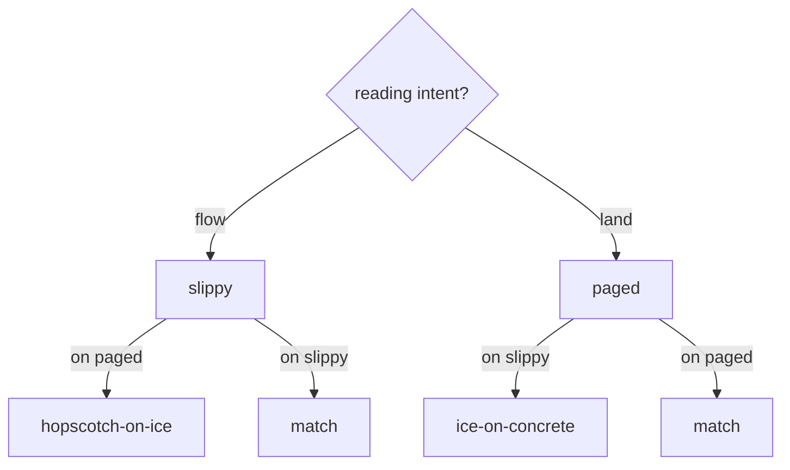
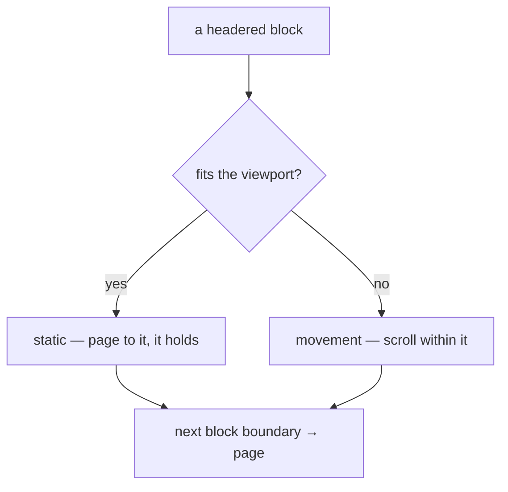
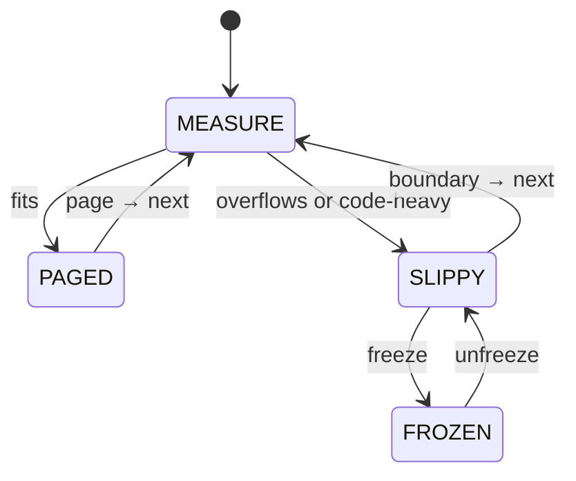
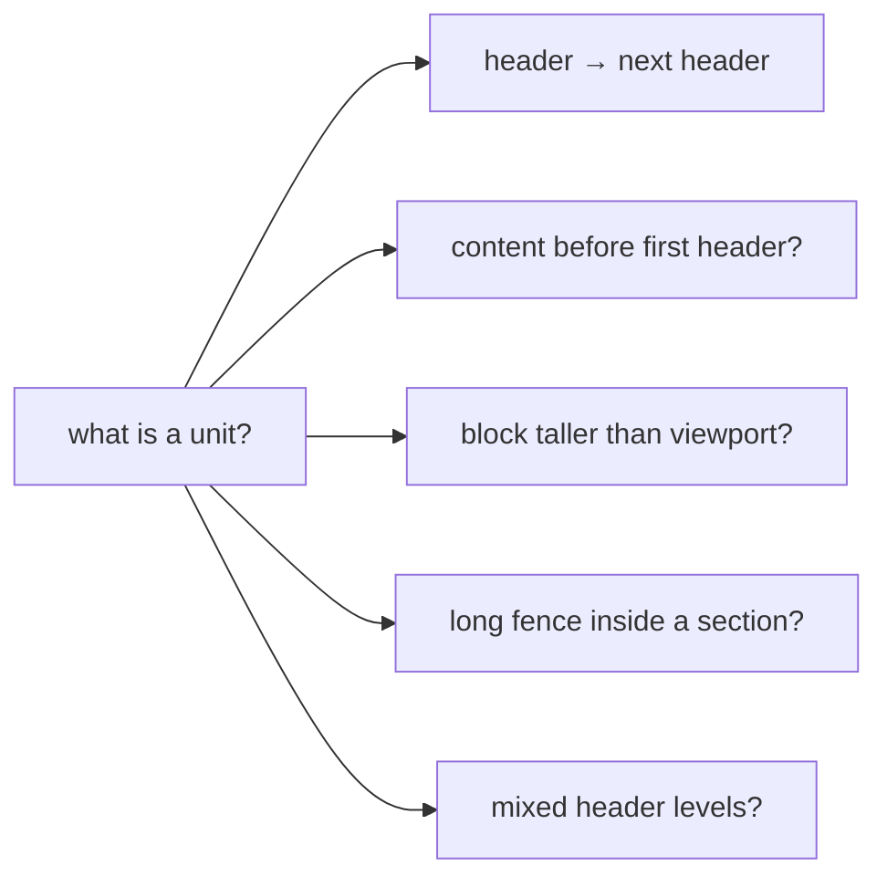

# Brief: Paged okudagram view — block-aware paging (candidate invariant)

**Date:** 2026-08-29
**Status:** Aspiration — constraint-space exploration, not a plan
**Branch:** feat/gloam-launcher (parked; no code yet)
**Context:** a dogfood musing on the scroll seam. The current TUI is
slippy: a flat line array, a continuous viewport sliced through it,
an "eye proxy" anchor pinning the nearest non-blank line to the
viewport middle on resize. Elegant for flow. But the document is
not all flow — it is also landing. Reading a headered block whole,
studying it, is a different intent than scrolling through. The
scratchpad named both failure modes long before this brief:

> *Hopscotch on ice.* Discrete intent on a continuous surface — you
> want to *land*; the floor won't hold still.
> *Ice dancing on concrete.* Continuous intent on a discrete surface
> — you want to *flow*; the floor won't slide.

This brief records the aspiration to resolve both at once, and the
constraint space we must explore to know whether it is a real
invariant or a tempting one.

## The aspiration (candidate invariant)

**Movement when movement is indicated; static otherwise — resolved
per block, not per user setting.**

A block that fits the viewport *holds* (you land, it stays). A block
that overflows the viewport *moves* (you scroll within it). The
viewer resolves the modality by measuring the block against the
screen; the user never owns the mismatch decision. This is not a
toggle (that is benchmaxxing the interface axis — it hands the user
exactly the decision they shouldn't have to make). It is a policy,
applied at the block.

If this holds, it joins the constitution's invariants alongside
*hard-wrap mandate* and *one glyph, one job*. If it doesn't hold —
if the constraint space closes it — we keep the slippy seam and
record why. Either outcome is a successful exploration.

## The modality match

The two failure modes are not symmetric options on a menu. They are
mismatches between intent and surface:



The synthesis the aspiration proposes is **not** "offer both and let
the user pick." It is: *the block decides.* A fitting block pages
(match for landing); an oversized block scrolls (match for flow).
Paged at the boundary, slippy within the oversized unit.



No hopscotch-on-ice (a fitting block won't scroll-jump under you);
no ice-dancing-on-concrete (an oversized block won't page-jump
mid-read). The mismatch is resolved at the measurement, not the
preference.

## The state space (resolving a conflation)

A musing on this brief surfaced a conflation worth separating
before any more cases are added: **"static" and "frozen" are not
the same thing.** They are two orthogonal axes we had been sliding
together:

- **Navigation mode** (how input moves the view): *paged* (jumps to
  a block boundary) vs *slippy* (scrolls within).
- **Input coupling** (whether input moves the view at all): *live*
  (input moves it) vs *frozen* (input ignored — *tied-to-the-mast*).

A fitting block in paged mode is "static" — but that is *physics*
(nothing to scroll, it holds by measurement), not *freeze* (input
decoupled by user choice). Calling both "frozen" collapses "can't
move because it fits" into "won't move because the user disabled
input." A state diagram separates them, because state diagrams
exist to distinguish states from the transitions between them:



Four states, two axes. `PAGED` is paged+live (a fitting block; input
pages to the next block — it holds by physics, there is nothing to
freeze). `SLIPPY` is slippy+live (an oversized or code-heavy block;
input scrolls within it). `FROZEN` is slippy+frozen — a *sub-state*
of SLIPPY, reached when the user wants to study an oversized unit
without it scrolling under a dodgy swipe or gravity mouse (the
`tied-to-the-mast` panel property). `PAGED-FROZEN` is degenerate and
not drawn: a block that fits has nothing to freeze. **Freeze is a
SLIPPY affordance, not a PAGED property** — the conflation, drawn
out, dissolves.

**The open question the diagram surfaces** (not in the original
brief): when SLIPPY reaches a block boundary, does it page-jump to
the next block (re-enter MEASURE) or continue scrolling into it? The
synthesis says "paged at the boundary" — so the transition
`SLIPPY → MEASURE` is named — but whether the *user* triggers it
(explicit page input at the boundary) or the *viewer* triggers it
(auto-page on overflow) is an exploration output. The diagram makes
the question visible; it does not answer it.

## The constraint space — what we don't yet know

This is the section that earns the brief its "aspiration" status.
Four open questions, any of which could close the invariant.

### 1. The unit (the load-bearing question)

You put scare-quotes around "okudagram/whatever" — rightly, because
the whole design lives or dies on what a "headered block" *is*.
"Header to next header" is the natural choice; the edge cases are
where the work hides:



Get the unit definition right and the paging machinery is mechanical.
Get it wrong and the paginator fights the author's structure. The
leans on the two hardest cases (E3, E4) are stated in prose, not
the diagram, because they are *proposed answers* to explore, not
settled policy: **E3** — the section is the unit; the fence is
content within it; an oversized section scrolls internally (the
synthesis holds). **E4** — nesting preserves the outer unit; the
inner header is a nav target, not a page break. *Both leans are
exploration outputs to defend, not inputs to assume.*

### 2. The seam

The renderer returns a flat line array; the TUI scrolls a window.
Block-aware paging needs the TUI to know *where the block boundaries
are in that array*. A musing on this brief — "it's just one matrix
fitting into another, we should be able to figure that out from the
numbers" — collapsed the seam to a ladder, and found the rung the
exploration was looking for.

**Rung 1 — viewport paging (pure numbers).** Jump by screen-height.
No structure needed. But this drops the synthesis (the block decides)
and reverts to arbitrary page boundaries — that's `less`/`man`
paging, lands mid-block → ice-dancing-on-concrete for landing
intent. *Too simple.*

**Rung 2 — block paging (scan the rendered output).** The renderer
preserves header markers as *content* by the NO_COLOR-parity
invariant ("strip escapes → `## Heading` as before"); the TUI already
scans the line array (the eye-proxy anchor reads blank/non-blank).
Finding block boundaries is a regex on existing output, not a new
return value. **The collision:** the same parity property that makes
real headers cheap to scan makes code-fence `##` indistinguishable.
Verified in this repo: `docs/ssh-and-gemini.md:49-51` has a code
fence demonstrating markdown headers —

```
# Heading 1
## Heading 2
### Heading 3
```

— and a scan of rendered output cannot tell that `## Heading 2` from
a real H2. The parity invariant is double-edged: it gives scanability
*and* the collision in the same stroke.

**Rung 3 — structured index (renderer returns block boundaries).**
The escape if the collision is unacceptable. The renderer emits header
line-indices alongside the lines; the TUI consumes renderer-derived
structure (eye-proxy anchor precedent). Costs a second channel for
what a scan gets for free in the common case.

**Lean:** default to rung 2 (scan), accept the collision as a known
small lie, keep rung 3 in reserve. The collision's failure mode (a
false page boundary inside a code-fence-heavy section) degrades
toward the fallback (constraint 4) — the same direction rung 1 lives.
A third escape exists — scan the *pre-finalize* stream where code
blocks are still wrapped in `\u0000RAW:code\u0000` tags and skip
inside them — but the TUI currently gets post-finalize output (tags
stripped), so that refactor approaches rung 3's cost anyway. *The
first mapped edge case of the exploration: code-fence `##`-collision,
resolved by the constraint-4 fallback, not by rung 3.*

### 3. Sequencing against the fzf epic

This touches the same TUI scroll seam as `td-05c154` (fzf-owns-the-
loop). If both land on the scroll seam at once, they tangle. Gate
this behind the fzf epic resolving (ship *or* abort) before any code.
An abort of the fzf epic clears the seam; a ship restructures the
TUI entry shape this brief would build on.

### 4. The fallback to slippy

What happens when the unit definition refuses to resolve cleanly —
a document with no headers, a block five viewports tall, a code-fence
heavy section whose `##` collides (constraint 2)? The honest answer
may be "slippy is the fallback, paged is the refinement," which makes
paged an *additive* layer over the existing seam rather than a
replacement. That would be the cheapest outcome and the least risky.

**The second mapped edge case** (surfaced by re-examining the use
cases): a code-fence-heavy unit — the `ssh-and-gemini.md` shape,
where the document's own structure is partly code demonstrating
markup. The reframe that resolved it: code blocks are second-class
(we render coloured text, truncate left, could truncate below); a
code-heavy unit is oversized-by-content, and the synthesis handles
it *by the same rule* — an oversized unit scrolls (SLIPPY), not by a
new exception. "Revert to slippy + hit freeze" is the fallback the
brief already named, triggered by content-type density, not just
physical overflow. *The collision case is the degenerate case the
fallback was for.*

**Freeze as a surfaced affordance.** The reframe introduced freeze
(tied-to-the-mast) as a per-unit affordance in SLIPPY — "study this
oversized unit without it scrolling under me." This is a *new use
case* the exploration surfaced, not a pre-existing one: the state
diagram (above) places it as a SLIPPY sub-state (FROZEN), not a PAGED
property. Worth its own line in the exploration rather than smuggled
in as "room to maneuver." Whether freeze belongs in the first cut or
is a later refinement is an exploration output.

The exploration should look for evidence that the additive shape
(slippy as fallback, paged as refinement, freeze as SLIPPY sub-state)
is sufficient before assuming a replacement is needed.

## What this brief is not

- **Not a plan.** No epic, no tasks, no gates — yet. The constraint
  space is unexplored; planning before it is settled is ceremony.
- **Not a toggle.** If the invariant holds, it is a per-block policy,
  not a user setting. A setting is the failure mode, not the feature.
- **Not a rewrite of the scroll seam.** The exploration's first job is
  to find evidence for whether the additive shape (paged as a layer
  over slippy) is enough, before assuming a replacement.
- **Not parked forever.** Aspiration with a recorded constraint space
  is a candidate invariant on record. It unparks when (a) the fzf epic
  resolves and clears the seam, and (b) the unit-definition question
  has an answer someone is willing to defend.

## How we explore (not build)

The output of this brief is *not* code. It is a settled constraint
space, or an honest "we don't know yet, here's what's blocking us."
The exploration is:

1. **Read the seam.** Trace `src/tui.ts` viewport + anchor logic
   against `src/render.ts` heading handler. Confirm option 2 is real,
   not hand-waved.
2. **Decide the unit.** Walk the edge cases above against real
   documents in the repo (this scratchpad, the briefs, the origin
   doc). Find the cases that break "header → next header" and decide
   a policy for each. *Output: a unit definition someone will defend.*
3. **Probe the fallback.** Find the degenerate cases (no headers,
   oversized blocks) and decide whether slippy-as-fallback covers
   them or whether the synthesis needs an extension.
4. **Then** draft the build brief (separate; this one closes as
   "constraint space mapped" and hands off to it).

Steps 1–3 are read-and-think; step 4 is where a build brief with
gates (like `BRF-FZF-OWNS-LOOP`) would start. This brief does not
prejudice step 4 — it may turn out the invariant doesn't hold, and
the honest output is "keep slippy, here's why," recorded here.

## Risk / open questions

- **The unit question may not have a clean answer.** If every edge
  case needs its own policy, the "block decides" synthesis is
  decorated Stuff — a rule per case dressed as a principle. The
  exploration's job is to find out.
- **Paged reading has a culture** (less, man, the pager tradition).
  The constraint space includes "what does a paged reader owe its
  user" — `b`/space, page boundaries visible, a way to know you're
  at a boundary. This is not free; it is part of the unit question,
  not separate.
- **The okudagram-as-panel lexicon** ("semantic panels," "on screen
  now," "tied to the mast") already names the *landing* mode's
  values. The aspiration is, in part, to make the lexicon's landing
  values as true as its flow values already are. That is a
  constitution-level claim, and it is why this brief treats the
  invariant as a *candidate*, not a feature.

## Related

- `docs/2026-08-27-okudagram-scratchpad.md` — the lexicon: *on screen
  now*, *tied to the mast*, *slipperiness is induced, not native*,
  *hopscotch on ice*, *ice dancing on concrete*, *book-binding*
  (renderer owns the binding; author owns the pages)
- `docs/showcase.md` — the okudagram header/closer (the unit's
  visual anchors, already shipped)
- `src/tui.ts` — the slippy seam: `viewport`, `anchorForScroll`,
  `preserveScrollFraction` (the eye-proxy anchor this would extend)
- `src/render.ts` — the heading handler (option 2's index source)
- `briefs/2026-08-29-brief-fzf-owns-the-loop.md` — `BRF-FZF-OWNS-LOOP`
  (shares the TUI seam; gate 3 of sequencing)
- `decisions/004-hard-wrap-mandate.md` — the precedent invariant:
  "okuda owns every `\n`" (a paged layer would inherit this)
- The constitution (`system.md`) — invariants join here if they hold