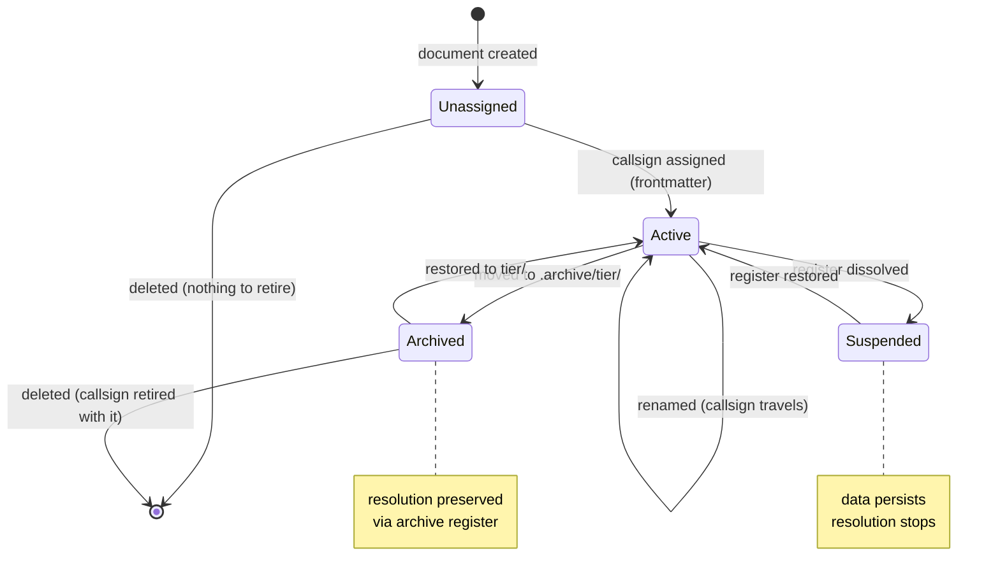

# Decision: The mnemonic namespace model

**Date:** 2026-08-30
**Status:** Accepted

## Context

ADR-024 settled what callsigns *are* (assigned frontmatter data, resolution
without ceremony). It did not settle what space they *live in*. That model
emerged in practice before anyone stated it: every callsign in the corpus
resides in a registered tier, while `docs/` — forty-nine documents — carries
none, deliberately, twice declining to badge itself. The operator noticed the
pattern while building the `&briefs` state table (second arrival = signal),
and three constraints accreted in one discussion: register-scoped existence,
header-only placement, exactly-one resolution — plus a forthcoming archive
policy that turns document moves into a lifecycle question.

## Decision

Five clauses, one lifecycle.

**1. Register-scoped existence.** Callsigns exist only in folders with
registers. Register presence is activation; `reg-sync` lifts exactly what
registered frontmatter offers. A folder earns mnemonics by earning its
register (the Registry Principle's step two; this rides on it).

**2. Suspension, not destruction.** Dissolving a register *deactivates* its
callsigns — resolution stops, honest errors follow — but frontmatter is never
stripped. Recorded data outlives its index; a re-registered folder returns
with its history intact. Dormancy is reserved for dissolved registers, never
for moved files.

**3. Header-only placement.** A callsign appears in exactly one place in the
corpus: the frontmatter of the document it names. In-band references speak in
paths (relative links — greppable, and jump-wired once BRF-DOCUMENT-LINKS
lands); out-of-band references speak in callsigns (voice, paper, SSH chat).
Two channels, no overlap. Meta-discussion — documents *about* the mnemonic
system — may cite callsigns as examples, but the owner-of-record is always
and only the frontmatter.

**4. Exactly-one resolution, enforced loud.** A callsign resolves to exactly
one document or fails with an honest error. The registry makes this
structurally true; the duplicate-callsign lint at `reg-sync` makes it
*loudly* true — a collision within a registry is a sync failure, not the
current silent first-wins coin flip in `resolveByCallsign`. (Enforcement
filed as its own issue; the `.find()` semantics are a bug under this clause.)

**5. The register declares its prefix.** The prefix is the register's
declaration (`briefs/` declares `BRF`), not a derivation from the folder
name — folder-derived is merely the default a register gets when it declares
nothing. Location and type coincide in this silo today; the declaration
survives the day they diverge.

**Archival.** The defined archive policy — old documents move to a similarly
named folder under `.archive/` — is a lifecycle state, not an exit. Archive
tiers keep registers (`.archive/briefs/INDEX.jsonl`), so resolution *survives*
archival: out-of-band jots must not die because a document moved, and the
archived state is legible from the path itself. Callsigns are never re-derived
and never reassigned; every transition is one-way away from *Unassigned*.

## The lifecycle

No transition returns to *Unassigned*. A callsign, once assigned, is
retired only by the death of its document.

## Alternatives Considered

| Alternative | Why Rejected |
|---|---|
| Prefix derived from folder name | Conflates location with type; forks the namespace when a silo hosts two types per folder or one type across folders; register-declaration covers the general case at zero cost |
| Destroy callsigns on register removal or archival | Violates ADR-024's assigned-data contract; re-registration would orphan the history the callsigns exist to carry |
| Drop resolution for archived documents | Out-of-band jots die at archival — backwards, since the archive is the tier most likely to be jotted ("that old butt-dial brief") |
| Allow callsign references in prose | Mention-vs-owner ambiguity pollutes the search channel; the in-band channel already exists (paths, links); header-only makes exactly-one a structural fact rather than a promise |

## Consequences

**What became easier:**
- The resolution contract is testable: one callsign, one registry hit, one
  document — and a loud failure when the corpus violates it.
- Archival is now safe for the out-of-band channel; moves are lifecycle
  transitions, not amputations.
- Assignment becomes deterministic as the deferred bootstrap automation
  approaches: declared prefix + slug tokens, no invention.

**What became harder:**
- `reg-sync` gets stricter — collisions fail loudly, which means newly
  created collision bugs block sync instead of hiding.
- Meta-documents carry a citation duty: examples may cite, but owners are
  declared in frontmatter only.
- Archive tiers need registers — one more index, but derived by the
  existing `reg-sync`.

**Constraints this imposes:**
- The wire format and the callsign format remain distinct instruments:
  callsigns are durable identity; jump tokens (11–99) are ephemeral session
  codes with no register and no lifecycle. This ADR does not touch the
  ephemeral keyspace.
- `.archive/<tier>/` naming is now a contract, not a convention.

## Enforcement

- **Duplicate-callsign lint** (the one code item): `reg-sync` fails loudly on
  a callsign collision within a registry; `resolveByCallsign`'s silent
  first-wins `.find()` semantics retired. Filed separately — this ADR is the
  contract, the lint is its enforcement.

## Related

- ADR: `decisions/024-callsigns-are-data.md` (the data contract this model
  scopes)
- ADR: `decisions/019-okf-v02-conformance.md` (registers; §4.1 extension keys)
- Brief: `briefs/2026-08-28-silo-mnemonics.md` (the origin brief, twice
  amended — this ADR is its namespace chapter)
- Brief: `briefs/2026-08-30-brief-content-shortlist.md` (the `.archive/`
  discovery question — resolution answered here; *discovery inclusion*
  remains that brief's product call)
- Doc: `docs/2026-08-30-naming-like-nasa.md` (the veto: a name must not lie
  about its referent)
- Commit: `d39a414` (the resolver; its `.find()` is the lint's target)
