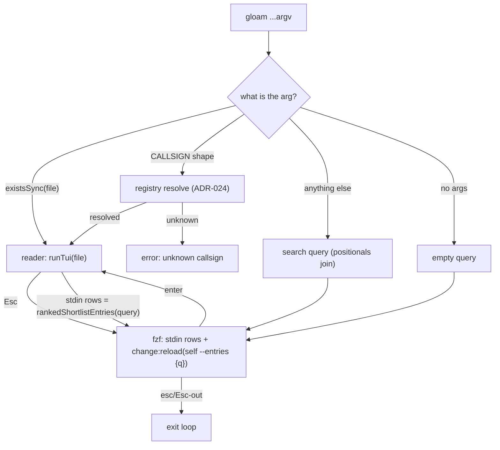

# Decision: The picker is a live search

**Date:** 2026-09-04
**Status:** Accepted

## Context

`BRF-CONTENT-SHORTLIST` (2026-08-30) built content search behind an
explicit flag — `gloam -g <query>` — and explicitly declined interactive
`change:reload` ("the entire machinery that would make it interactive is
what this brief declines to build"). The open question it left (flag vs
query-as-argv) was to be resolved by review.

One afternoon of operator dogfood resolved it with evidence, not
argument. Three consecutive failures were all **mode-boundary failures**:
a filename-only picker that silently swallowed `-g`; a smoke test green
while the operator saw zero results; a content query typed into the
wrong mode because nothing on screen said a mode existed. The operator's
own words closed the question: *"I would rather have the full text
search as the default — that is what most people will use,"* and *"as
yet I have not been able to fire up gloam and search and find and view
an arbitrary document."* The flag gate stood between the operator and
the corpus. Flags negotiate; defaults decide.

## Decision

1. **Plain `gloam` is the live search.** The picker seeds from the full
   file list and recomputes the ranked merge on every keystroke:
   `--bind=change:reload(<self> --entries {q})`. Type to search filenames
   and content simultaneously; no flag, no mode.

2. **`--entries <query>` is a headless printer** of the ranked entry
   stream (`path⇥evidence` lines). It is the reload target, works under
   both binary names, needs no TTY, and doubles as the debugging
   surface (`okuda --entries "load bearing" | head`).

3. **Bare arguments resolve deterministically, in this order:** an
   existing file → the reader reads it (contract unchanged); a
   callsign-shaped arg → registry dispatch (ADR-024/silo-mnemonics);
   anything else → search query (positionals join). The "heuristic" the
   brief feared is a filesystem existence check — deterministic by
   construction, not guesswork.

4. **`-g` survives as a seed alias** for `gloam -g <query>` — same
   behavior as a bare-arg query, kept so muscle memory and scripts
   don't break.

5. **The reseed loop recomputes per round:** read a document, Esc back,
   and the picker's rows already reflect the reseeded query.

## The dispatch, one diagram

## Consequences

**Gained:** one search, zero mode split — the operator's goal. The
picker, the reader, and the registry share one dispatch diagram that
fits on one screen. Live reload costs ~100ms per keystroke (bun spawn +
rg over ~200 files), runs async, and fzf kills the prior reload when a
new one starts — typing never blocks.

**Paid:** the brief's `change:reload` non-goal is reversed by operator
evidence — the brief's amendment records the palimpsest, this ADR is
the decision. The reload self-invocation resolves `execPath`/`argv[1]`
differently in dev (`bun run src/cli.ts`) and compiled (the binary)
mode — pinned by the entry-path tests, because it is exactly the seam
where a smoke-vs-operator divergence hid before.

## Related

- `briefs/2026-08-30-brief-content-shortlist.md` — the brief whose
  non-goal this reverses (amendment points here)
- ADR-016 (argv[0] dispatch) — the two-names contract is untouched;
  `okuda <file>` still reads, `gloam` still launches
- ADR-025 (mnemonic namespace) — registry channel still ranks first
- ADR-028 (the wire is the budget) — the entry budget survives; the
  reload is local computation, not wire traffic
