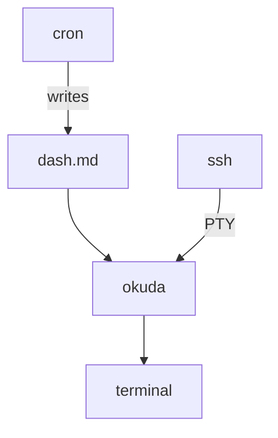

# The okuda-net

*No, we don't use a web server. No, you don't need a browser. Let me
show you.*

```
ssh okuda@host
```

That's the URL. What loads is a document — rendered, coloured, wrapped
to your terminal's actual width, with tables and diagrams and headings.
Live telemetry, if that's what's being served. Reasonably up to date.
View it on anything with a terminal: a laptop, a wall of tmux panes,
an ancient tablet propped on the kitchen counter.

And the server? The entire server is ten lines of sshd config:

```
Match User okuda
  ForceCommand /usr/local/bin/okuda --tui /srv/okuda/dash.md
  PermitTTY yes
  PasswordAuthentication no
  PubkeyAuthentication yes
  AllowTcpForwarding no
```

A dedicated Unix account, an authorized key, a document on disk. No
application server, no runtime to keep alive, no port but 22 — which
was already open.

> The API design is the minimalism itself. "That's it" isn't the end
> of the spec — "that's it" *is* the spec.

## The stack

An exporter turns your facts into markdown on a cadence. ssh carries
the bytes. The viewer typesets. The terminal applies ink.



- **The producer.** Any script that knows your business — agent runs,
  workflow state, build health — writes markdown to a file. Write to
  temp, rename atomically. The exporter's choice of what to include is
  the query, compiled ahead of time.
- **The transport.** OpenSSH. Audited for decades, deployed
  everywhere, does authentication as a side quest. We own none of it.
- **The renderer.** A viewer that turns markdown into finished lines —
  wrapped, spaced, coloured — in about ten milliseconds. It can serve
  at frame rates if you insist; nothing about a human reading pace will
  ever ask it to.
- **The display.** The terminal. Not a browser in denial — a cell grid
  with fifty years of compatibility contract behind it.

Mapped against the thing it replaces:

| The web | This |
| --- | --- |
| URL | `ssh okuda@host` |
| TLS + cookies | pubkey + `authorized_keys` |
| HTTP GET | ForceCommand + PTY |
| SSE / WebSocket | `fs.watch` event |
| CSS reflow | anchor + re-render |
| browser chrome | terminal + status line |
| payload | escape codes, kilobytes |

Same insight as client-side rendering — finished pixels over the wire,
display at the edge — minus the hundred-million-line client.

## The time dimension

The web's fundamental verb is *go*. Links are doors, URLs are
addresses, the browser is a vehicle. Its genius was spatial: a library
of infinite rooms, and you navigate between them.

The okuda-net's fundamental verb is *stay*. One address, one document,
and what changes is not your position in the net but the document's
position in time. You do not move through the okuda-net. The okuda-net
moves through time, and you hold still.

Holding still is a technology, not an attitude. When a live document
updates — three rows appear, a number ticks — the viewer re-renders and
pins the line under your eye to the same screen row. Without that
anchor, every update would yank you back to the top, *stay* would
collapse into *go*, and we'd have rebuilt the web's spatial stance with
worse tools. With it, freshness becomes the product: you park the
document and let the world flow past.

The same invariant covers zoom, because zoom is just time's twin: a
terminal getting narrower and a dashboard gaining three rows are the
same event — a reflow. Widen the window to read a wide table, narrow
it again to read prose; the line under your eye survives both
passages. Width and time, one mechanism.

## LCARS — the crucial explanation

The project this grew from is named for Michael Okuda, the designer of
the Star Trek interface language LCARS — the *Library Computer
Access/Retrieval System*. Read that name again. Retrieval.

LCARS was never a form-filling language. It was a publishing language.
The panels display state — dense, legible, colour-blocked — and the
human decides. The computer retrieves; the person acts. In four
decades of starship bridges, nobody fills in a form; they read a panel,
and then they do something.

And the design constraints were brutal in exactly the instructive way:
Okuda was designing for a television picture — NTSC, interlaced, chroma
smeared, on a CRT watched from across the room. Big flat colour blocks,
heavy contrast, sparse bold text: the look is the error-correction
scheme, form following channel capacity. The two audiences were one
artefact — atmosphere for the casual viewer at broadcast speed, real
content for the interested reader who paused the tape. The screens
seldom disappointed because the pauser was the design target, not an
afterthought.

Which means the sentence at the heart of this architecture — *there is
no interactivity, just structured information in a readable form,
reasonably up to date; you decide what to do* — is not reminiscent of
LCARS. It is LCARS, restated as a deployment. The PADD, it turns out,
is a terminal: any device that can hold an ssh session and a monospace
grid. A display net for PADDs, named for the designer of the display
net for PADDs — the name closes its own loop. The fictional future had
the semantics right; it just waited three centuries for the transport.

## Cadence — the honesty section

Every dashboard vendor lies about freshness. Here is the truth: how
often the document updates is a dial with named variables, and both
ends of the dial fail.

| Variable | What it constrains |
| --- | --- |
| Decision latency | the floor — how stale before a decision goes wrong |
| Attention budget | the ceiling — change noise destroys trust |
| Volatility | writes faster than meaning change are waste |
| Production cost | the exporter runs whether or not anyone looks |

Too fast is a slot machine: everything always changes, so nothing
registers as change, and readers stop looking — alarm fatigue ate the
ops world this way. Too slow is dead data wearing a live face, honest
only if the document carries a visible "as of" timestamp. The tuning
rule: the slowest cadence at which every decision the document informs
remains sound. Cadence belongs to the consumer's decision loop, not
the producer's capability.

### The two clocks

There are two clocks in the system and only one of them is real. The
producer's cadence is the only clock — cron, interval, exporter's
choice. The viewer never throttles: sitting on known-stale bytes while
fresher ones sit on disk is the specific dishonesty this architecture
exists to avoid. Instead the viewer replaces time with meaning —
repaint when the rendered content changed, not when a timer elapsed. A
rewrite with identical numbers produces zero visual events; a real
change lands instantly. "Neither too much nor too little" isn't a
tuned compromise; it's what you get when the predicate is *meaning
changed*.

The lineage says this is an old, winning pattern: Usenet rode UUCP,
FidoNet rode phone lines and scheduled its mail hours for 4 a.m. when
rates were cheap — cadence as policy, tuned to neither. The okuda-net
rides ssh. None of them owned their transport. The net-ness is the
practice, not the plumbing.

## Projections

If you want a json feed, fine — serve one. The architecture doesn't
care what's in the file: rendered pages for humans and `status.json`
for machines are two files written in the same cron tick. Content and
presentation, separated not by a template engine but by a file
extension. The document feed and the data feed are the same pattern
with different projections — pick per reader.

## The bounds

Stated once, so they stay stated:

- **Cadence is the freshness ceiling.** Pull-based means no interrupts.
  The document says `status: red`; the pager is a different channel.
- **No ad-hoc query.** You get the document, not a slice. Analysis is
  a different tool reading the same files.
- **Coarse security.** One key reads everything the account serves.
- **No write path.** The feed is a publication, not a form. That is
  the firewall, not a gap.

---

And the ending the whole architecture points at: the reader doesn't
have to be human. Markdown needs no extraction layer — it *is* the
semantic content, no scraping, no readability heuristics. An agent
reading a web page is an archaeologist; an agent reading this feed is
a native reader. Point your local model at the file: poll on cadence,
diff against the last state, decide, act. The feed is the agent's
`/proc`, and the reaction loop lives at the edge, where it belongs.

> The network is the computer, said Sun. The document is the network,
> says the okuda-net — and unlike Sun, we can prove it with one ssh
> command.
