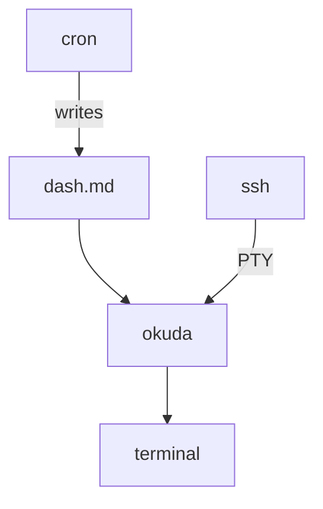

# The okuda stack — a web without the web

A riff, persisted. The question was what okuda *is* if you push the
minimalism all the way through. The answer came out as an architecture:
a data feed composed entirely of static documents, served over ssh,
rendered into whatever terminal is nearest — a PADD, a wall of panes,
a drawer-dwelling tablet. No web server, no protocol, no client SDK.

> The API design is the minimalism itself. "That's it" isn't the end
> of the spec — "that's it" *is* the spec.

## The stack

Four layers. okuda owns one of them.

- **The producer.** An exporter script — agent telemetry, workflow
  state, whatever the businessy stuff is — turned into markdown and
  written on a cadence. Write to temp, rename atomically; the viewer
  never reads a half-document. The exporter's choice of what to include
  is the query, compiled ahead of time.
- **The transport.** OpenSSH `ForceCommand` (the parked brief, option
  1). Pubkey auth, a dedicated user, a config file. No okuda code, no
  crypto to own, no port but 22 — which was already open.
- **The renderer.** okuda. ~10ms warm render for a document-sized file;
  the renderer is three orders of magnitude ahead of any cadence a
  human tolerates. Watch mode plus the content-anchor repaint without
  losing the reader's place.
- **The display.** The terminal. Any VT100-class terminal plus an ssh
  client is a reader, which is every device a deployment could want.

## The division of labor

okuda owns lines; the terminal owns cells. Everything hard about
windowing — fonts, DPI, damage tracking, compositing — belongs to the
terminal emulator, which somebody else ships and debugs. okuda's entire
windowing layer is a viewport index and a line fingerprint.

The generalisations all resolve the same way — compose with the layer
that already *is* the feature:

- **Multiple windows.** The terminal emulator is the window manager.
  tmux, zellij, six panes, six ssh sessions. The GUI world lost this
  argument with MDI; the terminal philosophy won by refusing to have
  it.
- **Zoom.** Font size → `SIGWINCH` → re-wrap. The content-anchor keeps
  the eye on its line through the reflow, so zoom was already shipped —
  the squich round-trip (widen for the table, narrow for the prose)
  was zoom all along.
- **Automated layout.** A tmuxinator file, versioned in git next to
  the exporter scripts. A monitoring wall as a config artifact.

> The terminal is the window. The window was already open.

## The API

Static documents, updated on a cadence, available as required. Pull,
not push. The lineage is long and undefeated:

- **RSS.** Publishers write on a cadence; readers fetch when they
  care; nobody holds a session.
- **`/proc`.** The original Unix telemetry API: files, a schedule,
  zero protocol.
- **Static-site generation.** All intelligence at write time; a file
  at read time.

The properties that fall out:

- **Total temporal decoupling.** Producer down is a stale document with
  a timestamp in it — visible staleness, the honest failure mode.
  Reader down costs exactly nothing.
- **The document is the cache and the query.** Expensive work happens
  once per cadence at write time, not once per reader.
- **Markdown is the contract.** `cat` is a debug client, `grep` is a
  query, `diff` between cadences is anomaly detection, `git log` on the
  telemetry directory is versioned history. The interchange format
  doubles as the human interface.

Mapped against the web it replaces:

| The web | This |
| --- | --- |
| URL | `ssh okuda@host` |
| TLS + cookies | pubkey + `authorized_keys` |
| HTTP GET | ForceCommand + PTY |
| SSE / WebSocket | `fs.watch` event |
| CSS reflow | anchor + re-render |
| browser chrome | terminal + footer |
| payload | escape codes, kilobytes |

Same client-side-rendering insight as the browser — rendered lines over
the wire, display at the edge — minus the browser.

## Time and width are the same event

The load-bearing coincidence: a terminal getting narrower and a
dashboard gaining three rows are the *same event* — the document
reflowed. The lines that change on a data update are the numbers; the
lines that hold are headers, labels, section titles — exactly the
structural lines you navigate by. The anchor holds position through
both axes, time and width, with one mechanism. The resize work pays
out twice.

## The bounds

Stated once, so they stay stated:

- **Cadence is the freshness ceiling.** Pull-based means no interrupts.
  The document says `status: red`; the pager is a different channel.
  Don't ask the feed to be the pager.
- **No ad-hoc query.** You get the document, not a slice. Analysis is
  a different tool reading the same files.
- **Coarse security.** One key reads everything the account serves.
- **No shared state across windows.** Two panes on one document are two
  sessions; linked cursors are not expressible — that is option 2's
  gate, and the gate is still standing.

## What exists, what's a use

The stack is almost entirely built. The ssh brief is a config file
away. The renderer, the anchor, the terminal fluency: shipped. The one
code gap: `--tui --watch` silently drops watch today (the TUI branch
returns before the watch block, and the watch repaint is a top-jump
the anchor abolished). One small brief — fs.watch inside `runTui`,
debounced, re-rendered through the anchored paint path — and the
dashboard use case falls out for free.

The moat, in one line: anchored live markdown over ssh with no server
code — nobody else keeps your eye on its line while the numbers move.
