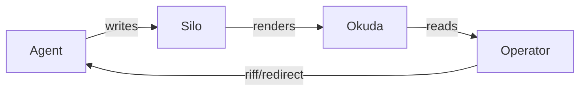
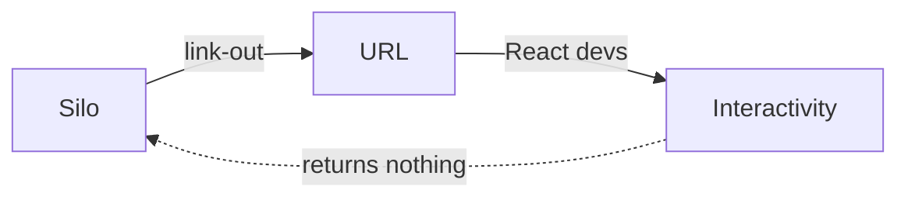
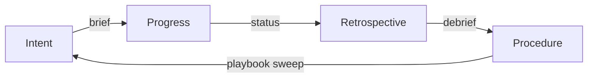

# Documents and apps in the same place

> "Okuda neckbeard." Seven syllables, one hand on a tablet, and you're
> at the document. That's not a UI property — that's a workflow
> property that emerged from bounded references, and it's the one
> that matters.

A position paper on what Gloam and okuda are, emerging from the
product-placement riff of 2026-08-27. Not a manifesto; a statement of
where the product thesis sits, so it can be cited by short string from
inside the silo it describes.

---

## The reframing

okuda is not a terminal markdown viewer. That framing is technically
true and strategically wrong — like calling a telephone "a device that
modulates electrical signals." The accurate description:

> okuda is the rendering surface of a mentation loop — the shared
> boundary between an agent that writes into a bounded context, an
> operator who reads what the agent wrote, and an audience who
> occasionally sees a diagram cast onto a screen.

Gloam is the interface that holds the loop: cadence, multi-window
riffing, short-string invocation, and one document rendered at a time.

The distinction matters because it changes what the rendering is *for*.
A viewer is judged on prettiness. A mentation surface is judged on
whether the operator actually *absorbed* what the agent produced —
whether the loop held. If the rendering fails, the operator glosses,
the agent writes into a void, and you've built a machine that talks to
itself. okuda's job is to make the brief get read. The closed grammar,
the diagram rendering, the scope discipline — cognitive-load
engineering, not aesthetics.

The loop itself:

The only outward valve:

Interactivity lives at the end of a URL. okuda links to it; it never
embeds it. The link is the firewall, not a gap.

---

## The agent is the ingester

The naive worry about a "solicitor's silo" is ingestion: how do
external documents (filings, emails, searches) get into the repo? The
answer dissolves the problem: **the agent writes into the silo as part
of the cadence.**

- **External information** gets mentated — read, summarised, structured — into a brief in the bounded context.
- **From that point** it's markdown, citable by short string, renderable by okuda.
- **Ingestion** isn't a pipeline you build; it's a consequence of the loop running.
- **The briefs folder** *is* the ingestion layer.

This is why the silo can be clean: it only ever holds mentated output,
never raw Stuff. The mess lives outside, gets transformed at the
boundary, and arrives as a Thing.

---

## The silo disciplines the agent; okuda serves the operator

Two bounded contexts, one rendering surface. The silo bounds what the
*agent* can touch; it does *not* bound what the operator can see.

| Bounded context | Who owns it | What lives in it | Example |
|---|---|---|---|
| Agent's silo | The agent (disciplined) | Briefs, status, debriefs, playbooks | `briefs/neckbeard.md` |
| Operator's window | The operator (sovereign) | Hockey scores, weather, a webcam | `dashboards/canucks.md` |

The operator can point okuda at whatever they want, however trivial.
The agent isn't writing the hockey dashboard (unless asked); the agent
works in its bounded context while the operator glances at their
ambient documents. The render marks which is which: agent-touched
briefs vs. operator-owned dashboards.

---

## Documents and apps in the same place

A dashboard today means a React app. Five hundred lines of ceremony to
display two numbers that change. That's decorated Stuff at industrial
scale:

| Layer | React dashboard | Gloam okudagram |
|---|---|---|
| Scaffold | project, deps, build config | none |
| Component tree | present | one document |
| Fetching layer | async, retry, cache | a URL in the doc |
| Build pipeline | bundler, minifier | none |
| Deploy target | host, port, runtime | file on disk |
| Refresh strategy | polling, WS, manual | cadence on the doc |
| Time to first render | a day, a sprint | five minutes |

Gloam collapses that. A markdown document with a URL in it, polled on a
cadence, rendered as an okudagram — *that's* a dashboard. It's also a
brief. Same medium, same authoring surface, same rendering pipeline.
The difference between "my morning brief" and "my hockey score ambient
display" is one line of frontmatter, not a technology stack. The
five-minutes-to-dashboard claim is real, and it's earned by scope
discipline, not by cleverness.

The scoping decision that makes this work:

> **okudagrams are glanceable, not interactive.** The operator is a
> spectator, not a user.

You look at the score, you maybe follow a link to a YouTube clip of a
good goal, you go back to fishing. You do *not* click into the okudagram
and filter by period and drill into player stats. The moment okudagrams
become interactive, you've started rebuilding React in markdown — the
chip pan fire. A dynamic document *updates itself*; it does not *respond
to you.* The link-out is the maximum permitted interaction, and it's
the right maximum.

---

## The shortest path is communicative

"Okuda neckbeard" — two words, transmissible by voice over a phone line,
no setup, no "go to this URL and click the third tab from the left."

The shortest path isn't computational (fewest hops to the file) but
*communicative* (fewest syllables to coordinate). That's a different
kind of efficiency, and it's the one that actually matters for how work
happens between humans.

It's like what3words — but for a landscape of text, not terrain:

| | what3words | Gloam |
|---|---|---|
| What's addressed | a 3m square of the planet | a document in a silo |
| Token | three words | one short string |
| Assignment | central authority, pre-computed | author-assigned, registry-maintained |
| Semantics | random (a hash) | meaningful (an abstract) |
| Scope | global | bounded |
| Collision risk | eliminated by pre-computation | managed by the registry |

what3words needs *three* words because the planet is huge and the
namespace must be collision-free at planetary scale. Gloam gets away
with short strings *because the context is bounded.* The constraint
isn't a limitation — it's the enabling condition. Remove the boundary
and you need three words again, or four, or a path.

The fzf/launcher assimilation isn't a keybinding fix — it's the
**operable layer** of the whole vision. The launcher takes "neckbeard,"
resolves it against the registry, and you're at the document. One hand
on a tablet, two words typed or spoken, you've arrived.

The incidental property worth preserving:

> "Okuda neckbeard" leaks nothing on an unencrypted phone line. No
> client name, no matter, no URL to be logged, no path structure to be
> reverse-engineered. The reference is meaningless outside the silo —
> you need to be in it to resolve it.

For a solicitor whose professional life is "don't reveal client data on
insecure channels," that's a feature you couldn't buy deliberately and
got anyway. Keep it: don't let the resolution layer start embedding full
paths in error messages or completion hints.

---

## The speech input

Say "okuda neckbeard" to your agent; the agent runs fzf with the same
config as Gloam and resolves to the same file the operator would reach
typing it by hand. Then the agent does whatever it was going to do —
read it, summarise it, cite it in a brief, email a derived playbook to
Jimmy.

The invocation surface is shared:

- **Typed by hand** → operator types `same-place`, fzf resolves, okuda renders.
- **Spoken to an agent** → agent runs fzf with the same config, resolves the same file.
- **Same registry, same short string, same document.** One namespace, two consumers, zero bridging.

The bounded reference scheme is the agent's *command surface* as much as
the operator's *navigation surface*. The agent doesn't need a separate
API or a different addressing scheme — it uses the operator's
vocabulary, and arrives at the operator's files. "Okuda
lease-amendment-3, check it out" works whether typed or spoken, whether
the recipient is human or model.

---

## The solicitor in the field

The stress test, stated as a day-in-the-life: a solicitor out and about
with a phone, a tablet, and an SSH connection back to the office. On
the phone, swipe through panels — each a different feed rendered by
Gloam. On the tablet, three or four open SSH sessions back to
different repos/silos at base. No real secrets apart from the SSH
keys themselves.

Someone adds a document the solicitor should see. They notify by
whatever channel they were already using — a phone call, an SMS, a
word in the hallway — and give the secret key: a couple of words.
The solicitor goes straight to the document and acts accordingly.

> It's all the things you need without the things you don't. And it
> only does one thing: gives you information you can assimilate.

The notification channel is *not a system*. Gloam doesn't ship a
notification pipeline — no push, no Slack integration, no email-with-
link. It provides the *resolvable string*; the two humans carry it
over whatever channel they already trust. The short string is both
the address and the access token, and it's meaningless outside the
silo, so the notification itself is safe over any channel. End-to-end
confidentiality without a crypto pipeline — the bounded-reference
property paying rent again.

### Just text

It's not a second brain. It's not a library of Babel. It's not a
Skynet prototype. It's just text.

Every "knowledge tool" pitch of the last five years sold itself as a
cognitive extension — your second brain, your external memory, your
thinking partner. That's Compulsive Narrative Syndrome at product
scale: a grand story to justify a feature list that doesn't cohere.
It over-promises what no tool can deliver (cognition) and
under-delivers what it could (legibility). Gloam inverts the pitch: it
doesn't make you smarter, it makes the *text* reach you. A pizza-shop
promise — modest, sustainable, true. And the only one that holds up in
front of a solicitor with liability insurance: "it made me smarter"
isn't a defence in court; "I had the document in front of me at 14:32
and acted on it" is.

### The timing argument

The reason Gloam works *now* and wouldn't have worked five years ago:
the agent produces the text that fills the silo. Before LLMs, a
"documents and apps in the same place" tool would have required
humans to write all the briefs, dashboards, playbooks — and they
wouldn't, because writing is expensive. The tool would sit empty, and
empty tools die. The agent makes the silo populate itself as a side
effect of doing work.

> Gloam isn't an AI tool; it's the rendering surface for the age of
> agents — the thing that makes agent output legible to the operator
> who commissioned it.

These days we all have pals who are good at text. They are called
AIs. okuda is what their output looks like when it's rendered for the
person who asked for it, not dumped into a void.

### The lifecycle

A solicitor's entire job is: know the thing, prove you knew the thing,
on a deadline, with liability.

If the loop holds for *that*, it holds for anything softer. The
solicitor case isn't the target; it's the discovery device that
surfaces what Gloam has to be.

The agent contributes to a *maintained set* — the playbook sweep is
the institutional memory; the agent feeds it, doesn't own it. That's
the difference between "the agent ran the firm" and "the firm
absorbed the agent's output." You want the latter.

---

## The gating risk

Dynamic documents are untested. The timestamp-on-render idea — "this is
live, last updated 10:47" — is the right approach: provenance as UI,
not as policy. But the hard work is *rendering* decisions:

- **Source gone** → stale data with a timestamp? blank space? error glyph?
- **Source slow** → timeout threshold? last good frame?
- **Source malformed** → error glyph? last good frame? blank space?
- **Mid-update** → atomic swap? partial render?

Each is a design call, and they're the calls that determine whether
dynamic documents feel like a feature or a bug. Worth a set of tests
that throw malformed/empty/stale data at the renderer before trusting
the dynamic path for anything you'd show a client.

Briefs should be immutable once written; live info goes in a
referenced, separately-versioned file. The dynamic document updates
during the day; the brief, once the day closes, is the frozen artefact.
That's a decision, not an emergent property.

---

## Parked (Derrida-gated)

Questions surfaced during the riff that fail the Derrida question —
"should this even be in our consideration set?" Not yet. Noted and
moved on.

- **Where does the silo name come from?** It's the CWD; we're inside
  it. Where do we display it? Don't know yet. Doesn't matter until
  someone needs to see it.
- **Rendering target: phone width vs. projector width.** A diagram
  that renders on a 27" terminal breaks on a phone-width SSH session.
  Mermaid pipes at a fixed width; phones are narrow. Does okuda
  re-pipe at the terminal's actual width, or render canonical and let
  the terminal scroll? The former serves the phone; the latter
  serves the projector. Different modes. Not our problem until the
  phone case is real.

---

## Render for the car radio

The Tamla Motown producers had a test: mix for the car radio, not
the studio monitor. A car speaker has limited bandwidth, road noise,
a distracted driver. If the track survived that, it was a track. If
it only sounded good on the studio monitors, it was production sheen
— decorated Stuff with no survivable signal.

okuda's closed grammar is the same principle applied to rendering.
Viewed on a 30-column half-width panel with no OSC8 and a font that
might not have box-drawing glyphs, most markdown becomes noise:
paragraphs staircase, tables overflow into soup, diagrams break their
topology. okuda's output stays legible across the room at that width.
The constraint isn't a limitation; it's a noise-tolerance design.
Every element in the grammar degrades gracefully:

| Element | Car radio (30 cols) | Studio monitor (full width) |
|---|---|---|
| Bold heading | still bold, still a heading | bold, a heading |
| ANSI colour | still coloured | coloured |
| Hard-wrapped prose | reflows cleanly | reads as prose |
| Fixed-width diagram | may elide, stays square | full diagram |
| Table | may overflow, stays tabular | aligned table |
| Pull-quote | still a pull-quote | a pull-quote |

The terminal is inherently a hostile rendering surface — limited
width, limited fonts, no mouse guarantee, no reflow intelligence.
Testing at half-width isn't a stress test; it's the *native* test.
The studio monitor is the exception.

> Judge the map by its survival in the territory, not by its
> fidelity on the surveyor's desk. The closed grammar is a set of
> elements that survive lossy channels; anything that doesn't
> survive is production sheen — a signal that only exists under
> optimal conditions, and therefore isn't a signal.

---

## Compressed

- **Gloam** — a mentation interface for bounded contexts.
- **okuda** — renders a closed grammar, one document at a time.
- **Dynamic documents** — ambient, not interactive; interactivity lives at the end of a URL.
- **Short-string invocation** — the social protocol: transmissible by voice, one-handed on a tablet, incidentally confidential.
- **The solicitor** — the stress test, not the target.
- **Just text** — not a second brain, not a library of Babel, not a Skynet prototype.
- **The timing** — agents fill the silo; okuda renders it. That's the moat.
- **Render for the car radio** — the closed grammar is a noise-tolerance design, not a limitation.
- **Build** the freeze decision early; iron the fzf; ship the thing.
