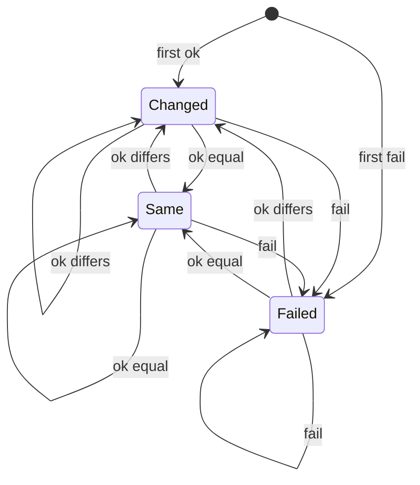

# Fetch-state stamp — the state machine

**Date:** 2026-08-27
**Kind:** design map, pre-wiring. The muppet-shoelace check.
**Brief:** `briefs/2026-08-27-brief-fetch-state-stamp.md` (td-a27b86)
**Substrate landed:** `src/tui.ts` — `gateFetch`, `renderEqual`, the
discriminated-union read path (commit `dbf1d17`).
**Colour landed:** ADR-015 — the `alert` role (`#ff5555`, commit `b8e1a0a`).

Three states, nine transitions, and one trap the three-state name hides.
This doc exists to surface the trap *before* the chrome layer trips over
it — map the machine, mark the decisions, then wire. The diagram below
is the current one (glyph-labelled, post-ADR-015); the pre-ADR-015
abstract graph is retained beneath it as the deprecated palimpsest.

---

## The three states

The stamp reports *our observation*: when we last looked, and what we
found. Three values, one enum, no overlap.

| State | Glyph | Colour | Meaning | Content viewport |
| --- | --- | --- | --- | --- |
| `changed` | `●` | amber | fetch ok, rendered content differs from previous | repaint |
| `same` | `○` | muted | fetch ok, rendered content identical (the gate held) | no repaint |
| `failed` | `✗` | red (`alert`, TBD) | fetch threw or source gone | no repaint — retain last-known-good |

The word "checked" is load-bearing and the glyph is the only state-coloured
element — the timestamp and filename stay muted (provenance, not alarm).
NO_COLOR degrades to `*` / `.` / `!`.

---

## The diagram (current)

States labelled with their decided glyph — the visual identity that
landed with the substrate (`dbf1d17`) and the `alert` role (ADR-015,
`b8e1a0a`). The glyph is the only state-coloured element in the real
footer; here it carries the identity the colour attribute will paint
onto (`●` amber, `○` muted, `✗` red).

Three nodes, every pair connected both ways, plus two self-loops per
node. The symmetry is the first tell: this is not a linear progression,
it's a fully-connected graph where any state can reach any other. The
glyphs are not decoration — they are the one character the reader
glances at, and the colour is an attribute of that character, not a
second signal.

## The diagram (deprecated)

> **Deprecated** in `b8e1a0a` (ADR-015): "pre-ADR-015 — states
> uncoloured, the `alert` role unjustified; the two-gate structure
> unmarked. Retained as the palimpsest layer — the abstract graph
> before the identity landed."

---

## The transition matrix — where the trap lives

Nine transitions. The brief says the stamp is "set on every fetch,
frozen between fetches." So count what repaints on each:

| From | Trigger | To | Content repaint | Footer repaint |
| --- | --- | --- | --- | --- |
| `*` | first ok | `changed` | yes (first paint) | yes |
| `*` | first fail | `failed` | yes (blank) | yes |
| `changed` | ok, equal | `same` | no | yes (`●`→`○`) |
| `changed` | ok, differs | `changed` | yes | yes |
| `changed` | fail | `failed` | no (retain) | yes (`●`→`✗`) |
| `same` | ok, differs | `changed` | yes | yes (`○`→`●`) |
| `same` | ok, equal | `same` | no | yes (time only) |
| `same` | fail | `failed` | no (retain) | yes (`○`→`✗`) |
| `failed` | ok, differs | `changed` | yes | yes (`✗`→`●`) |
| `failed` | ok, equal | `same` | no | yes (`✗`→`○`) |
| `failed` | fail | `failed` | no (retain) | yes (time only) |

**Content repaints on 3 of 9 transitions. Footer repaints on all 9.**
That is the "more than meets the eye": the content gate and the stamp
gate are *two gates*, not one. A single boolean cannot express "always
repaint the footer, conditionally repaint the content" — it collapses
them, and three-quarters of transitions lose their timestamp refresh.

### The shoelace, located

The landed substrate (`gateFetch`) returns one `repaint` boolean, `false`
for `same` and `failed`, and `rerenderAnchored` early-returns on it. That
boolean is the *content* gate — correct for the viewport. But if the
chrome layer wires the stamp repaint to that same flag, the footer
freezes on every non-`changed` transition: `same → same` keeps the old
time, `failed → failed` keeps the old time, and `failed → same` (source
recovered) never shows the recovery. The stamp would read "checked 14:32"
forever while the clock marches on. That is the muppet end run this
diagram exists to prevent.

The fix is structural, not a flag rename: **the footer repaints on every
fetch outcome; the content viewport repaints only on `changed`.** Two
gates, two repaint paths. The substrate's `repaint` is the content gate;
the chrome layer adds the footer repaint outside the early-return (or
the footer repaint always fires and the content repaint stays gated).

---

## What the diagram is here to surface

### Two gates, not one

The load-bearing finding. The content gate (`renderEqual`) decides
whether the viewport re-paints; the stamp gate fires on every fetch
because the timestamp is "set on every fetch." Conflating them freezes
the clock on three of nine transitions. The chrome layer must repaint
the footer unconditionally on fetch and the viewport conditionally on
`changed`.

### The recovery ambiguity — `failed → same`

Source goes away (`✗`), source comes back, content is identical to the
last-known-good we've been showing. The gate reads `same`; the glyph
goes `✗` → `○`. The reader sees red go grey with *no content motion*.
Semantically correct — the content didn't move, and `○` means "all
quiet" — but a reader who watched the red appear may expect `●`
("something happened: the feed recovered"). The decision: is
source-recovery a `changed` event or a `same` event? This doc's read:
`same`. The recovery *is* the `✗` → `○` transition; making it `●`
would conflate "the situation changed" with "the content changed," and
the stamp reports content state. But it's a real decision, not a
derivable consequence — mark it.

### Initial vs subsequent `changed` — a deliberate conflation

First fetch is `changed` (prev=null sentinel) with no prior to compare.
A later real change is also `changed`. Both amber `●`. "Content arrived"
and "content moved" share a glyph. The brief does this; the diagram
notes it as a non-decision — the distinction carries no action for the
reader, so one glyph serves both.

### `same` is absorbing — no decay

There is no "stale" state. `same` holds `○ checked 14:32` forever until
content moves or a fetch fails. The brief rejects decay, heartbeat,
tick. So a reader who hasn't checked in three hours sees `same` and must
infer staleness from the *timestamp*, not the glyph. The glyph says
"current as of the last check"; the timestamp says when that check was.
Staleness is a reader inference from the time, not a state the machine
asserts. That is the "permitting, not demanding" property: the stamp
reduces uncertainty about whether to bother; it does not raise alarms
about bothering.

### No loading state — rejected

There is no "fetching…" transient. The fetch is awaited within the
event; the stamp is frozen during it. A heartbeat would be a push-model
signal, and the stamp is pull-model. This is an anti-state, recorded so
nobody adds one later.

### `failed` initial vs `failed` subsequent — same glyph, different substrate

First fetch fails: `failed` with empty lines (no last-known-good).
Later fetch fails: `failed` retaining the last-known-good on screen.
Same `✗`, same red, different content underneath. The state machine
needs one `failed` node, not two — the *stamp* is identical; only the
*lines* differ. The retain-on-failure branch handles both via
`prev ?? []`.

---

## Open decisions

1. **Footer-repaint decoupling.** The chrome layer repaints the footer on
   every fetch outcome and the viewport only on `changed`. Confirm the
   implementation shape (footer repaint outside `rerenderAnchored`'s
   early-return, or a separate cheap footer repaint) when the stamp cell
   lands.
2. **Recovery semantics.** `failed → same` (recovery, no content change)
   shows `✗` → `○`, no content motion. Adopted here as `same`; confirm
   against dogfood once the stamp is visible.
3. **`alert` palette role.** `failed` cannot ship as amber (collides with
   `changed`). Gated on the ADR for a new red role — the diagram assumes
   it; the code stubs it until the ADR lands.

---

## Related

- Brief: `briefs/2026-08-27-brief-fetch-state-stamp.md`
- Substrate: `src/tui.ts` — `gateFetch`, `renderEqual`, `Fetch`, `FetchState`
- Sibling: `briefs/2026-08-26-brief-tui-live-documents.md` (fs.watch feeds
  the same gate)
- Scratchpad: `docs/2026-08-27-okudagram-scratchpad.md` — *the quiet
  update*, *permitting, not demanding*
- td: `td-a27b86`