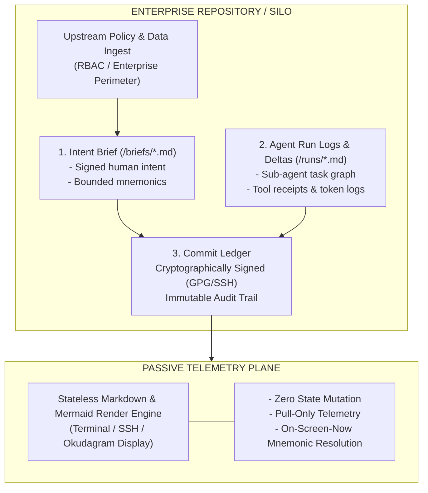
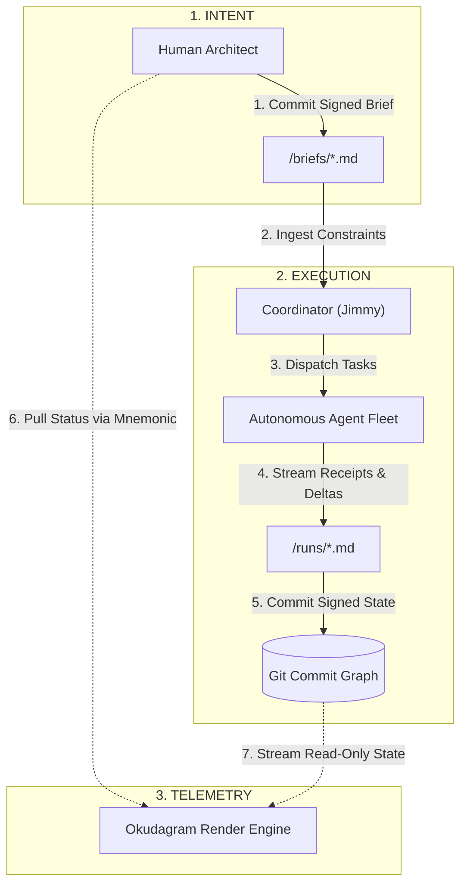
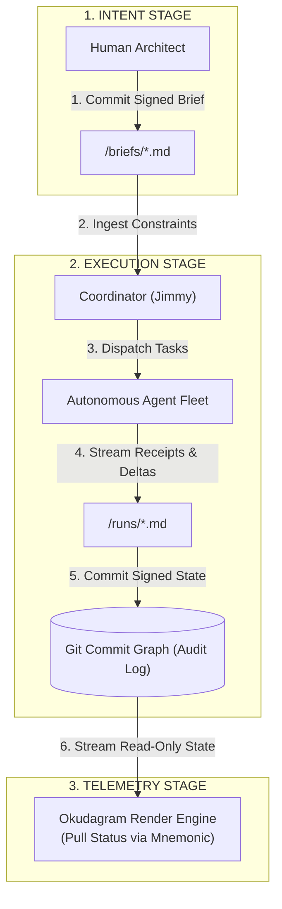

Got it. Swapping out the sequence diagram and adhering strictly to flowcharts and the `mmd` fence convention.

Here is the revised architecture section with the flowchart handling the execution lifecycle:

---

### Formal Architecture: The Bounded Git-Backed Intent Ledger

Enterprise adoption of agentic AI routinely fails security and compliance reviews due to the **nondeterministic execution gap**: human operators interact with conversational agents in unlogged chat interfaces, outputs are manually pasted into disparate tools, and the resulting paper trail is fragmented across ephemeral session logs, SaaS silos, and undocumented prompt histories.

The **Bounded Git-Backed Intent Ledger** solves this by enforcing an air-gapped, append-only topology where every strategic brief, agent plan, intermediate telemetry checkpoint, and final artifact is anchored in a version-controlled repository.

---

#### 1. The Bounded Context and Mnemonic Namespace

Each operational silo functions as an isolated repository governed by clear enterprise boundaries:

* **Silo Boundaries:** The repository is pre-populated strictly with verified upstream enterprise documents, data schemas, and regulatory constraints. Access control is maintained at the repository layer (e.g., branch protection rules, cryptographically verified commits, hardware-enforced SSH/SCIF access).
* **Deterministic Mnemonics:** Artifacts and data streams receive explicit, human-memorable identifiers (e.g., `audit-q3-recon`, `sec-vuln-triage`) within the repo's bounded namespace. Because the scope is strictly constrained to the silo, collisions are eliminated.
* **Fuzzy Resolution Engine:** When a user queries a partial mnemonic, the agent does not execute unverified commands; it resolves the query against the repository index and emits an ephemeral, structured Markdown Okudagram listing valid target nodes with one-line contextual summaries.

---

#### 2. Separation of Intent, Execution, and Display

The architecture maintains strict functional isolation between the human decision-maker, the automated workforce, and the rendering surface:

* **Intent Ingestion (`/briefs`):** The human operator creates a structured Markdown brief defining requirements, operational constraints, and acceptance criteria.
* **Task Decomposition (`/runs`):** The orchestrator layer (Jimmy) parses the brief, generates a deterministic execution graph, and assigns sub-tasks to specialized background agents. Every prompt template, model version, API interaction receipt, and code patch is committed alongside the task.
* **Stateless Rendering:** The display engine has zero write permissions. It reads the raw Git tree and projects pure telemetry. It cannot alter repository state, invoke agents, or leak runtime context.

---

#### 3. Auditability and Regulatory Compliance

By treating the Git commit graph as the authoritative record of intent and actuation, the system achieves instant parity with SOC 2, ISO 27001, and federal regulatory standards:

| Compliance Dimension | Traditional AI Chat / SaaS Interfaces | Bounded Git-Backed Telemetry Architecture |
| --- | --- | --- |
| **Provenance** | Opaque; conversational context is volatile and vendor-hosted. | Explicit; every action traces directly to a signed commit and brief SHA. |
| **Reproducibility** | Non-reproducible; model drift and dynamic prompt mutations alter outputs. | Deterministic; exact input states, reference documents, and tool receipts are frozen in history. |
| **Data Sovereignty** | High risk; prompt leakage across global multi-tenant services. | Contained; data never leaves the bounded repository perimeter without explicit policy validation. |
| **Forensic Audit** | Requires manual screen captures, chat exports, and fragmented log reconstruction. | Native `git log`, `git diff`, and cryptographic signature verification over standard CLI tooling. |

When auditors or security teams demand an account of an automated action, compliance officers do not sift through chat logs. They inspect standard Git diffs: who authorized the intent, what constraints were placed on the fleet, how the agents executed the run, and the exact state delta applied to the enterprise baseline.

---

