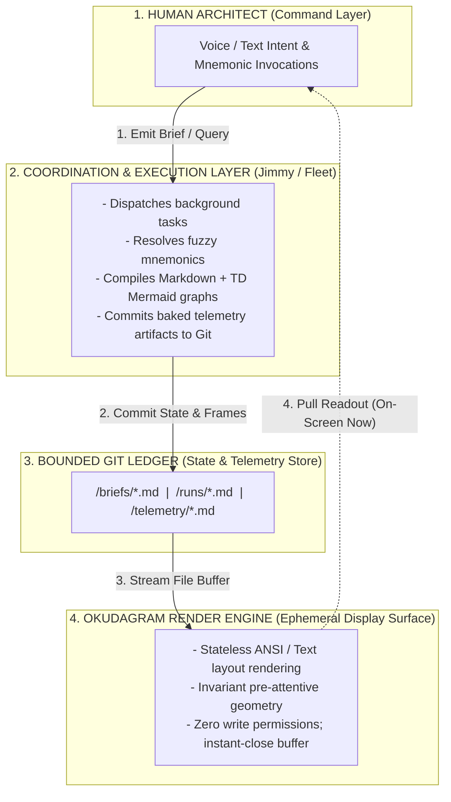
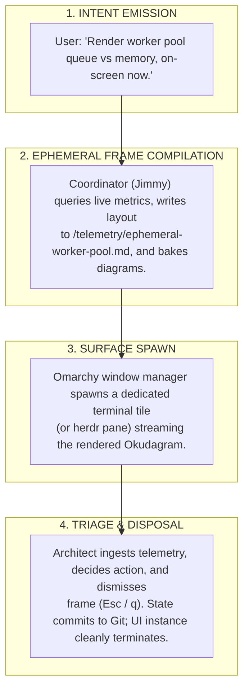

### Ephemeral UI Rendering & Mnemonic Recall Specification

This specification formalizes the stateless, pull-based telemetry stack for the Omarchy Linux and Okudagram environment. The architecture decouples the **Intent Ingress Head** (conversational agent/coordinator) from the **Telemetry Render Head** (stateless terminal display), using bounded Git repositories as the authoritative ledger.

---

#### 1. Bounded Mnemonic Resolution Engine

Mnemonics serve as low-overhead, deterministic addressing handles for project states, meeting jump-lists, and diagnostic logs within a repository silo.

* **Namespace Bounds:** Mnemonics are isolated to the active Git repository root (`$REPO_ROOT/.telemetry/index.json`).
* **Canonical Schema:** `[domain]-[subdomain]-[descriptor]` (e.g., `audit-q3-recon`, `sec-auth-triage`).
* **Resolution Pipeline:**
1. **Direct Match:** Exact string match executes an instant buffer pull.
2. **Fuzzy Match Fallback:** Partial string queries (e.g., `recon`) trigger Jimmy to generate an ephemeral index Okudagram displaying candidate matches with single-line contextual summaries.
3. **Voice/Text Narrative Bridge:** If invoked via voice during active discussion, the agent narrates the target delta while simultaneously painting the candidate list.

---

#### 2. Diagram Persistence Standard

Visual reasoning artifacts (state diagrams, workflows) are stored as standard `mermaid` code blocks to maintain clean version control, auditability, and deterministic parsing across environments.

* **Orientation Constraint:** All flowcharts must strictly use `flowchart TD`. Horizontal terminal geometry is constrained (typically 80–100 columns), whereas vertical scroll space is infinite.

* **Storage Convention:** All diagrams are defined using standard fenced `mermaid` blocks. The local terminal rendering engine reads the raw Markdown and compiles the visual output on the fly during display.

---

#### 3. "On-Screen Now" Ephemeral UI Lifecycle

When data complexity exceeds linear text streams, the architect issues an "on-screen now" directive to instantiate an ephemeral telemetry frame.

---

#### 4. Hardware Transport & Device Profile (E-Ink PADD)

The architecture supports transport to ultra-low-power, distraction-free command devices (Kindle/e-ink slates, portable terminals) over secure shell.

* **Transport Layer:** OpenSSH over WireGuard/cellular. Payload is strictly raw ANSI escape codes and UTF-8 plain text (bandwidth consumption $<2\text{ KB/s}$).
* **Display Mechanics (Bistable Freezing):**
* Display is entirely passive; no interactive widgets, form controls, or mouse-driven focus loops.
* The terminal receives the Markdown/Okudagram stream, paints the frame, and triggers an e-ink screen refresh.
* Screen drops into a zero-power static display state until the next pull mnemonic is emitted.

* **Input Decoupling:**
* **Reading Pane:** Displays the rendered document with hardware page-turn keys or simple vertical swipe gestures.
* **Command Pane:** Separate terminal or voice channel dedicated strictly to communicating intent and directives to Jimmy.

---

#### 5. Compliance, Security, and Storage Topology

| Subsystem Component | Operational Role | Storage / Path Pattern | Access Mode |
| --- | --- | --- | --- |
| **Intent Layer** | Human-signed briefs, objectives, acceptance constraints. | `$REPO/briefs/[mnemonic].md` | Read/Write (Architect) |
| **Execution Layer** | Agent run records, sub-task graphs, tool receipts, execution deltas. | `$REPO/runs/[mnemonic]-[run-id].md` | Append-Only (Jimmy/Agents) |
| **Telemetry Layer** | Rendered Okudagram layouts, jump-lists, TD state charts.

 | `$REPO/telemetry/[mnemonic].md` | Read-Only (Okudagram Engine) |
| **Audit Ledger** | Git commit graph with GPG/SSH signed tree state. | `$REPO/.git/` | Cryptographically Signed |

The system prohibits unauthenticated background mutation of active displays. Telemetry is pulled exclusively on demand, ensuring zero notification interrupts, provable data provenance, and sub-second situational recovery.