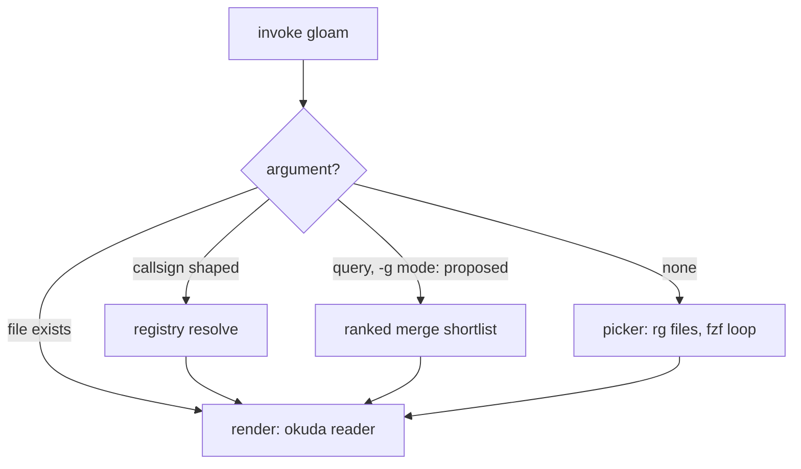
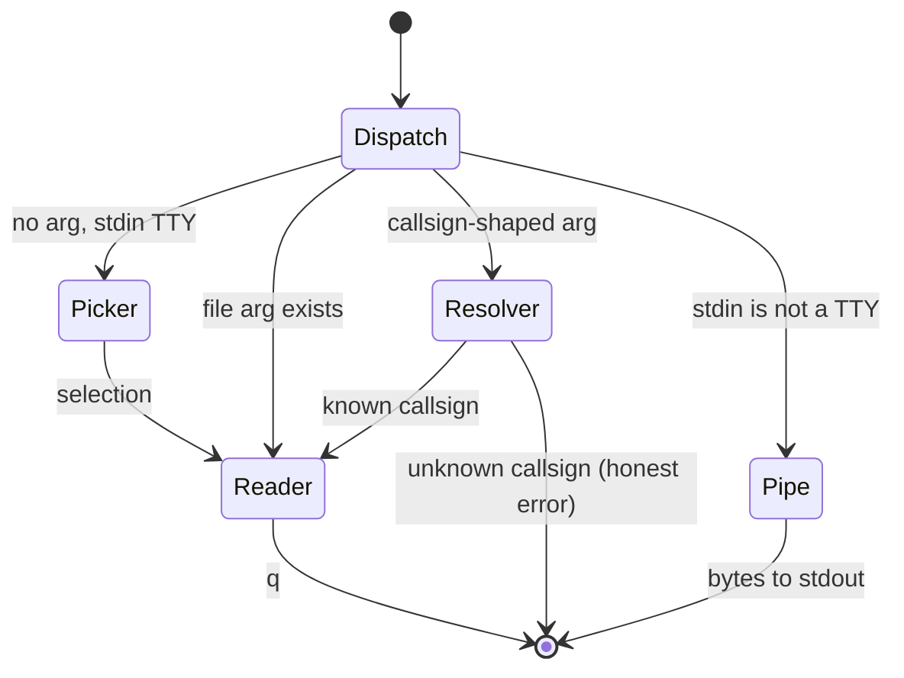

# Gloam's seams — the CLI, its verbs, and the compositions they offer

> Logged 2026-08-30. Status: **options paper — nothing decided.** The usage
> this documents is partly real (verified in source, cited), partly proposed
> (marked). The point of the paper is to see all the options at once before
> any of them earns a brief. Companion to the three-concerns doctrine
> (`docs/2026-08-20-origin-doc.md`): compositing, windowing, rendering.

## What gloam actually is

Not a program — a decomposition. Three seams, each already a separate
process or a pure function:

1. **select** — fd/rg → fzf → a path. The launcher loop
   (`src/launcher.ts`) is this seam wrapped in a TUI.
2. **resolve** — a callsign → a path, via the tier registers
   (`src/root.ts`, `resolveByCallsign`; dispatch at `src/cli.ts:95`).
3. **render** — markdown → ANSI bytes (`okuda <file>`, and pipe mode:
   `src/cli.ts:77` — non-TTY stdin is read as the document).

Headless gloam is not a feature to build; it is these seams *without the
loop that binds them*. Most of it exists.

## The dispatch tree, as it stands

## The invocation modes, as a state machine

## Verified inventory

| Seam | Today | Where | Headless? |
|---|---|---|---|
| render, file | `okuda <file>` | `src/cli.ts` | yes — bytes to stdout |
| render, pipe | `cat doc.md \| okuda` | `src/cli.ts:77` | yes — the headless renderer already exists |
| resolve | `gloam <callsign>` | `src/cli.ts:95` | **no — gated on `stdin.isTTY`** |
| select | the picker loop | `src/launcher.ts` | **no — loop-bound; `--print-query` machinery exists but is internal** |
| compose | `reg-menu`, `reg-sync` | `scripts/` | yes — emit markdown / maintain registers |
| structured API | the registers themselves | `*/INDEX.jsonl` | yes — field-anchored queries, no code needed |

## The options, on paper

**Option A — pipe composition (exists today, zero code).**
The client composes the seams itself: `rg` over registers for field hits,
`rg -l` for bodies, fzf or nothing for selection, `okuda` (or anything)
for rendering. This document's own research was done exactly this way —
the session writing these lines has been a headless gloam client all day,
by hand. Cost: none. Limitation: each client reinvents the ranking and
dedupe conventions.

**Option B — two flags (`gloam --print`, `gloam --resolve`).**
`--print` runs the selector headless and emits the chosen path (the
`--print-query` plumbing already talks to fzf in this style). `--resolve`
emits the registry path for a callsign, un-gating the TTY check —
resolution is a pure registry read; there is no reason it needs a
terminal. Cost: small, surface-only, no rendering change. These are the
only two gaps in an otherwise complete seam set.

**Option C — gloam as a service over SSH (ForceCommand).**
The silo already chose OpenSSH ForceCommand over daemons
(BRF-SSH-SERVED, feasibility debriefed). A headless verb slots in as
another ForceCommand: `ssh host okuda-silo` serves; the same grammar
extends to select/resolve. Cost: bounded by the SSH brief's own scope.
No listening processes are added — "service" in the Unix sense, not the
TCP sense.

**Option D — a JSON mode (described in order to refuse it).**
Structured output for programmatic clients. Rejected in principle: the
registers are already the structured API — `INDEX.jsonl` is greppable,
maintained by `reg-sync`, and consumed by `reg-menu` today. A JSON
surface over the same data is an API server assembled from extra steps,
and it forks the schema conversation away from the registers. If a
client needs structure, it reads the register.

## Clients

Who composes these seams, observed and proposed:

- **The human at a terminal** — the TUI loop; the primary client, unchanged
  by everything above.
- **Two panes, one silo** — two gloam instances side by side (tmux
  split), cross-referencing: read a string on the anchor pane, type it
  into the probe pane, pick from the suspects. The panes share the
  corpus through the filesystem; the operator is the compositor between
  them. The first multi-client story, and it ships today — pane *roles*
  (anchor = tied-to-the-mast, probe = slippy) belong to the host (Herdr,
  Panel Library brief); the workflow costs nothing now.
- **Agents** — pi sessions and the like, reading the silo by pipe: register
  queries, path resolution, document renders. Informally active today
  (several documents in this silo were written by an agent composing these
  seams manually).
- **Herdr, the host** — owns windowing; a `--print` selection is a path
  it can open in any pane by any renderer, okuda optional.
- **Blog and SSH readers** — the gopher-serve family; ForceCommand delivery
  per Option C.

## Foreign composition — the world beyond the filesystem

The seams compose with the silo's own clients. They also compose with the
*world*, by the same rule, at zero cost: **the corpus emits addresses, and
the foreign system does the work.** No email integration, no SAP
connector, no transport built — a URL is just a qualified address for a
foreign silo, and emitting addresses is what the corpus already does.

The mechanism ships today: markdown links to web targets ride OSC 8
(BRF-DOCUMENT-LINKS's two link species — web links leave via the host,
local links ride the tokens). A vector row in an `AMPER` document can
carry a `mailto:` link or a SaaS deep-link as ordinary markdown, and the
terminal hands it off. Three tiers, by durability:

1. **Recipient has silo access** → send the **callsign or path**. The
   durable tier: the address never rots, the recipient sees current
   state. The email carries an address, not a copy.
2. **Recipient is outside** → `mailto:` with quoted content.
   Self-contained, but a frozen copy — diverges from the ledger on send.
3. **Recipient lives in SaaS** → the deep link, keyed-up session and
   all. Richest and most volatile: the URL reconstructs state from
   *their* database under *their* routing and auth clock.

**The boundary: SaaS URLs are projections, never the record.** The
silo's copy stays master; a foreign route change costs the corpus
nothing, because the ledger never held the dependency. Rendering of the
emitted artifact (email themes, SAP layout, Fonts and Shite) is the
foreign engine's concern — we do not care how the far side looks, only
that the address resolves.

## The moat — refusals as fortification

This section is also the answer to the request this pattern exists to
repel: *"add email integration / build a SAP connector / support our
calendar."* The moat question — *can you name your secrets?* — is
answered by naming them:

1. **Statelessness.** The terminal sees keystrokes, the corpus sees
   bytes; no daemon, no listener, no session state anywhere in our code.
2. **Address-emission over integration.** Foreign systems are addressed,
   never embedded. Every integration request is answered by a URL the
   corpus already has the mechanism to emit.
3. **The ledger as the durable layer.** Projections live in foreign
   systems and rot there; the record lives here and is why the rot never
   reaches us.

Each documented refusal is a wall segment with a warrant. The request
will come back — requests do — and the answer is now a citation, not a
meeting.

**Stage 4, when a named consumer arrives: harness-assisted API
hoisting.** For sufferers of REST syndrome who cannot reach the
filesystem API unaided: a thin adapter that hoists the register API to
their wire protocol — HTTP, their schema, their verbs. An assistive
device, not a feature: it is named for what it does, it accommodates
rather than cures (the cure is `jq`, and graduation happens when the
sufferer learns it), it is gated on a named consumer, and it hoists
*from* the registers — the source of truth never moves. The silo
accommodates input variation (dunts, switches, Morse) and output
variation alike; the full stack of human variation, served.

## Anti-goals

- **No daemons.** Service delivery rides OpenSSH (ForceCommand) or plain
  process invocation. Nothing listens.
- **No JSON surface.** The registers are the structured API.
- **No native integrations.** Foreign systems are *addressed* (URLs,
  mailto, deep links — see Foreign composition), never embedded; their
  rendering and their state are their concern.
- **No deep navigation stacks.** The loop recurs in cycles, never in
  depth: picker → reader → picker, two levels, and the desk-clearing
  gesture (Esc-Esc, or a future `Ctrl-L` bind) resets to the `&`-family
  root — which is what an *empty query* already renders, guaranteed by
  byte order.
- **Rendering never leaves okuda.** Headless gloam emits *paths* and
  *markdown* — the byte stream's origin is compositing, legitimately;
  coloured bytes on a screen remain okuda's whole job.
- **No API stability promises yet.** The registers are stable in practice;
  a de facto interface becomes a declared contract only when a second
  producer appears (the standing threshold, per ADR-025's precedent).

## Gaps, if the options ever graduate

1. `gloam --resolve <callsign>` — un-gate the TTY check; print the path.
2. `gloam --print` — headless selection; emit the path, skip the loop.
3. The ranked-merge conventions (registry field hits > body hits, dedupe
   by path) live in BRF-CONTENT-SHORTLIST; headless clients inherit them
   by reusing the same sources rather than re-inventing ranking.

## Open questions

- Do the flags belong on `gloam`, on a subcommand, or nowhere (Option A
  sufficient)? The honest trigger is a second client complaining, not a
  first client imagining.
- Should `--print` respect the rooted-silo root detection, or is selection
  root-agnostic? (The picker is currently root-aware for the badge only.)
- Does the agent client deserve a documented *conventions* page (how an
  agent should query the silo: registers first, bodies second), or is the
  BRF-CONTENT-SHORTLIST ranked-sources section already that page?
