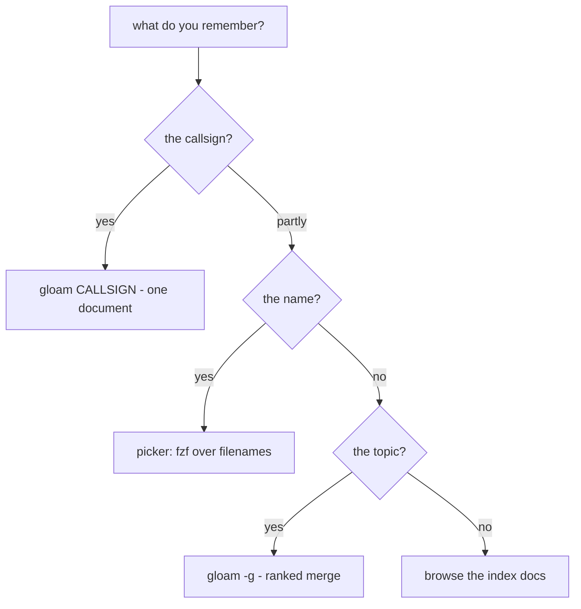

# Searching the silo — draft conventions

> Logged 2026-08-30. Status: **draft** — conventions become conventions by
> use; this page is the attempt to write down what the fingers already do
> and what they should. Companion to `docs/2026-08-30-gloam-seams.md` (the
> seams paper — mechanisms); this page is the *operator's manual* — how to
> drive them. Two audiences, deliberately: humans and agents. The agent
> conventions are the same idioms with the TUI removed.

## The uncertainty ladder

Every search starts from what you remember. The ladder maps that to a tool;
climb only as high as your memory allows.



- **Know the callsign** → `gloam BRF-CONTENT-SHORTLIST`. Exactly one
  document, or an honest error. No search at all — this is resolution.
- **Know (part of) the name** → `gloam`, the picker. fzf over filenames.
- **Know only the topic** → `gloam -g <query>` (landing per
  BRF-CONTENT-SHORTLIST): registry field hits first, body hits second.
- **Know nothing** → the index docs (`&briefs`, `&alpha`, the tier
  indexes). Browsing is a legitimate search strategy; the jump tokens
  exist for exactly this.

## The picker: fzf's query grammar (the leverage nobody uses)

The picker is fzf in extended-search mode. The grammar applies to
filenames today, and to shortlist rows when `-g` lands. Space means
AND; every term refines:

| You type | You get |
|---|---|
| `speech` | fuzzy: anything containing s-p-e-e-c-h in order |
| `speech brief` | AND — both terms must match |
| `'speech` | exact word match — kills fuzzy surprises (`'` prefix) |
| `^brief` | starts with `brief` |
| `shortlist$` | ends with `shortlist` |
| `!speech` | excludes matches containing `speech` |
| `brief \| decision` | OR — either term |
| `'2026-08-28 !speech` | combos: exact date, no speech docs |

The composable habit: **exact-anchor what you're sure of, exclude what
you're not looking for, stay fuzzy about the rest.**
`'mermaid !aborted` finds the mermaid work minus the experiment's corpse.

**The query survives.** The loop reseeds: `q` from a document returns to
the picker with your query intact. Read as many hits as you like — the
search state is never lost to browsing. (This is the `--print-query` /
`--query` reseed; it is the difference between a search tool and a
file list.)

## The two-digit grammar

In any index or jump-wired document, type two digits to open the row
beside the number; `u` walks back. Tokens 11–99, per ADR-021's offset.
Ephemeral by design — never jotted, never referenced; the durable codes
are callsigns. The distinction in one line: *jump tokens are for this
session; callsigns are for next week's phone call.*

## Register idioms (manual, agent-grade)

When driving the silo without the TUI, the registers are the interface.
Field-anchored, never free-text over the corpus:

```bash
# owner of a callsign (field-anchored — summaries may cite other callsigns)
rg '"callsign":"BRF-CONTENT-SHORTLIST"' */INDEX.jsonl

# everything a tier says about a topic (summary text)
rg -i 'mermaid' briefs/INDEX.jsonl

# ranked merge: owners first, bodies second, deduped by path
{ rg -i "\"callsign\":.*$1" */INDEX.jsonl; rg -l "$1" --type md; } | sort -u
```

Order is precision order: a register field hit is an owner; a body hit
is a mention. When both appear, the owner outranks the mention — which
is only safe because ADR-025 guarantees the field is the only place an
owner is declared.

## Agent conventions (the same idioms, TUI removed)

1. Registers before bodies. A field-anchored register query answers
   "what is this document" faster and cleaner than any content scan.
2. Paths, not callsigns, for in-band reference. Agents cite files the
   way documents do: relative paths (per ADR-025, the in-band channel).
3. Render by pipe when a human will look: `cat doc.md | okuda` — the
   headless renderer. Agents reading for themselves need no render at
   all: the markdown *is* the interface.
4. No JSON. The register is the structured API. There is nothing else.
5. The ranked-merge order (owners > filenames > bodies) inherits from
   BRF-CONTENT-SHORTLIST — agents should reuse the same sources, not
   re-invent ranking.

## The three breadcrumbs — ambient state, hot-potato held

The loop holds exactly three pieces of session state, each answering
one of the reader's lost moments. Learn to pick them up:

| Breadcrumb | Question it answers | Holding time |
|---|---|---|
| The reseeded query | *why was I reading this?* | survives one loop; cleared on demand |
| The backstack | *how did I get here?* | dies with the process; `u` walks it |
| The document itself | *is this still true?* | `r` reloads off disk — silence means nothing changed |

A browser history answers *where you went*; the reseeded query answers
**what you were looking for** — intent, not trajectory. And the
holding times are deliberate: state that lives too long becomes drift
(a settings store, a stale cache, a second ledger), so each breadcrumb
is held exactly as long as its question can still be asked, then
dropped. Hot potato, by design. When in doubt: `Esc` shows the query,
`u` walks the path, `r` checks the world.

## Document states (the docs/ lifecycle)

`docs/` is unregistered — no callsigns, no register (ADR-025's boundary).
But documents there have lifecycles, especially foreign-origin drafts
(other models, other sessions, other silos). The state lives in the
opening blockquote, the only register an unregistered folder should
 carry:

```
Logged <date>. Status: fresh | reconciled | aligned | discussion | superseded.
Origin: <source, if foreign>.
```

- **fresh** — landed as-received, not yet checked against the ledger
- **reconciled** — scraped against the contracts; provenance note records
  what was scraped, kept, routed (ADR-027 clause 3)
- **aligned** — the ledger stops arguing with it; a normal citizen
- **discussion** — a riff or options paper; no decision claimed
- **superseded** — a newer document owns the content; link forward

The status change *is* the note: edit the blockquote when the state
changes (the VRL doc walked fresh → reconciled → aligned on its first
day). No frontmatter, no lift machinery — a register for docs/ fires
only on a **named consumer** (an agent pipeline filtering by status, a
feed hiding `fresh` drafts); until then the blockquote is the register,
and the migration, when it comes, is one mechanical pass.

## The two keymaps — one pair of hands

Two components share the keyboard: the **reader** (okuda) and the **picker**
(fzf). Same keys, different meanings — the mode is always visible: the
picker announces itself with the `gloam ❯ ` prompt; the reader is the
framed document. Verified against `src/tui.ts` (`decodeKey`) and
`src/launcher.ts` (`FZF_BINDS`); fzf's built-in emacs bindings remain
available (`FZF_DEFAULT_OPTS` is emptied, not replaced).

**Reader — motion and exit**

| Key | Action |
|---|---|
| `j` / `k` | line down / up |
| `space` / `b` | page down / up (less/man convention) |
| `Ctrl-D` / `Ctrl-U` | half-page down / up |
| `g` / `G` | top / bottom |
| arrows, PgUp/PgDn | same motions, for everyone else |
| `r` | reload off disk |
| `?` | toggle verbose hints |
| `11`–`99` | jump to the wired row (two-digit buffer; any non-digit cancels) |
| `u` / Backspace | back — pop the backstack |
| `q` / `Q` / Ctrl-C / Ctrl-Z | quit to the picker |

**Picker — filter and act**

| Key | Action |
|---|---|
| type | filters (fuzzy; `--exact`; see the grammar table above) |
| `Enter` | read the selection — into the reader |
| `Ctrl-W` | clear one word of the query |
| `Esc` | clear query — and on an empty query, done |
| `Ctrl-D` / `Ctrl-U` | page down / up — **mirrored from the reader** |
| `Ctrl-C` | abort the loop entirely |

**The seam rules**

1. **Mirrored where semantics match.** `Ctrl-D`/`Ctrl-U` page in both
   components — the one deliberate reuse, bound into fzf for exactly this
   reason. Paging should never surprise between modes.
2. **Dual-duty keys change meaning with the mode.** `Esc` cancels a
   half-typed token in the reader but clears-or-exits in the picker;
   digits are a jump buffer in the reader but filter *text* in the picker
   (typing `11` finds files containing 11); `q` quits the reader but
   filters for the letter q in the picker. The prompt tells you which
   world the hands are in.
3. **The bridge.** The operator's flow out of the reader into an empty
   picker prompt: exit the reader, `Esc` to clear the reseeded query —
   two keystrokes to a blank `gloam ❯ `, ready for a new word. Note for
   the keymap owner: the reader's lone `Esc` is a buffer-cancel no-op in
   `decodeKey` as coded, so codify whichever bridge is intended — the
   observed flow or an explicit `Esc`-quits — before it drifts.

## Status

Draft. The test of a conventions page is whether the fingers converge on
it — revisit after the `-g` mode lands and after the next agent session
works from this page alone. Additions that survive three uses graduate;
additions that never survive one were ceremony.
