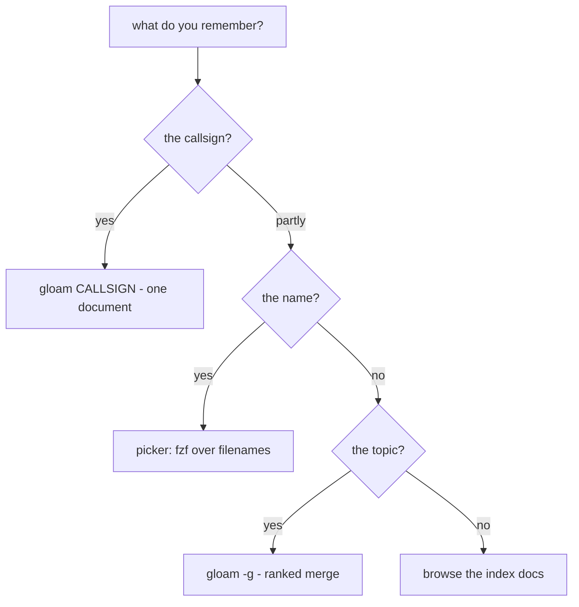

# Searching the silo — draft conventions

> Logged 2026-08-30. Status: **draft** — conventions become conventions by
> use; this page is the attempt to write down what the fingers already do
> and what they should. Companion to `docs/2026-08-30-gloam-seams.md` (the
> seams paper — mechanisms); this page is the *operator's manual* — how to
> drive them. Two audiences, deliberately: humans and agents. The agent
> conventions are the same idioms with the TUI removed.

## The uncertainty ladder

Every search starts from what you remember. The ladder maps that to a tool;
climb only as high as your memory allows.



- **Know the callsign** → `gloam BRF-CONTENT-SHORTLIST`. Exactly one
  document, or an honest error. No search at all — this is resolution.
- **Know (part of) the name** → `gloam`, the picker. fzf over filenames.
- **Know only the topic** → `gloam -g <query>` (landing per
  BRF-CONTENT-SHORTLIST): registry field hits first, body hits second.
- **Know nothing** → the index docs (`&briefs`, `&alpha`, the tier
  indexes). Browsing is a legitimate search strategy; the jump tokens
  exist for exactly this.

## The picker: fzf's query grammar (the leverage nobody uses)

The picker is fzf in extended-search mode. The grammar applies to
filenames today, and to shortlist rows when `-g` lands. Space means
AND; every term refines:

| You type | You get |
|---|---|
| `speech` | fuzzy: anything containing s-p-e-e-c-h in order |
| `speech brief` | AND — both terms must match |
| `'speech` | exact word match — kills fuzzy surprises (`'` prefix) |
| `^brief` | starts with `brief` |
| `shortlist$` | ends with `shortlist` |
| `!speech` | excludes matches containing `speech` |
| `brief \| decision` | OR — either term |
| `'2026-08-28 !speech` | combos: exact date, no speech docs |

The composable habit: **exact-anchor what you're sure of, exclude what
you're not looking for, stay fuzzy about the rest.**
`'mermaid !aborted` finds the mermaid work minus the experiment's corpse.

**The query survives.** The loop reseeds: `q` from a document returns to
the picker with your query intact. Read as many hits as you like — the
search state is never lost to browsing. (This is the `--print-query` /
`--query` reseed; it is the difference between a search tool and a
file list.)

## The two-digit grammar

In any index or jump-wired document, type two digits to open the row
beside the number; `u` walks back. Tokens 11–99, per ADR-021's offset.
Ephemeral by design — never jotted, never referenced; the durable codes
are callsigns. The distinction in one line: *jump tokens are for this
session; callsigns are for next week's phone call.*

## Register idioms (manual, agent-grade)

When driving the silo without the TUI, the registers are the interface.
Field-anchored, never free-text over the corpus:

```bash
# owner of a callsign (field-anchored — summaries may cite other callsigns)
rg '"callsign":"BRF-CONTENT-SHORTLIST"' */INDEX.jsonl

# everything a tier says about a topic (summary text)
rg -i 'mermaid' briefs/INDEX.jsonl

# ranked merge: owners first, bodies second, deduped by path
{ rg -i "\"callsign\":.*$1" */INDEX.jsonl; rg -l "$1" --type md; } | sort -u
```

Order is precision order: a register field hit is an owner; a body hit
is a mention. When both appear, the owner outranks the mention — which
is only safe because ADR-025 guarantees the field is the only place an
owner is declared.

## Agent conventions (the same idioms, TUI removed)

1. Registers before bodies. A field-anchored register query answers
   "what is this document" faster and cleaner than any content scan.
2. Paths, not callsigns, for in-band reference. Agents cite files the
   way documents do: relative paths (per ADR-025, the in-band channel).
3. Render by pipe when a human will look: `cat doc.md | okuda` — the
   headless renderer. Agents reading for themselves need no render at
   all: the markdown *is* the interface.
4. No JSON. The register is the structured API. There is nothing else.
5. The ranked-merge order (owners > filenames > bodies) inherits from
   BRF-CONTENT-SHORTLIST — agents should reuse the same sources, not
   re-invent ranking.

## Status

Draft. The test of a conventions page is whether the fingers converge on
it — revisit after the `-g` mode lands and after the next agent session
works from this page alone. Additions that survive three uses graduate;
additions that never survive one were ceremony.
