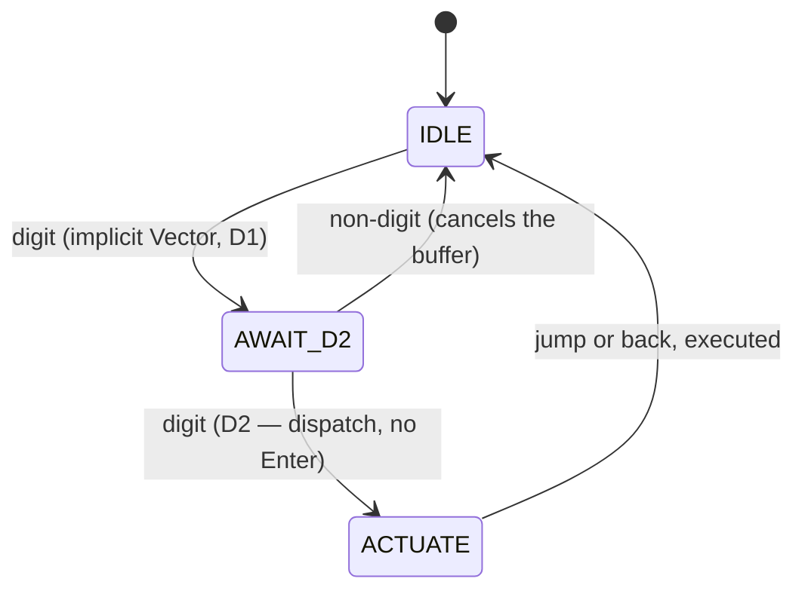

# Unified ingress grammar — BNF and state machine, reconciled

> Logged 2026-08-31. Origin: Gemini conversation (foreign draft).
> Status: **reconciled**. **Kept:** the unified-grammar impulse, the BNF
> form, the state machine — which turns out to match the shipped digit
> buffer almost exactly (`advanceNumBuffer`, `src/tui.ts`). **Reclassified
> (the draft's one real design error):** `Glow` and `Zoom` are **system
> commands** — continuous scalars acting on the environment, not document
> addresses — and are removed from the two-digit navigation grammar.
> **Struck:** the `g` opcode (collides with shipped `g` = top), the
> `register[]`/`POP_histor_ystack` fictions, the "zero debounce" claim
> (the state machine's own Timeout transitions and ADR-021's spaced
> double-tap protocol disagree with it). **Routed:** the system-command
> category to td-b4bae8; the grammar extension question to the keymap
> owner under ADR-026.

## The two categories (the reconciliation's spine)

The draft treated all commands as one grammar. They are two, and the
boundary is *what the command acts on*:

1. **Document navigation** — `Vector` (jump to token), `AMPER` (open a
   `&`-family vector), *echo-tango* (the operator's phonetic prefix,
   concept unfiled). These act on the **corpus**: they move between
   documents, consume the ephemeral token space (11–99), and are
   mode-dependent (reader jump buffer vs picker filter, per the
   two-keymap reconciliation). This is the VRL grammar.
2. **System commands** — `Glow` (luminance), `Zoom` (viewport), and
   future settings. These act on the **environment**: continuous
   scalars, not addresses. They must **not** borrow the two-digit
   navigation grammar — the token space has exactly one meaning (row
   address), and discrete fixed-width operands are the wrong shape for
   knobs anyway. System commands get their own idiom (nudge keys,
   named voice commands) when their features exist — the luminance
   scalar is unbuilt (td-b4bae8); Zoom is unimagined.

The draft's over-engineering was exactly this conflation: giving settings
the address grammar. The fix is not trimming the BNF — it is splitting
the category.

## The navigation grammar, formalized (shipped truth)

The state machine below is not a proposal — it is `advanceNumBuffer`
(`src/tui.ts`), already shipped and tested:

```bnf
<jump_command>   ::= <digit> <digit>          ; implicit vector — no opcode
<back_command>   ::= "u" | Backspace          ; pop the backstack
<digit>          ::= "0" | ... | "9"          ; convention: 11–99, ADR-021
```



Matches the shipped buffer keystroke for keystroke: digits accumulate,
the second digit *dispatches without Enter*, any non-digit cancels so a
stray keystroke never ambushes a half-typed token. The draft's S1
(opcode-awaiting) state is **removed**: the keyboard channel has no
opcodes — bare digits are already implicit Vector, and an explicit `v`
opcode would buy nothing while costing a key (and `g` was already taken
by top — the draft repurposed a shipped key without checking). Opcodes
belong to the *voice* channel only, where an explicit lead-in word
disambiguates speech from dictation.

**Voice ingress rides the same state machine by injection:** `"Vector
one fiver"` → keys `1` `5` → `IDLE → AWAIT_D2 → ACTUATE`. The voice
grammar composes; it does not fork. (Per ADR-026: identical across
channels; deviation is noise.)

## The voice opcode layer (proposed, routed)

For the voice channel specifically, the draft's opcode idea survives in
its correct category:

- `"Vector <digits>"` — reader navigation (as above)
- `"AMPER <name>"` — picker query for a `&`-family vector
- `"Vector unwind"` — the backstack pop (shipped: `u`)
- *echo-tango* — the operator's phonetic-prefix concept; **unfiled** —
  it needs a definition and a brief before it is grammar

Each spoken phrase injects the keyboard payload and lets the shipped
state machine do the rest. Voice adds *recognition*; it adds no
*states*.

## The system-command category (deferred, routed)

`Glow` and `Zoom` remain good *names* for the environment knobs, and the
draft's instinct that they deserve voice is right. But they wait on
their features — the luminance scalar is unbuilt (td-b4bae8, sequenced
behind state-glyph tuning) — and they enter through their own category:
continuous scalars, nudge-style or named-phrase, never the two-digit
address space. When the scalar ships, its voice binding is a td-b4bae8
decision, not an amendment to the navigation grammar.

## Internal contradiction, recorded

The draft claimed "zero debounce timers" while drawing Timeout abort
transitions in its own state machine. The shipped truth is between:
the spaced double-tap protocol (ADR-021 corollary) is a *timing-aware*
buffer, deliberately — pure no-timeout dispatch would make a stray
keystroke ambush a half-typed token. Timing exists; it is protocol, not
debounce.

## Related

- `src/tui.ts` — `advanceNumBuffer`, `decodeKey` (the shipped machine)
- `docs/2026-08-30-search-conventions.md` — the two-keymap reconciliation
  (mode-dependence of injected keys)
- ADR: `decisions/021-jump-token-numbering-offset.md` (the 11–99 space)
- ADR: `decisions/026-wire-format.md` (grammar changes are versioned
  decisions; the opcode question belongs there if it ever ripens)
- td-b4bae8 — the luminance scalar (the system-command category's first
  citizen)
- `docs/2026-08-30-voice-actuator-testing.md` — the M4 ingress pipeline
  this grammar rides on
