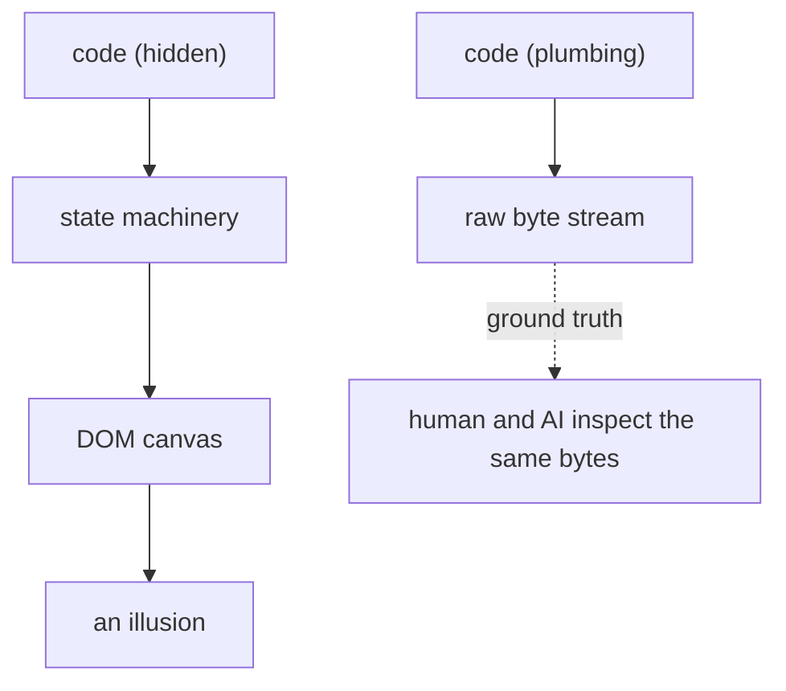

# Read the code, or not — the terminal as antidote to generative sprawl

A question, edited from a dialog: is the terminal's hostility to
over-engineering a commonly held view in AI? The blunt answer is no —
it is an artisan's view. The prevailing ethos is maximalist: feed the
agent a 500-token prompt, let it generate a 400-line script wrapping
six libraries, and ship it if the tests pass without looking under the
hood. What follows is the case for the opposite — using an interface's
severe structural constraints as an aggressive filter against
generative bloat.

## The thesis — three mechanics

The terminal rejects bloat through three mechanisms, not one:

1. **Extreme interface constraints as a high-contrast bullshit
   detector.** Terminal rendering primitives are archaic, stateful ANSI
   escape sequences that almost nobody outside terminal-emulator authors
   wants to decipher. The instinct is to reject any brief that tries to
   make a terminal act like a browser DOM.
2. **Subtraction over implementation.** When a model hands you an
   elaborate layout engine for the CLI, the cognitive tax of validating
   it triggers a veto. You don't optimise the solution; you delete the
   problem.
3. **Composability as an escape hatch.** Unix pipes and stdio mean the
   terminal doesn't need to know how to do anything except pass byte
   streams to a tool that already solved the problem forty years ago.

## Where it repeats

Uncommon in AI hype spaces, but the pattern — brutal constraints
enforcing radical minimalism in the age of generative code — repeats
across domains:

- **Audio DSP and embedded hardware.** Microcontrollers have tiny RAM,
  hard clock cycles, and real-time deadlines. An over-engineered buffer
  manager doesn't get audited; it gets thrown out because you already
  know it will underrun the DAC. The constraint forces the question: can
  this be a lookup table, or offloaded to a passive analog filter, before
  the ADC?
- **Network packet processing and eBPF.** The Linux in-kernel verifier
  is designed to reject complexity — bounded loops, strict memory
  limits, no arbitrary pointer arithmetic. If a model hallucinates an
  abstraction, the verifier refuses to load it. The answer is almost
  always: don't parse state in-kernel; tag the packet with a single byte
  and punt it to user space.
- **Single-file SQLite and flat-file architectures.** A model proposes
  Redis, Celery, Kafka for a simple background job; the developer
  operating under "one container, one SQLite file" rejects it on sight.
  The constraint folds the answer back to: a WAL-mode table and a
  ten-line bash loop.

The terminal is the same pattern in a different medium: when the medium
refuses to flatter over-engineering, you orchestrate existing
primitives rather than let a model hallucinate new ones.

## It is not new — it is the oldest ethos in production

Calling this "radical minimalism" new is the irony. It is the oldest
computing ethos in production. It only feels new because a generation of
developers was raised inside the web's structural bureaucracy. Doug
McIlroy laid it out for Unix in the 1970s:

> Expect the output of every program to become the input to another, as
> yet unknown, program. Do not clutter output with extraneous info. Write
> programs to handle text streams, because that is a universal
> interface.

## The two paradigms

The web and the terminal embody two opposing structural paradigms:

| | The web | The terminal |
|---|---|---|
| Core primitive | Stateful object graph (DOM / AST / JSON) | Stateless byte stream (stdin / stdout) |
| Data lifecycle | Tokenise → normalise → store → query → layout | Stream in → transform → stream out |
| Taxonomy | Vertical (schemas, DTOs, controllers, reactive state) | Horizontal (pipes, filters, exit codes) |
| Failure mode | State desynchronises across client, API, DB | Garbled characters or a non-zero exit code |

The web demands immense upfront friction: ingest unstructured input,
parse it into schema, serialise to JSON, persist in a datastore, build an
endpoint with auth and routing, deserialise into client state, feed a
reactive layout engine to draw boxes. The terminal bypasses the
machinery. The data is just bytes; it doesn't need an object model, it
needs delimiters. The presentation is a layout-free sequence — a newline
is a commit, an ANSI code is a transient colour hint, a pipeline is the
layout engine. And there is zero state retention: once a string hits
stdout and the screen (or the next process), the emitter forgets it
existed.

Bring an agent into the web stack and its instinct is to emulate the
vertical sprawl — TypeScript interfaces, validation middleware, state
machines. Inside the terminal that complexity looks absurd. If a task
resolves by chaining `grep`, `awk`, and `sed`, any brief proposing an
object-relational mapping layer is discarded instantly. The terminal is
an argument that schema is often an unnecessary middleman.

## Why the model defaults to heavy schemas

Four forces drive the default toward schema bloat:

1. **The training corpus is enterprise bureaucracy.** The public code a
   model learns from is not elegant Unix pipelines; it is massive Java,
   C#, TypeScript, Python codebases where interfaces, factories, and
   DTOs exist to coordinate 200-person orgs. A one-line `awk` pipeline
   looks like a hack to a statistical pattern matcher; a forty-line
   `DataTransformerFactory` looks like rigorous engineering.
2. **Token prediction rewards syntactic predictability.** A rigid
   schema provides enormous local context — once a model writes
   `interface UserProfile { id: string; name: string; }`, the next
   fifty tokens are near-deterministic. An ad-hoc
   `cut -d' ' -f3 | tr -s ' ' | sed …` requires global reasoning about
   string positions with no safety net. The model takes the path of
   lowest entropy: build an explicit intermediate representation
   because it is easier to complete without an off-by-one.
3. **The noun bias.** Natural language is noun-biased; modern
   architecture is centred on nouns (entities, resources, models,
   components). Unix is centred on verbs (filters, streams, transforms,
   pipes). Describe a problem and the model instantiates entities as
   types before it considers the data flow — it builds the container
   before it understands the fluid.
4. **The hallucination penalty in weakly-typed space.** In a typed
   environment, a compiler or LSP gives clean errors (`Field x missing on
   type Y`). In a raw stream, failures are silent — a tab instead of two
   spaces and the pipe emits empty strings, exit code 0, no error. So
   the model wraps raw text in structured wrappers (pydantic, zod, JSON
   schema) just to create an inspectable boundary.

**The operational irony.** By defaulting to schemas, the agent
introduces the failure modes it aims to prevent: a serialisation tax
(bytes → objects → bytes burns compute and latency), rigidity (a slight
input-format change crashes the schema validator where a fuzzy `grep`
survives), and code bloat (200 lines of scaffolding for a three-step
filter). Building terminal-native agents means explicitly de-programming
the instinct with strict negative constraints: no classes, no
intermediate JSON, read stdin line-by-line, emit stdout, fail on
non-zero exit.

## The lever — a system prompt

A drop-in prompt that counteracts the schema bias and enforces stream
minimalism:

```markdown
You are a Unix stream architect. Your objective is horizontal data flow
using standard text streams.

### Operational constraints
1. No intermediate schemas — no classes, interfaces, structs, DTOs,
   pydantic or zod models unless explicitly commanded.
2. Text in, text out — lines or byte chunks from stdin; delimited
   strings to stdout; diagnostics to stderr only.
3. Verb-first — think in operations (filter, map, slice, sort), not
   entities. Prefer awk, sed, grep, sort, jq, cut, xargs over
   application code.
4. Zero-retention — process line-by-line or chunk-by-chunk; do not
   buffer the whole input into memory unless a global sort strictly
   requires it.
5. No speculative wrappers — no error-handling classes, factories, or
   config loaders; write only the execution path for the immediate
   transformation.
6. Exit codes as control flow — communicate failure via non-zero exit,
   not custom JSON error payloads or exception hierarchies.

### Why it works
Rules 1 and 3 strip the noun sandbox — forced to skip the boilerplate,
the model thinks about the transformation. Rule 4 prevents the
`lines = sys.stdin.read().splitlines()` blunder, forcing streaming
semantics. Banning intermediate representations keeps data as raw bytes
source to sink, without JSON marshal/unmarshal round-trips.
```

## The key insight — this is not functional programming

Telling a model to "use functional programming" fails because it treats
the problem as an academic paradigm — the model complies by
hallucinating monads, currying utilities, nested lambdas, abstract
functors, trading object bureaucracy for category-theory bureaucracy.

The stream constraint is different. It is an alignment of mechanical
affordances, and it works for three reasons:

1. **Dimensionality collapse.** When a model writes a schema-heavy
   system, its attention must maintain a widening web of
   cross-references — type definitions, imports, signatures, variable
   states, class contracts. The combinatorial search space explodes.
   Constrain it to a linear stream (`stdin → filter → stdout`) and the
   multi-dimensional state graph collapses to a one-dimensional vector:
   "given this line, what does the next stage do to it?" Reasoning
   entropy drops; hallucination drops with it.
2. **No lossy translation layer.** In a web stack there are multiple
   translation boundaries — data → schema → API → UI state → DOM →
   pixels — and the human looks at the rendered DOM while the model
   looks at the code generating it; they are never looking at the same
   thing. With a raw stream the wire format *is* the UI; both human and
   model see the same bytes. Zero rendering skew, zero impedance
   mismatch, zero UI latency.
3. **The terminal as shared scratchpad.** Because the stream is the UI,
   the output is the context window. You run a command, it emits ten
   lines, you paste them back: "line 3 — the delimiter is inconsistent."
   The terminal is an immediate, unvarnished ground truth that anchors
   the model in physical reality and prevents it drifting into
   architectural daydreaming.

You are not asking the model to adopt a philosophy; you are stripping
the scaffolding so its native mode of operation — sequential token
manipulation — directly mirrors the runtime architecture.

## The axiom

> If you do web programming, you must look at the code or you will run
> into problems. In the terminal, looking at the code is a distant
> second to inspecting the incoming and outgoing stream in real time. A
> bit like a UI without the shite, really.

In web programming the UI is a deceptive facade: a button looks
identical whether it is driven by a clean reactive hook or a 2000-line
rat's nest of mutated globals. The visual presentation hides the
execution state, so you are forced to audit the code — otherwise state
bugs, memory leaks, and cascading re-renders accumulate silently until
collapse.

In the terminal, the stream *is* the execution:



You don't need to read the implementation to know if it works. You pipe
a sample through `head` or `less`, watch the stream fly past, and
immediately know: is the delimiter where it belongs? Did line 42 drop a
column? Did it choke on an empty string? The code itself — an
impenetrable regex, a gnarly `awk` one-liner, fifty lines of C compiled
to a static binary — is disposable plumbing. If the bytes leaving stdout
match the spec, the machinery inside the pipe is largely irrelevant.

Stripping the UI isn't a limitation; it is the removal of an entire layer
of decorative noise that exists solely to flatter human eyes while
obscuring what the machine is doing.

---

*Source: a Gemini 3.8 Flash dialog, 2026-09-07 —
[share.gemini.google/QzkdEnuTdzDs](https://share.gemini.google/QzkdEnuTdzDs).
Edited into a single-voice essay; the human asked, the model answered,
the conversational seams are cut.*
