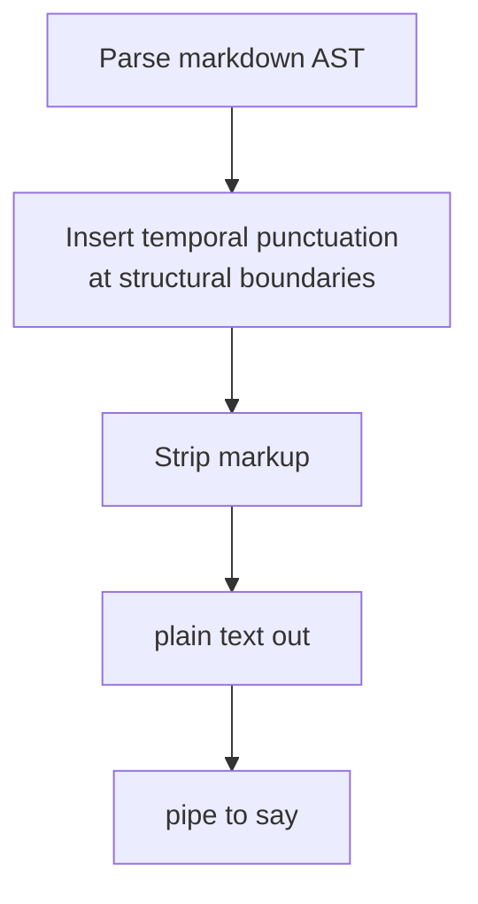

# Apple `say` TTS — temporal prosody for portable text

**Date:** 2026-09-09
**Kind:** reference / pipeline specification
**Serves:** the temporal-punctuation extractor (`BRF-TTS-TEMPORAL`), which
transforms markdown into plain text that any TTS engine reads with natural
prosody — pauses where a human reader would pause, no visual artefacts in
the audio, no audio artefacts in the visual.

---

## The pipeline

If you're piping raw Markdown into `say`, the engine chokes on syntax
symbols (`#`, `*`, `` ` ``), flattens cadence, and turns bullet lists into
run-on sentences. The fix is a 3-stage pipeline:



The output is plain text. `say` is the first consumer, not a dependency —
the same text pipes to `espeak`, `festival`, `flite`, `spd-say`, or any
engine that reads plain text. The commas are the portable prosody
protocol; the engine is the sink.

## The boundary vocabulary

Markdown structural elements map to temporal punctuation (commas =
silence, spaces = letter segmentation). The mapping is a lookup table,
not code — it is data, tuned by ear (see `BRF-TTS-TEMPORAL`).

Starting values, dogfooded against this document (2026-09-09):

| Markdown element | Temporal punctuation | Why |
| --- | --- | --- |
| Heading end (any level) | `,,,,,,` (6 commas) | Section boundary; the listener registers a new section. |
| List-item start | `,` (1 comma) | Prosodic boundary between items. |
| Bold label end | `,,,,` (4 commas) | Boundary between "what this is" and "what it does" — subject to predicate. |
| List-item end (before next) | `,,,,,,` (6 commas) | Structural boundary between items, heavier than intra-item. |
| Paragraph break | `,,` (2 commas) | New thought within a section. |
| Code fence start/end | `,,` (2 commas) | Structural shift into/out of a block. |
| Mermaid linear flowchart node | `,` (1 comma) | Labels are the content; arrows are the inter-item commas; boxes are visual-only. Same prosody as a list item. |
| Table row break | `,` (1 comma) | Row boundary. |

### Acronym segmentation (orthogonal axis)

Not silence (how long to pause) but segmentation (how to chunk text for
pronunciation). `say` and every TTS engine pronounces spaced letters
individually:

| Markdown element | Segmentation | Example |
| --- | --- | --- |
| Inline code / acronyms | Space between letters | `AIFF` → `A I F F` |
| CamelCase identifiers | Space + split | `parseAST` → `parse A S T` |
| Snake_case identifiers | Replace `_` with space | `foo_bar` → `foo bar` |

This is the universal version of the engine-specific "spell out" command.
Spaces work on every engine; the engine-specific syntax does not.

## Why not legacy speech tags

Apple's Speech Manager supports embedded control tags (`[[slnc 600]]`,
`[[pbas +5]]`, `[[volm +0.1]]`, `[[char LTRL]]`) — but only on *classic*
voices (Alex, Victoria, Fred). Modern neural and Siri voices drop or
vocalize the tags. See ADR-033 for the full decision.

The legacy tags are a voice-class-specific protocol. The punctuation
approach is a universal protocol — every voice class honors it, and every
Unix TTS engine does too. One protocol, one pipeline, every sink. The
legacy tags were considered and Foxtrot Oscar'd; see the ADR.

## What the legacy vocabulary had that punctuation can't replicate

Pitch (`[[pbas]]`), volume (`[[volm]]`), and exact millisecond timing
(`[[slnc 600]]`). These are real capabilities the comma approach is
coarser than — you can't lift pitch on a heading, you can't boost volume
on a bold label, you can't say "exactly 600ms" instead of "approximately
6 commas." This loss is accepted (ADR-033): per-element pitch/volume/rate
is out of scope; `say --rate` handles rate at the CLI level, not
per-element. If a future document needs pitch emphasis, that's a new
brief — and at that point the voice-class fork becomes a real decision,
not a premature one.

## Voice selection

`say -v <voice>` selects the voice. List available voices:

```bash
say -v '?'
```

Classic voices (Alex, Victoria, Fred) and neural voices (Siri, enhanced
variants) both honor the punctuation pipeline. The legacy tags were the
only voice-class-specific element, and they are removed.

## CLI pipeline (end-to-end)

The extractor emits plain text. The CLI invocation pipes it to `say`:

```bash
# Extractor → say (the simplest case)
okuda --tts doc.md | say

# Extractor → file → say (for inspection or replay)
okuda --tts doc.md > /tmp/doc.txt
say -f /tmp/doc.txt

# Extractor → say with rate adjustment
okuda --tts doc.md | say --rate 180
```

The extractor is the compositing layer (where the text comes from); `say`
is the sink (where the text goes). The CLI surface (`-v`, `--rate`, `-o`)
is `say`'s, not the extractor's. See `BRF-TTS-TEMPORAL` for the extractor
specification.

## Portability across Unix TTS engines

The extractor emits plain text with commas and spaces. Any TTS engine
that reads plain text will speak it with the same prosody:

```bash
# macOS
okuda --tts doc.md | say

# Linux (espeak-ng)
okuda --tts doc.md | espeak-ng

# Linux (festival)
okuda --tts doc.md | festival --tts

# Linux (Speech Dispatcher — wraps espeak, festival, pico, etc.)
okuda --tts doc.md | spd-say -e
```

The commas are the portable prosody protocol. The engine is the sink.
The CLI flags are the engine's surface, not the pipeline's content.

## Related

- `briefs/2026-09-09-brief-tts-temporal-punctuation.md` — the extractor
  specification (`BRF-TTS-TEMPORAL`), including the mermaid linear
  flowchart boundary and the branching deferral
- `decisions/033-punctuation-over-legacy-speech-tags.md` — the ADR
  recording the decision to Foxtrot Oscar the legacy tags
- `docs/2026-09-09-say-tts-tips-and-tricks.md` — the first dogfood
  document (manual comma markup, the prototype)
