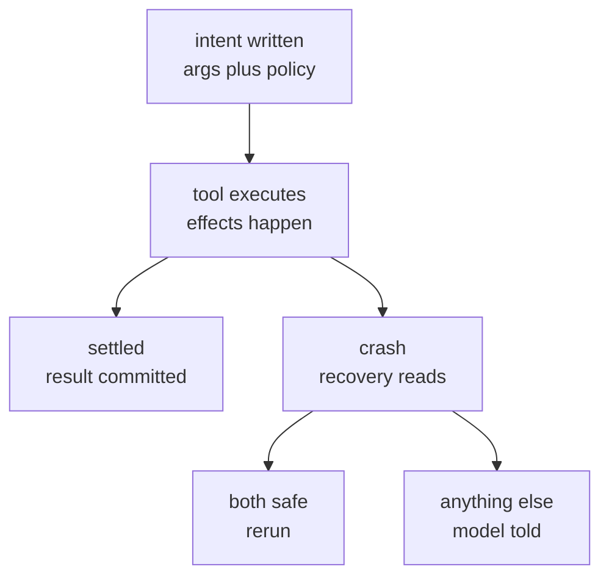

# Pi Durable: the instrument is bigger than what it certifies

> ◆ The conformance suite that certifies Pi Durable's storage backends is 1,583 lines
> against an 870-line largest backend — and the one thing the harness asks a tool author
> to promise has no instrument at all.

## What we are deciding

Whether Pi Durable is something okuda should learn from, track, or ignore — and whether
the framing that came with the link survives measurement.

Two claims arrived with it, and both are checkable against the source rather than argued:

- **It is a first attempt at a real-world agent.** Measured: yes, and the parts that make
  it real are not the model loop. They are the storage seam, the task graph, and the
  recovery rule.
- **The Pi team beat their products until only the robust parts remain.** Measured: yes,
  and the culture is legible in the file sizes rather than only in the design. Which is
  what makes the one gap interesting.

Everything below is measured against `earendil-works/pi` at `2003871`, cloned 2026-10-04.

## What it is, measured

Pi Durable is a harness, not a coding agent: storage plus the machinery to run many
conversations in parallel, each a durable object rather than a process. Three seams carry
the design — a storage interface, an execution environment, and a task graph in which every
model request, tool call and compaction is a task that checkpoints before it moves.

The post's numbers are close. The one place they are generous is worth naming:

| Measure | The post | The source |
|---------|----------|------------|
| durable src, no tests | about 15,000 lines | 17,716 / 61 files |
| minus testing tier | — | 15,644 |
| storage backends | 3,000 lines | 2,735 |
| vacation demo | about 1,300 | 1,325 (TUI 655) |
| examples | 30+ | 32, numbered |

`src/testing/` holds the conformance suite (1,583) and the benchmark (489). They are
instruments rather than runtime, so dropping them is defensible and it is what the phrase
"without tests" is doing — but the runtime is 17,716, and the honest headline is that one.

## The hardening, measured

This is where the framing turns into a number.

The storage tier ships a conformance suite — 17 named cases over 1,583 lines — plus a
489-line benchmark, and both live in `src/` rather than `test/`, because they are a product
for backend authors, not a test of the backends already written. The largest backend is
sqlite at 870 lines. **The instrument that certifies a backend is nearly twice the size of
the biggest thing it certifies.**

The examples are executable too: all 32 live under `test/examples/`, numbered `00` to `31`,
so the documentation is a test corpus with a reading order. And the two demo agents share a
byte-identical 655-line `tui.ts`, which makes "most of it the TUI" really "half of it is a
TUI neither demo wrote".

That is the culture the reader described, and it is not a vibe. It is that the
certification apparatus outgrew the thing certified.

## The promise with no instrument

Then the gap, and it is exact.

`replay: "safe"` is how a tool author opts into being rerun after a crash. The post
describes it as "reruns only if it declares replay: safe". The code is stricter than that,
and the strictness is the good part — `src/harness/tool.ts:98`:

```ts
if (replay === "safe" && tool?.replay === "safe") {
```

Both the stored intent and the currently resolved tool must say safe. The default written
before execution is `tool.replay ?? "unsafe"` (`src/harness/tool.ts:88`). And `tool?.` is
optional chaining: if the extension was replaced or removed during the crash, the tool does
not rerun. A tool that **gains** `safe` after the crash still will not rerun — the
declaration must be **stable across the crash**, not merely true at rerun. The post does not claim this,
and it should, because it is a better guarantee than the one advertised.

The crash path, with that branch as the only decision in it:



Now the asymmetry. `src/testing/` contains exactly two instruments, and both are for
storage. There is no tool-conformance, no replay suite, no fixture an author can run to
prove a declaration:

- **Storage** — 17-case conformance suite, 1,583 lines, shipped in `src/`. A new backend is
  certified by running it.
- **Tool replay safety** — a boolean. Checked by nothing. Declared by two tools.

The harness's own handling is well tested — 9 cases in `test/harness-tools-recovery.test.ts`,
39 across the three recovery files — but that is the harness's **rule** under test, not the
author's **promise**. And `replay: "safe"` appears **8 times in the whole repository**, in two
files, both under `src/experimental/` — `vacation/vacation.ts:44` and
`durable/subagent.ts:33`. The surface is tiny, unexercised and unverifiable, which is
exactly the shape in which a wrong declaration survives review.

The failure is silent and it points the expensive way: a wrong `safe` reruns a
non-idempotent effect. The post's own example is a payment charged once — by an idempotency
key that is the extension's job, not the harness's.

**This is not a defect in the code. The code is right.** It is a gap in the instrumentation,
and it is exactly the gap the framing predicts: the team hardens what it can measure, and a
promise is not yet measurable.

## The fork

**A — Borrow nothing; track it.** Pi Durable is a compositor under the three-concerns test:
it owns where the text comes from, which okuda assigns to the environment. No shared
surface, no shared code, no ADR. Read the Slack-bot and GitHub-triage examples when they
land, because those are the tools that will test the declaration in the world.

**B — Borrow the shape of the certification, not the design.** okuda's own external
dependency — `mermaid-to-md` on stdin and stdout — has a shim, a swallowed exit code and a
silent empty render. A storage backend in Pi Durable gets 17 cases and a benchmark; our one
external dependency gets a `command -v`. That asymmetry is worth copying, and it is
available without taking any of their code.

## What is not in question

- **The three-concerns boundary.** Nothing here touches it. Pi Durable composites, okuda
  renders, and the line holds — `docs/2026-08-20-origin-doc.md`.
- **The 15k figure.** 17,716 minus the 2,072-line testing tier is 15,644. "Without tests" is
  doing a little work, and it is the right work.
- **That the demos are real.** `subagent.ts` is 55 lines, so "a few lines of code" is
  literal, and the demos are built from shipped primitives rather than private scaffolding.
- **That the memo discipline is careful.** Hooks may re-run after a crash, so a decision is
  stored with the first write winning — `src/harness/scheduler.ts:1098-1113`. The guard is
  not the interesting part; `:1271-1274` is, where memo names are read with `Object.hasOwn`
  so a name like `toString` cannot resolve to an inherited property. Same culture as the
  conformance suite, in four lines.

## Where I would land

**B, narrowly, and A otherwise.** Take the discipline — an instrument a third party runs —
and leave the architecture. The architecture is a compositor's answer to a compositor's
problem, and okuda does not have that problem. The habit is portable, and we are missing it
in exactly one place: the dependency we cannot render without.

Two things would change my mind about the criticism. If the Slack or GitHub tool examples
ship with a `replay: "safe"` declaration, the gap gets real teeth and this note should be
re-read. And if Earendil ships a way to **test** a declaration — even a fixture that fails a
tool claiming safe and unable to prove it — then the gap closes and this becomes a note
about a fixed defect rather than an open one.

I would also re-read "infinitely long conversations". The mechanism is real: bounded working
set, unbounded archive, compaction as a task like any other. But the honest version is that
the summarizer is lossy and the archive is searchable, and that is buried behind the
flourish in section 5 of the post.

## Evidence

All probes ran against `earendil-works/pi` at `2003871`, cloned shallow into `tmp/pi-probe/`.

- **Line counts** — `packages/durable/src` 17,716 over 61 files; `src/testing/storage-conformance.ts` 1,583 with 17 `createCase` entries; `src/testing/storage-benchmark.ts` 489; storage backends sqlite 870, jsonl 845, memory 810, sqlite/node 210.
- **Recovery coverage** — `test/harness-tools-recovery.test.ts` 9 cases over 405 lines; the three recovery files 39 cases over 1,551 lines.
- **Declaration surface** — `replay: "safe"` occurs 8 times repo-wide, in `src/experimental/vacation/vacation.ts:44` and `src/experimental/durable/subagent.ts:33`.
- **Demo identity** — `vacation/tui.ts` and `durable/tui.ts` share SHA1 `c5a31e8c61e02cc6bc667bfb064c7bdfbc71f134`, 655 lines each.
- **Two probes returned a silent zero before the third worked — and the first version of this bullet misattributed the cause.** Corrected 2026-10-05. It read: "`\|` is a literal in BSD basic regex rather than alternation". That is backwards. BSD grep handles `\|` as alternation; the failure is **toybox**. The agent's shell resolves `grep` to a toybox build behind the app's PATH shim — 23 brokered commands, `grep` among them — while a clean login shell resolves it to `/usr/bin/grep`, BSD grep 2.6.0-FreeBSD, GNU compatible. One fixture, the same patterns:
  - `it(\|describe(` — BSD **4**, toybox **0**.
  - `^\s*it\(` — both greps **error, exit 2**; BSD with `-E` **3**; toybox with `-E` **0, exit 1** — the silent zero, and reachable only under `-E`.
  - `it|describe` — both greps **0** without `-E`, **4** with it.
  - **So `-E` is not the fix.** It repaired `\s` on BSD and broke `\|`, which had worked without it. No flag combination is safe across the three engines.
  - **The reader and the agent do not run the same grep**, and that asymmetry rather than the dialect is the hazard: a pattern verified by hand in a terminal silently returns zero to the agent.
- **`rg` trades the dialect hole for a coverage hole.** Its default honours `.gitignore` and skips hidden paths: `rg --files .` lists **473** where `-uu` lists **33,932**, and a marker written only to `tmp/` returns **0** without `-uu` and **1** with it — and `tmp/` is gitignored and is where every probe in this silo lives. The Grep tool inherits that default: it missed the same marker from the repo root and found it when pointed at `tmp/` explicitly. **Explicit paths bypass the ignore rules; a root-level search applies them.**
- **The break-tag contrast.** A plain fence holding the break tag between two letters renders with the tag deleted and the surrounding space left behind — the `stripHtml` pass at `src/render.ts:594` through `:773`. The identical tag inside a `mermaid` fence reaches the diagram intact. **Mermaid fences are exempt from that pass**, which is why the diagrams in this silo work at all, and it makes the blanket "in every context" in the docs-note skill too broad.
- **Italics survive `--no-color`, and the house rule says they do not.** On a fixture carrying one bold and one italic: the colour path emits `38;2;223;162;26;1m` and `38;2;224;180;92;3m`, so the attribute rides **inside** the colour code and a count of bare `[1m`/`[3m` there reads **zero** for both. The colourless path emits `[1m` and `[3m` standalone — measured bold 2 (the heading plus the span) and italic 1, the authored one. So the mechanism in the rule is right and its conclusion is inverted: the attribute is inside the colour code, and it is re-emitted beside it when colour is dropped. **The earlier count was taken from the colour render and read as a claim about the colourless one** — the same shape as reading a total as a delta.
- **The citation gate, and why the References list is short.** `scanReferences` mints a vector for a code path only when it resolves on this filesystem (`src/vectors.ts:178-186`) and for a named document path only when it is written with its directory (`src/vectors.ts:197-203`). So `src/render.ts` earns a silcrow while `DEPENDENCIES.md` does not, and every `src/harness/...` citation here — a path in the Pi repository, not in this silo — earns none. That is correct behaviour and worth saying out loud, because a note about an external repository is the first document here whose main citations are unjumpable by design.

## Related

- `docs/2026-09-19-the-tag-the-renderer-eats.md` — the `stripHtml` defect and its measured reach
- `docs/2026-08-20-origin-doc.md` — the three concerns and the scope test
- `DEPENDENCIES.md` — the one external dependency, and what it has instead of a conformance suite
- `https://earendil.com/posts/pi-durable/` — the post under review, 2026-10-01
