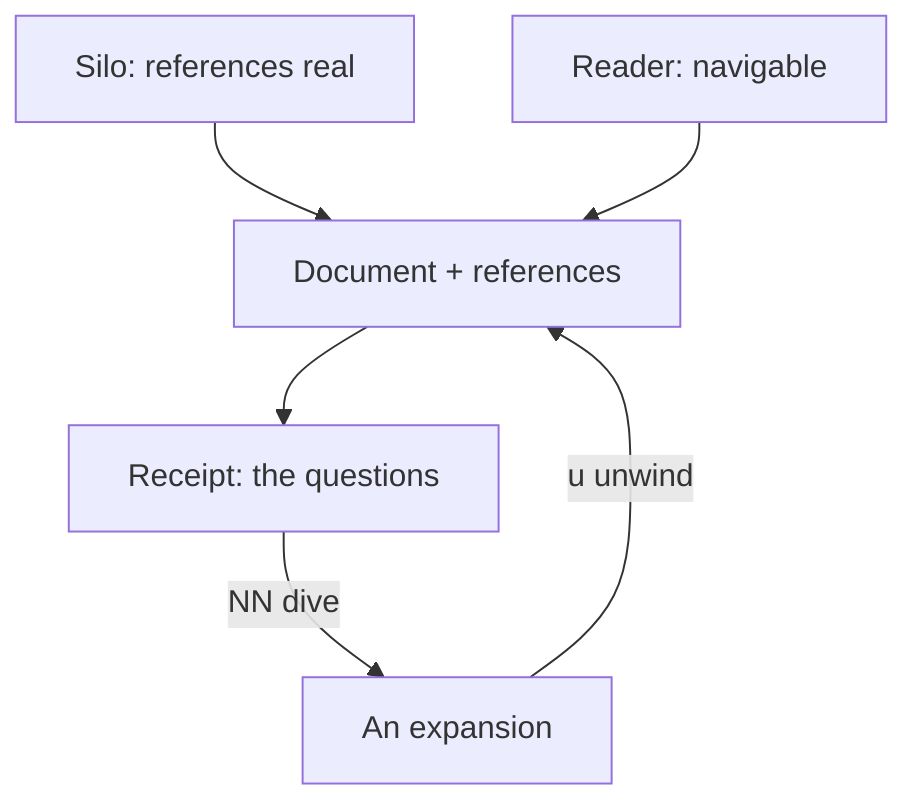

# The composed unit — and the questions at the end

> The silo makes the references **real**; the reader makes them **navigable**.
> Neither half is the point. **The document plus its references is the unit.**

## The composition

The silo supplies **reality**: a boundary inside which a reference resolves and a
claim can be checked — callsigns, citations, the census, the keep-class. The
reader supplies **legibility**: the jump map, the receipt, the backstack, the
identity header. Neither is sufficient alone. A real reference nobody can follow
is an archive; a navigable reference that resolves to nothing is a flash.

## The diagram

The two arrows into the unit are the whole argument, and the loop at the foot is
why it holds: the receipt is not a terminus. It is a re-entry point, and the
reader who presses a number is doing exactly what the map was for.

## The receipt is the question list

A talk ends with *any questions?* and the question is good **because the talk
happened** — the audience could not have asked it beforehand, having lacked the
structure. The receipt does the same job mechanically.

- **The body asks for elision.** Mid-argument there is no time to stop, so the
  reference is passed over and the argument continues.
- **The receipt returns it.** Every reference the body carried is re-listed at
  the foot, in reading order, at the one moment the reader is equipped to
  interrogate it.
- **So elision becomes safe.** Skipping is only honest if the skipped thing comes
  back. The receipt is the return path, which is what lets the map be read fast.

This is the section's reason to exist, past provenance and navigation: it is a
**deferred-intent surface**, and it is why the reader trusts the arguments they
skipped. It is also the last beat — a fermata before the reader leaves.

## The named failure — the receipt that omits

The value depends entirely on the receipt being **derived**, not curated. Measured
once (`decisions/047-references-section.md`): a polished hand-written section held
six of the nine references the map held, and the omissions were invisible because
the section read as complete. The generated receipt cannot omit at the author's
discretion; a hand list omits by omission.

The one crack left is the cap. Past eighty destinations the receipt stops, and it
stops *looking complete* — the older rows fall off, and the reader is not told.
The honest remedy is a boundary mark, the way `…` says where a cell stops, not a
warning that fires on every render of a growing page. Below the cap, the surface
is trustworthy; at the cap, the mark is the fix still owed.

## References

- **The map** — `&stack.md`
- **The unit of context** — `docs/2026-10-10-the-unit-of-context.md`
- **The References section** — `decisions/047-references-section.md`
- **The shared artifact** — `docs/2026-10-06-the-shared-artifact.md`
- **The silcrow, explained** — `docs/2026-09-04-the-silcrow.md`
