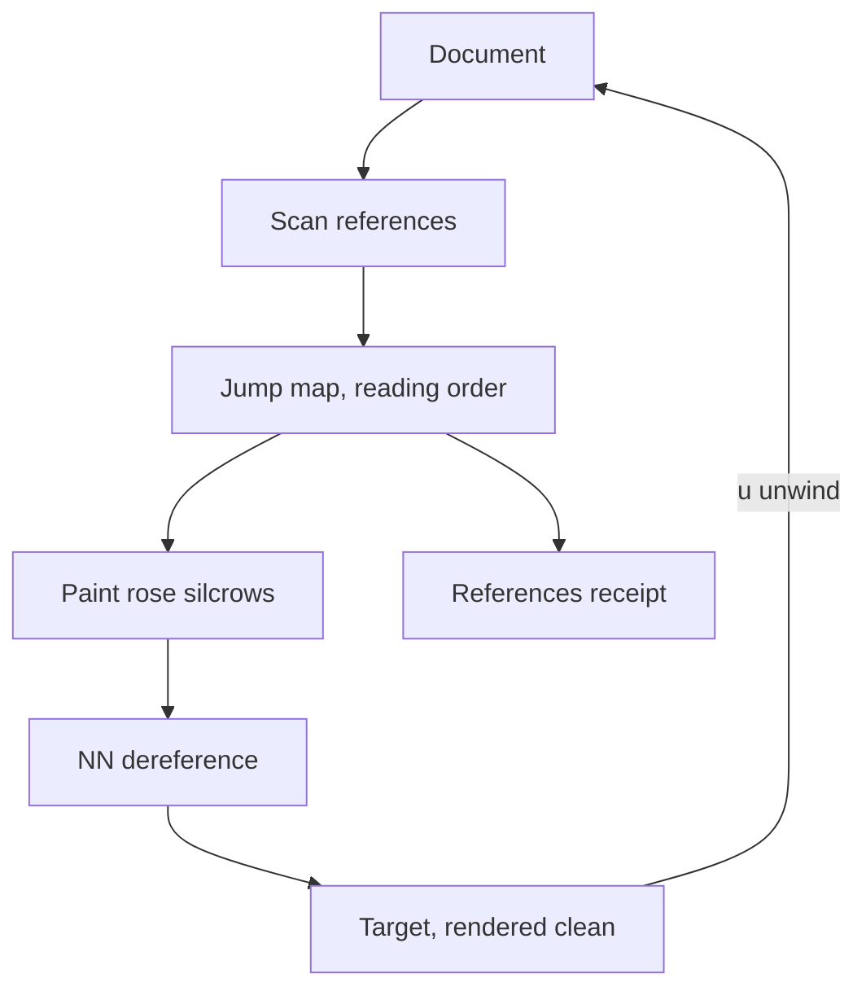

# The reader — making references navigable

> The silo is storage and the seam is transport; neither is reading. The reader
> is where a document stops being a file and becomes a map you hold.

## The shape that survived

**Browse → read → browse.** `fd` finds the markdown, `fzf` narrows it exactly,
okuda renders the selection, and quitting the reader returns the picker with the
query intact. No preview pane: it was a degraded read, a frozen top-slice, and
every failure of the launcher traced to embedding a document inside the picker.
The loop replaces the preview with the real one.

## The diagram — the jump map

The map is **derived, never authored**: the reference is the text, a callsign or a
local path in prose, and the numbers are assigned in reading order and deduped by
target. The reader presses a number and the target opens clean; `u` unwinds to
the annotated main document, `99` promotes the target to a fresh main document.

## Why it earns its place

A **hyperlink is a door** you walk through — the literature called the cost
*disorientation*, and its remedy was always a map. A **reference is a map you
hold**: text that resolves, that can be counted, cited, diffed, and seen in full
without leaving the document. Numbers are pointers and evaporate with the glass;
names are identities and survive it, so the trained eye reads the name and uses
the number.

## The named failure — the promise that flashes

The vectors paint only where the registry resolves them: a shape that looks like a
callsign but resolves to nothing (an acronym, a stale name) is a promise the
actuator cannot keep, and a painted vector that fails on press looks exactly like
a working one until you press it. Gate on the property, not the shape.

## References

- **The map** — `&stack.md`
- **The silcrow, explained** — `docs/2026-09-04-the-silcrow.md`
- **The References section** — `decisions/047-references-section.md`
- **The unit of context** — `docs/2026-10-10-the-unit-of-context.md`
- **The Gloam launcher** — `playbooks/gloam-launcher-playbook.md`
