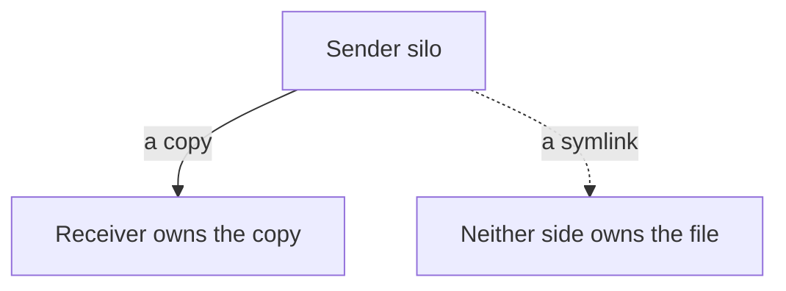

# The seam — the crossing, and how to make it

> **A silo's gates are exactly as wide as its boundary.** `just check` proves the
> silo and proves nothing about a file it wrote somewhere else. That is not a
> weakness of the gates; it is what a boundary *is*.

## What the silo buys, and where the seam leaks

Inside the boundary, three things hold for free: **context** (why this exists,
what it refuses), **attribution** (one authority per fact; a derived artefact
declares itself), and **verification** (gates as wide as the boundary). The seam
is the one place all three leak at once.

## The diagram

The solid edge is the rule, the dotted edge the anti-pattern. A **copy is a
message**: the receiver owns it, may adapt it, and can evolve without the sender.
A **symlink across a seam is shared memory**: the receiver depends on the sender's
path and state, and neither side owns the file. The defect is not that a copy can
drift from its source; the defect is a crossing that does not say so.

## The named failure — undeclared scope

> **Undeclared scope is the defect class — not non-blocking scope.**

A gate that states its limit is not a false signal; a gate that does not is. The
worked instance: a register whose stored hashes had drifted was reported as a gap
— and the gate's own header had already declared that check *informational in v1*.
The measurement was right and the verdict was wrong, which is the same shape as
the symlink: the pointer was never the problem, the **silence** was.

## The faff is the instrument

Outside a silo everyone is ignorant, and that is unavoidable — the boundary is
what makes each silo knowable at all. The failure is **unnamed** ignorance, and
its length is the measure: **the length of the negotiation measures how much of
the interface is undeclared.** A crossing with a written interface takes one
message; a crossing without one takes an afternoon. So *when the faff starts,
stop and declare something* — write a sentence into an artefact, do not open an
investigation.

## The test

For any crossing, can a stranger say — **from the artefacts alone** — what wrote
it, where it landed, and who must commit it? If not, the crossing is the defect,
whatever the pointer says.

## References

- **The map** — `&stack.md`
- **The seam, the rule** — `docs/2026-10-10-the-seam.md`
- **The impostor symlink** — `docs/2026-10-10-the-impostor-symlink.md`
- **No parallel stores** — `playbooks/registry-playbook.md`
- **Participants are actors** — `docs/2026-10-08-the-participants.md`
