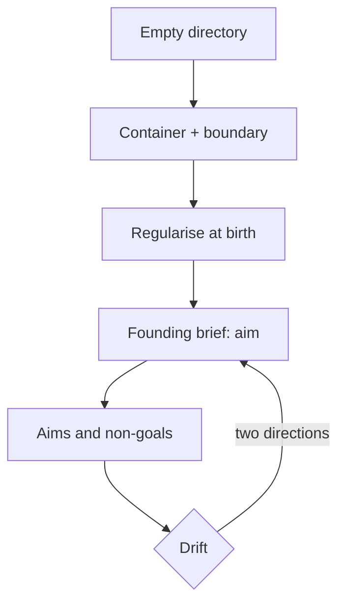

# The silo — the container that makes references real

> A reference resolves **within** a silo, so a stranger can follow it. A fresh
> participant reads the container and knows the project. That is the whole of the
> boundary's job, and it is two jobs at once: the unit of citation and the unit
> of context.

## The sequence

**container → regularise → founding brief.** Create the container early, while it
holds almost nothing, because a container built after the fact is a prune.
Regularise at birth — an index for every directory that accumulates, a dated name,
front matter, a gate that passes once — because retro-fitting an index to a pile
is editorial work, and the decisions (what is a refusal? what was built?) are far
cheaper at four documents than at four hundred. Then write the founding brief.

## The diagram

The two arrows back into the brief are the point. **Drift has two directions**,
and the second is quieter: failing to pursue what the project set out to do, and
pursuing what the project refused. A founding brief without non-goals can only
detect the first.

## Why it earns its place

Without a written aim, drift is invisible: the silo accumulates documents that
each look fine, and there is nothing to compare them against. With one, drift is
**checkable** — put the new work beside the founding brief and the difference is a
fact rather than a mood. The founding brief is the silo's **audit surface for
intent**.

## The named failure

**Aim drift** — the project-level form of **frame defaulting**: a substrate
answers the mean of *"a project like this"* because it cannot see *this* project's
aim, and the aim is the one frame that exists only in the container. The remedy is
a location, not an integration: move the participant inside the silo, where the
corpus is the context.

## The refinery rule

The honest counterweight: a silo-aware substrate inherits the silo's own mean and
produces documents that fit beautifully and add nothing. So the rule is not
*always inside*: **inside** for work that must align, **outside** for work that
must surprise, **regularise whatever comes back in.** The silo is a refinery, not
a fortress.

## References

- **The map** — `&stack.md`
- **Silo genesis** — `docs/2026-10-09-silo-genesis.md`
- **The founding brief** — `docs/2026-08-20-origin-doc.md`
- **Frame defaulting** — `docs/2026-10-08-frame-defaulting.md`
- **The shared artifact** — `docs/2026-10-06-the-shared-artifact.md`
