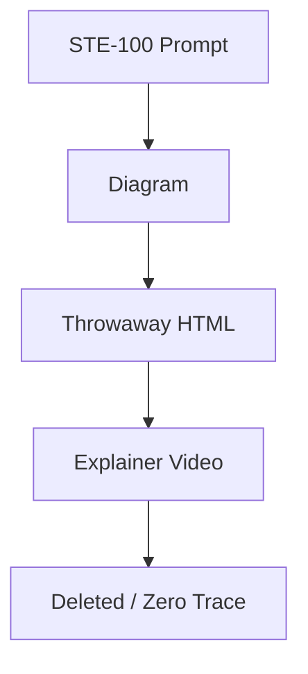
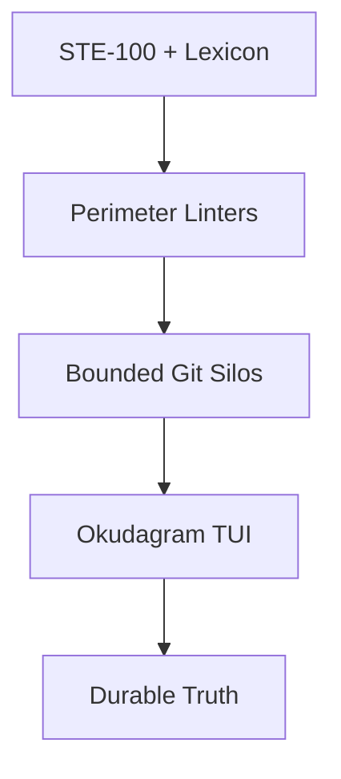
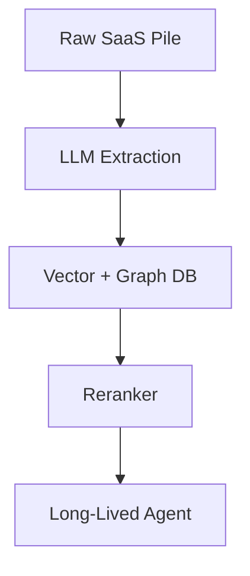
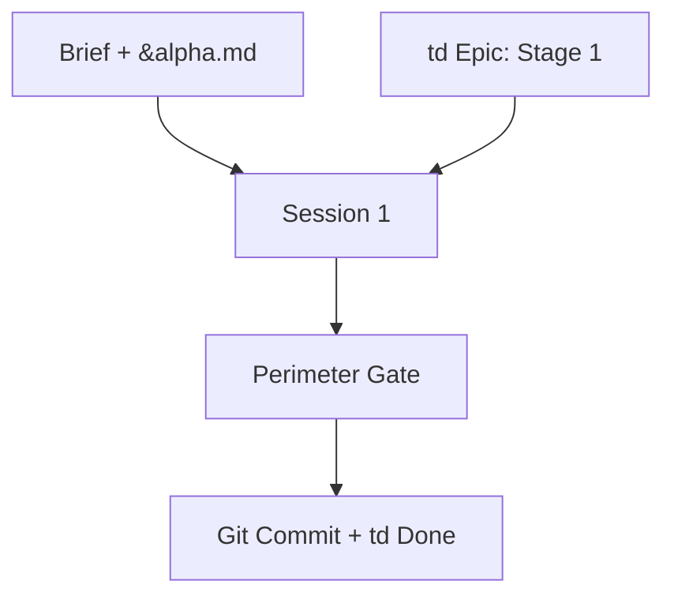
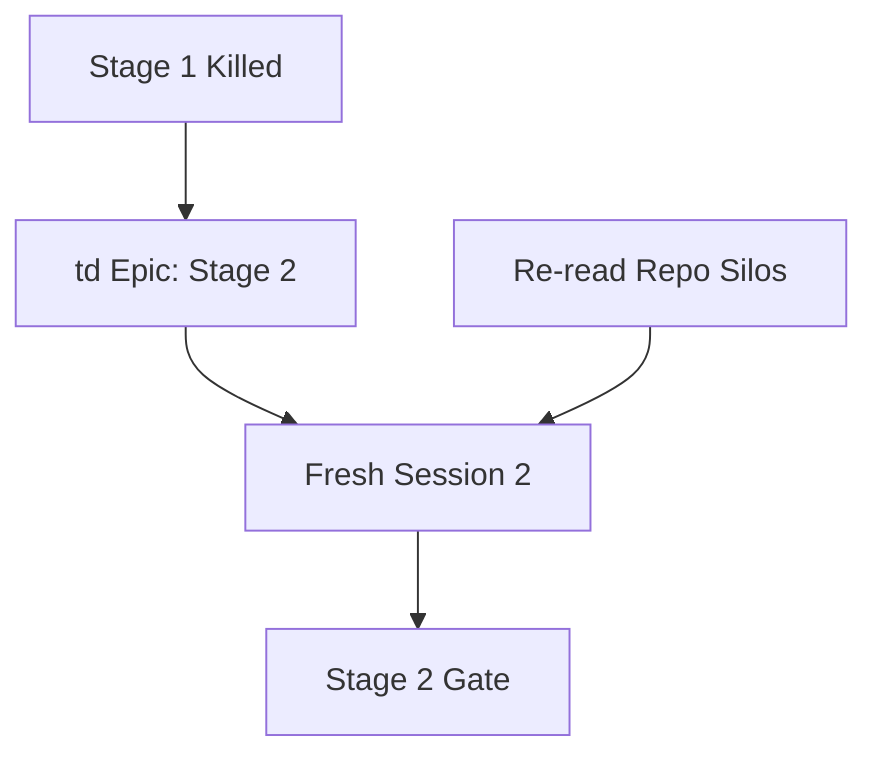
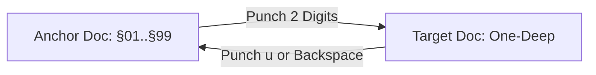

Here is the revised draft with all Mermaid diagrams broken down into **flat, single-layer `flowchart LR` / `flowchart TD` blocks** (no nested `subgraph` containers, no `sequenceDiagram` actors, no multi-line node labels, and no `&` edge fan-ins)—so your terminal `mermaid-to-md` renderer can parse and lay them out cleanly within the width cap.

---

# The Outcrop and the Orifice: A Field Review of Karpathy’s ASD-STE100 Ladder

On October 1, 2026, Andrej Karpathy posted a short field note on X that immediately rippled through the engineering ecosystem:

> *"We’ll be spending a lot more time trying to understand the outputs of language models. A few thoughts, tips & tricks:*
> * **Writing:** *Ask your LLM to explain something in **ASD-STE100**, it’s a controlled language specification originally developed for aerospace maintenance documentation... Sometimes I’ve tried to soften it a bit e.g. ask for '80% of the way to ASD-STE100' because the spec is quite stringent.*
> * **But even better: Diagrams / images.** *Instead of writing, ask your LLM to create a diagram.*
> * **But even better: Web pages.** *Ask for output 'in HTML' to get a beautiful, interactive webpage.*
> * **But even better: Explainer videos.** *The output format I am most bullish on is fully custom / bespoke explainer videos generated on any arbitrary topic (e.g., 3b1b style + ElevenLabs narration)."*
> 
> 

In the geological sciences, there is a time-honoured tradition when reviewing a colleague’s field paper: you begin by tipping your hat to their mapping skill—they walked the ridge, they hammered the right outcrop, and their strike-and-dip measurements are impeccable—before gently pointing out that they have the stratigraphy completely upside down.

Karpathy’s field mapping here is first-rate. He has identified the exact fault line of 2026 software work: **our bottleneck is no longer generating tokens; it is comprehending and verifying what was generated.** And in reaching back to the late 1970s for **ASD-STE100** (Simplified Technical English), he struck pure gold. We arrived at the exact same aerospace standard two weeks earlier while building our own workspace (`docs/2026-09-18-simplified-technical-english.md`).

Where our interpretation diverges from Karpathy’s is what happens *after* step one.

Look at his "But even better" ladder: **ASD-STE100 $\rightarrow$ Diagrams $\rightarrow$ Ephemeral HTML Webpages $\rightarrow$ Bespoke Explainer Videos.**

Karpathy treats the comprehension bottleneck as a **pedagogical problem**—how a human student absorbs a one-off concept from an AI tutor—and climbs *up* an abstraction ladder toward richer, flashier, throwaway media.

In systems engineering, that is climbing in the wrong direction. If you want a workspace that humans and agents can actually trust over months of production work, you don't climb *up* from ASD-STE100 into ephemeral HTML toys and custom video renders. You drill **down** from ASD-STE100 into **permanent, linted, artefact-oriented repositories**.

---

### 1. The Outcrop Karpathy Mapped Perfectly: Synonym Drift Kills

Why does raw LLM prose feel so exhausting to review? Because models are trained like high-school essayists to avoid repeating words. A model will call a component an *engine* in paragraph one, a *motor* in paragraph two, and a *propulsion unit* in paragraph three.

In creative writing, that’s style. In aircraft maintenance—and systems architecture—**synonym drift is a bug.**

ASD-STE100 was created by the aerospace industry so maintenance crews worldwide could read procedures without fatal ambiguity:

* One word, one meaning: if a fastener is a *bolt*, it is called a *bolt* forever.
* Procedural sentences stay under 20 words and describe a single action.
* No throat-clearing, no decorative qualifiers, no polite fluff.

Karpathy proposes using this as a **prompting technique** ("explain this 80% of the way to ASD-STE100") so chat outputs read like workshop manuals.

That works brilliantly for a single chat turn. It fails the moment you try to run a real project across dozens of agent sessions, because **a prompt is a plea, not an invariant.** If you have to beg the model in every session not to invent synonyms, your architecture will still drift by Tuesday.

Instead of leaving ASD-STE100 in the prompt, we wired it into the **artefacts and the perimeter**:

* **The Conceptual Lexicon (`conceptual-lexicon.md`):** Every load-bearing noun in the repository (*silo*, *callsign*, *silcrow*, *seam*, *gate*) is defined once.

* **Mechanical Lexicon & Prose Linters (`lexicon-lint.ts`, `prose-check.ts`):** We don't ask the model for "80% STE-100" and hope for the best; we run deterministic scripts on `.githooks/pre-push`. If a document introduces unapproved terminology or violates structural rules, the gate rejects the commit.

---

### 2. Where the Stratigraphy Flips: Ephemeral Toys vs. Durable Artefacts

Look at steps 3 and 4 of Karpathy’s ladder: asking the LLM to generate single-use interactive HTML pages or custom 3Blue1Brown video explainers, watching them for ten seconds until the idea "clicks," and then deleting them.

**Karpathy’s Pedagogical Ladder (Climbing Up into Ephemera):**

**The Engineering Inversion (Drilling Down into Bedrock):**

If you are trying to intuit how a learning rate slider affects gradient descent, a throwaway HTML canvas is a neat party trick.

If you are building and maintaining software with AI agents, **ephemeral artifacts are a trap**:

1. **They leave zero provenance:** When an agent generates 500 lines of bespoke HTML/JS to "explain" a system behaviour and you delete it ten seconds later, nothing was deposited into the project's institutional record.
2. **The mechanism can lie:** An LLM-generated animation or interactive HTML slider is itself un-audited code. If the model hallucinated the physics loop inside your throwaway visualization, you just transferred a bug into your own mental model with high visual confidence.
3. **The next session starts from zero:** Because the artifact was discardable, the next agent session (or your colleague tomorrow morning) has to reconstruct the exact same understanding from scratch.

Meanwhile, the enterprise AI world makes the opposite mistake: seeing that chat outputs are ephemeral, they build massive **7-layer "AI Second Brain" database stacks**:

Both approaches are **agent-oriented**. Karpathy’s ladder builds disposable visual prosthetics for the human; the enterprise RAG stack builds elaborate database prosthetics for the agent.

Neither fixes **the artefact**.

---

### 3. The Artefact-Oriented Alternative: Bounded Silos and `marcus/td`

What happens if you take Karpathy’s ASD-STE100 insight seriously—not as a chat trick, but as the foundation of your entire repository?

You stop building database pipelines, and you stop generating throwaway HTML apps. Instead, you make the repository itself a **flight-deck checklist**:

* **The Filesystem is the Schema:** We separate documents into bounded silos based on how they age: `decisions/` (numbered, durable invariants), `briefs/` (date-prefixed active specs), `debriefs/` (honest execution traces), `advisories/` (ideas we evaluated and explicitly refused), and `.archive/` (completed briefs pruned out of the active working set).

* **Short-Running Agents over "Agent Memory":** We don't trust long-running agent sessions or opaque vector memory stores; long sessions rot. Instead, we manage every brief as an epic in **[`marcus/td`](https://github.com/marcus/td)** broken into clean stages.
* **Continuity by Re-Reading:** We design our workflow so we can **new-up a fresh agent session at the start of every stage**. The fresh session reads our deterministic root entrypoints (`&alpha.md`, `&briefs.md`, `&next.md`) and queries `td` to see the exact checkpoint of the job in flight. Both humans and agents use `td` as the single source of operational continuity.

**Stage 1 Execution (Fresh Session):**

**Stage 2 Handoff (Zero Context Carry-Over):**

---

### 4. One Durable Instrument Beats a Thousand Throwaway Webpages

Karpathy is right that walls of unconstrained text are low-bandwidth and that spatial layout and diagrams matter. Where we part ways is *how* that visual hierarchy should be delivered.

Instead of asking an LLM to hallucinate a new Tailwind/HTML micro-app every time we want to inspect our system, we built **one durable, keyboard-driven terminal instrument**—inspired by Star Trek *Okudagrams*—that renders our Markdown silos, tables, and Mermaid diagrams with zero web-stack bloat.

> **[IMAGE PLACEHOLDER: Screenshot 1 — The Okudagram Terminal Control Surface]**
> Caption: The durable terminal viewer rendering a repository document: high-contrast Okudagram chrome, deterministic callsign header, hard-wrapped STE-inspired prose, and render-time injected two-digit silcrows (`§01`, `§02`).
> 
> 

Because our unit of context is the **document** (not the chunked paragraph), our navigation model is built for speed and focus:

* **Render-Time Silcrows (`§`):** We don't clutter raw files with web URLs or maintain an external graph database. When a document references another decision or brief, the renderer dynamically injects a two-digit silcrow token (`§01`..`§99`).

* **Two Keystrokes to De-Reference:** Punch the two digits and the referenced document opens immediately.
* **Strictly One-Deep:** The de-referenced document does *not* render its own outgoing silcrows. You verify the cited evidence without falling down a transitive wiki rabbit hole, then hit `u` or `Backspace` to return immediately to your anchor document.

> **[IMAGE PLACEHOLDER: Screenshot 2 — One-Deep De-Referenced Artefact]**
> Caption: Punching the two-digit silcrow opens the referenced decision one-deep. Outgoing links are suppressed to preserve reading focus; punching `u` or `Backspace` returns to the parent document.
> 
> 

And what about audio? Karpathy jumps to ElevenLabs voiceovers narrating custom video explainers. We took the aerospace cockpit route instead: deterministic terminal speech (`&ear.md`, `&speak.md`) governed by a strict spoken-block and punctuation grammar (`decisions/033-punctuation-over-legacy-speech-tags.md`). No cloud video rendering pipeline—just the terminal reading the artefact cleanly when your eyes are off the glass.

---

### The Verdict: Keep the Aerospace Standard, Ditch the Throwaway UI

Karpathy’s instinct to reach for **ASD-STE100** is the sharpest observation in AI workflow design this year. He correctly diagnosed that natural language is too loose for supervising autonomous machines, and that 1970s aerospace engineers already solved the ambiguity problem.

Just don't let the second half of his post lure you into trading durable engineering artefacts for disposable browser toys—or worse, into building a seven-layer enterprise RAG cathedral to index sloppy prose.

Take ASD-STE100 to its logical conclusion:

1. **Constrain the vocabulary** in a lexicon and enforce it with a linter on `git push`.

2. **Bound your silos** so active briefs, durable decisions, and archived history never mix.

3. **Run short-lived agents** against staged checkpoints in `marcus/td` instead of trusting long-running agent memory.
4. **Build one sharp instrument** to read your artefacts, rather than generating a thousand throwaway webpages.

The outcrop Karpathy found is real. Just follow the seam down into the bedrock instead of up into the clouds.