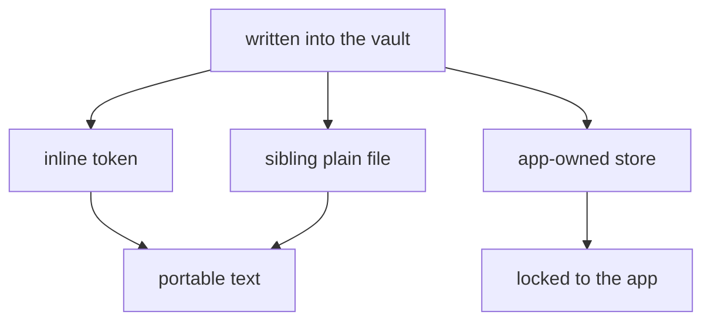

# Not worth the candle

> ◆ The extras cost nothing at the moment you adopt them and everything at the
> moment you leave. That deferral is the whole of their appeal: the bill arrives
> after the decision, which is why the extras look free.

## Method — the page is a claim, the binary is the instrument

The operator asked for an assessment of a marketing page. A page can only be
marked for consistency, so the binaries were run: `zn` extracted to a throwaway
directory, a vault created, a note captured, a comment written, the sidecar read,
a file renamed out from under it. One control, `glow`, run the same way —
installed, one file rendered, the directory listed before and after.

Everything below carrying a byte count, a path or a flag was observed in that
hour. Everything about consequence is a reading, and marked as one.

## The sighting

| | |
| --- | --- |
| **What** | ZenNotes CLI + TUI, v0.8.0. MIT. macOS (arm64/x86_64), Windows, Linux. 9.3–10.5 MB per platform — one static binary, no runtime. |
| **Substrate** | Markdown files in a folder, plus a hidden `.zennotes/` directory. Go. |
| **Concerns owned** | All three, deliberately. Rendering (Glamour), compositing (`zn capture` from any shell, an MCP server, a CLI that writes), windowing (`zn open -n` opens a second desktop window). |
| **Rendering** | Glamour — *"the renderer behind Glow"* (`README.md:605`) — with `zen` as a built-in alternative. Inline images via the Kitty graphics protocol; diagrams via a pure-Go Mermaid renderer, or `mmdc` for pictures. |
| **Accessibility posture, in its own words** | An **input** posture, stated and good: which-key, `Ctrl+G` palette, `F2` context actions, Vim motions *or* a plain editor. A **reading** posture — speech, tempo, a colour contract — appears neither on the page nor in `--help`; `NO_COLOR` and `--no-color` are honoured. An absence of statement is not a proven absence: no screen reader was run. |
| **Which of our exclusions it sells** | Themes, keymaps, export styles and a full workflow — but not the *presentation* surface. It is not competing for what `docs/2026-08-29-tfs-exclusion-principle.md` excludes. It is competing for the *terminal*, which is worse news. |

## The operator's thesis, tested

The claim: *the extras are not worth the candle, because you can only use
ZenNotes to get them, so your notes are not your notes.*

**Right in consequence, overstated in mechanism.** The bytes travel. Verified
three ways:

- A captured note is plain markdown with frontmatter — `zn capture` wrote
  `probe note.md` and nothing else.
- Task state is **inline**: a checkbox carries `@status:` on its own line, or
  inherits its note's `status:` from frontmatter (`README.md:248,269`). Nothing
  is hidden in a database.
- A `.base` database is a **folder whose rows are markdown record pages**
  (`zn base add --page`), and a loose `.csv` converts into one.

So the files leave with you. What does not leave is the **reading**. `@status:`
is a grammar; the board, the calendar, the saved filter and the comment thread
are renderings that exactly one program performs. The markdown is a free gift;
the semantics is the part that is not yours.

◆ An *interpretive* hostage rather than a data hostage — the milder crime with
the higher price, because nothing looks taken.

## The test — what the tool writes

The useful question about any tool that touches a vault is not *what can it
display* but *what did it put in my files, and does a second program read it?*
That is the **footprint**, and it tiers cleanly:

| Tier | Where the truth lives | In `zn` | Survives the app? |
| --- | --- | --- | --- |
| 1 | inline in the markdown | `@status:`, `status:`, `tags:` | ✓ as text; ✓ as meaning *if* a second reader knows the grammar |
| 2 | a sibling plain file | `.base` folders (rows are `.md`), loose `.csv` | ✓ — a folder of markdown is a folder of markdown |
| 3 | a store the app owns | `.zennotes/comments/<note>.comments.json`, saved filters, session, keymaps | ✗ |

ZenNotes is more disciplined here than its feature list suggests: nearly all of
it is tier 1. The failures are few, and they are real.

## What the probe found that the page does not say

- ✗ **Comments are a parallel store, keyed by filename, and they orphan
  silently.** Reproduced: `comment add` wrote
  `.zennotes/comments/probe note.md.comments.json`; `mv "probe note.md"
  "renamed note.md"` — an ordinary rename, a git operation, anything that is not
  `zn rename` — and `zn comment list "renamed note.md"` answered *"No open
  comments"* while the sidecar sat stranded on disk. The house test for the
  defect class is *can it be deleted and regenerated from the silo?*
  (`playbooks/registry-playbook.md:139-153`). A comment thread cannot: it is a
  shadow store by definition, and the association dies on a rename without a
  warning.
- ⋮ **72 commands, and about half of them are the notes.** Roughly 38 read or
  write note-side (notes, search, folders, tags, tasks, comments, databases,
  capture); about 31 are ecosystem (vault ×10, server ×11, config, status,
  doctor, update, completion, open, tui, mcp). That split is honest for a
  platform and expensive for a tool: the ontology leaks into the global flags —
  `--vault`, `--server`, `--workspace-source`, `--token`, `--no-input` — because
  there are five ways to hold a vault and the CLI carries all of them.
- ✓ **The reversibility taxonomy is better than most.** `write` is labelled
  *"Destructive: prefer append"*; `trash` is reversible with `restore`;
  `delete` demands `--yes`; `server update` retains a rollback. Somebody
  designed by *what can be undone*, which is the one habit worth stealing
  outright.
- ✓ **`zn task watch` reports; it does not execute.** *"zn only reports:
  whatever runs on a change is your own script, so nothing that executes lives
  in the vault"* (`README.md:274`). A supply-chain judgement made correctly,
  early, in one sentence — the opposite of the plugin model it imitates.
- ⋮ **Mermaid renders as text, *"through a pure-Go renderer"*** (`README.md:615`).
  That is okuda's differentiator, shipped as a bullet in somebody's feature list.

## The control — Glow

`glow` v3.0.0 was the operator's comparison, and it earns its place as a control
rather than a rival.

**The measure is legible.** `glow --help` fits on one screen: eight flags — `-p`
pager, `-t` tui, `-s` style, `-w` width, `-n` preserve newlines, `-l` line
numbers, `-a` all, `--config` — and three subcommands, every one of them
housekeeping (`completion`, `config`, `help`). It renders and stops. Render one
file in a throwaway directory and the directory still holds one file.

**It is not a fair fight, and that is the point.** Glow does less: no board, no
backlinks, no capture. So the comparison is not *better product* — it is a
different axis. The operator's claim is that **the number of jobs is itself a
cost**, and on that axis Glow wins uncontested: it charges nothing to leave, so
leaving is not a decision.

**And a caution for us.** okuda has the same zero footprint — verified, render a
file in an empty directory and only the file remains; `src/` contains no write
call — but for a *structural* reason, not a virtuous one. A viewer has nothing
to persist. The property is cheap for us and expensive for them, so it grades
the category, not the character. What transfers is the **test**, not the mark.

## Verdict

ZenNotes is a good product executed well: unusual reversibility discipline, a
correct refusal to execute what lives in the vault, a 10 MB static binary that
keeps its promise, and installation prose that names its own failure modes. As
an Obsidian-alternative for people who live in a terminal it is serious, and the
dialect is what makes it defensible — portable data, non-portable workflow, high
switching cost. The moat is not a flaw in the design. It *is* the design.

But the operator's judgement holds on the axis that matters for a vault you mean
to keep for ten years:

◆ **The candle is not the price of the extras. It is the price of leaving them,
and that price is invisible until it is large.**

A viewer can be swapped in an afternoon because it wrote nothing. An application
charges a migration, and the migration is discovered a year in, when the
`@status:` tokens have accumulated into a board somebody depends on. The
deferral is not a trick and nobody hides it. It is simply that the bill and the
decision never appear on the same page.

## The counter-argument owed

A review without a steelman is a preference with a table. So: **conventions are
how plain text acquires structure.** `todo.txt`, iCalendar, the Tasks plugin's
inline emoji, `@status:` — each is a grammar written *in the file*, and a grammar
in a file is portable precisely because anyone willing to read the spec can read
it. A second tool could learn `@status:` in a morning.

That qualifies the operator's thesis without overturning it, because it splits
the complaint into three different things:

- The **tokens** are a dialect — lossy for a foreign reader, but legible, and
  repairable by publishing the grammar. Not a defect.
- The **views** — board, calendar, saved filter — are not in the file at all, and
  no diligence by a third party recovers them.
- The **comments** are worse than not-in-the-file: they sit *beside* it, under a
  filename key, and a rename destroys the association in silence.

One principle failure, one interpretive hold the operator predicted, and one
matter of taste — whether you want a board at all, and if you do, no viewer will
give you one.

## What okuda takes

- **The footprint contract.** Before stating what a tool can do, state what it
  writes. A viewer's whole advantage is that the line is empty, and one sentence
  in the README would let a reader compare on the same axis as the capability
  list. *Proposal* — not yet written.
- **Two habits worth stealing.** The reversibility taxonomy (label the
  destructive verb, make the soft delete reversible), and *report, do not
  execute*.
- **The uncomfortable one.** If a competitor ships Mermaid-as-text and Glamour
  for everything else, then okuda's case cannot rest on what it renders
  *instead of* other tools. It rests on rendering *quality* — the width frame,
  the measured geometry, the palette, the tempo. That was always the claim
  (`docs/2026-08-25-what-it-feels-like.md`); this is the first sighting that
  makes it a requirement rather than a preference.

## Out of scope

- The desktop app (2.70.0, `.sparks/ZenNotes-2.70.0-mac-arm64.dmg`) — not
  installed, not assessed.
- Server mode: the eleven `zn server` commands and the self-hosted sync path were
  read, not exercised.
- One version, one platform. v0.8.0 on darwin/arm64 only; the Windows and Linux
  notes are read from the page, not observed.
- Accessibility: no screen reader run, no timing measured. The *absence of a
  stated* reading posture is recorded; nothing is claimed about behaviour.

## Related

- `docs/2026-10-08-prior-art-the-ai-markdown-wave.md` — the register; entry 4 is
  this sighting condensed to its five rows
- `AGENTS.md` — the three concerns, three owners
- `docs/2026-08-29-tfs-exclusion-principle.md` — the exclusions being tested
- `playbooks/registry-playbook.md:139-153` — no parallel stores, and the cache /
  shadow-store test
- `docs/2026-10-06-the-shared-artifact.md` — why the artifact must be checkable
