# test diagrams

[Ref](https://medium.com/@yugenelee/your-markdown-diagrams-could-look-like-this-12-mermaid-tricks-worth-copying-bd7eac85e1dd)

## Reserch Diagram

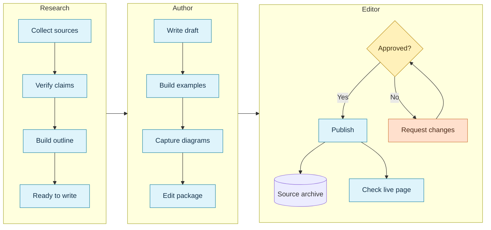

## Clients Diagram

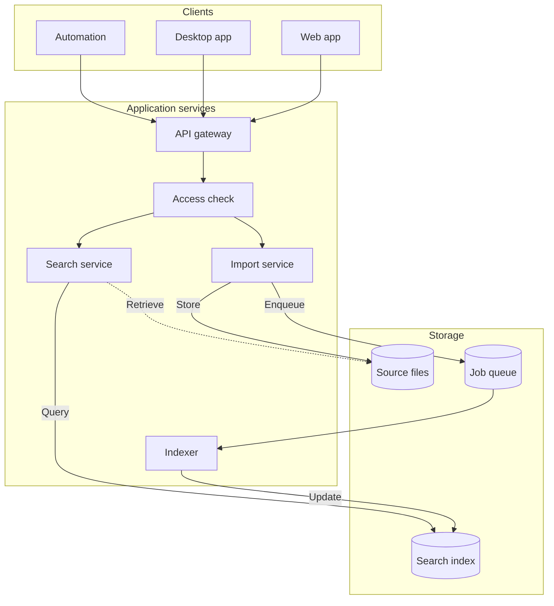

## Release Pipeline

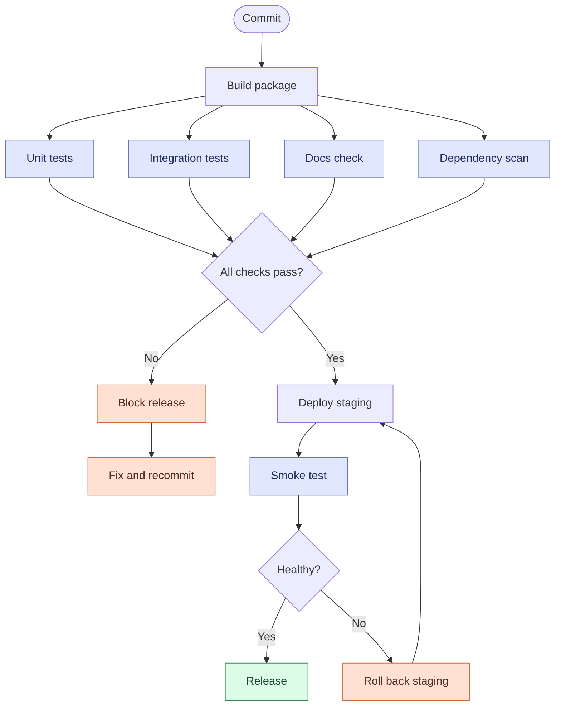

## Sequence Diagram

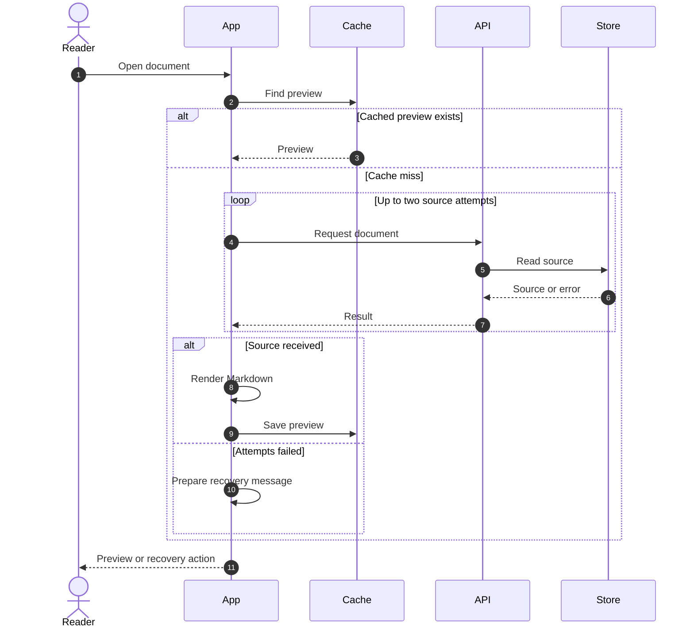

## CSV Processing FLow

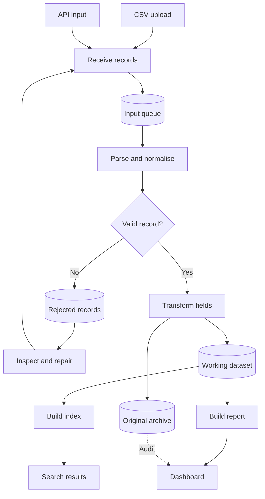

## Request Processing

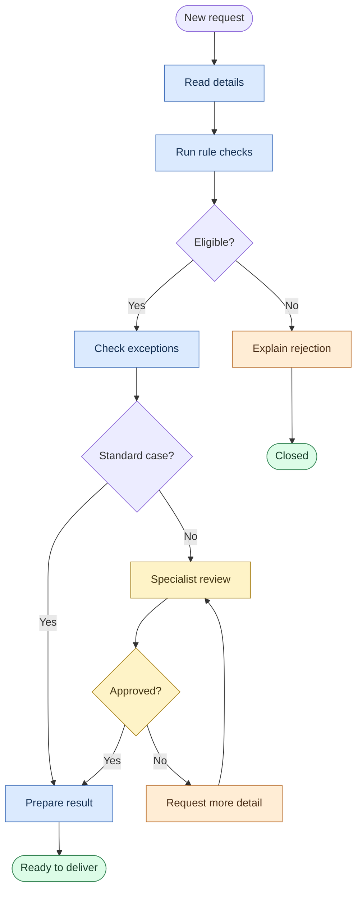

## Gateway Processing

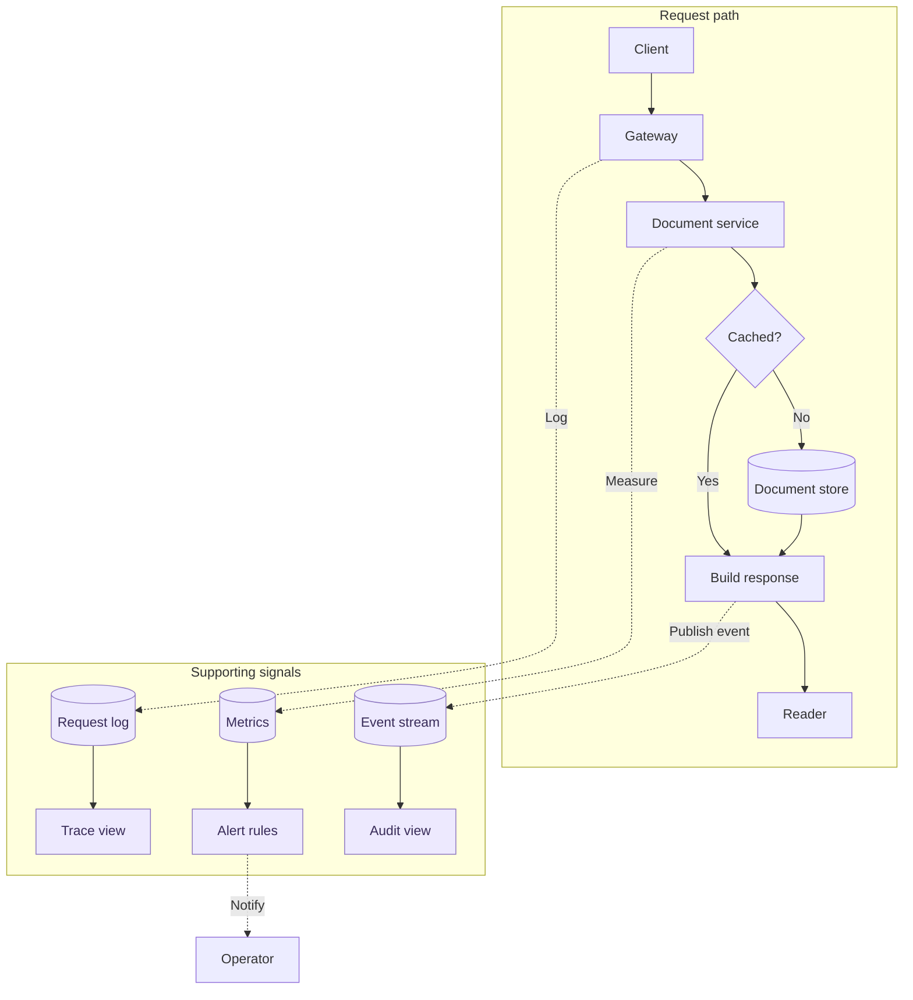

## State Diagram V2

- What is the `stateDiagram-v2` diagram type?

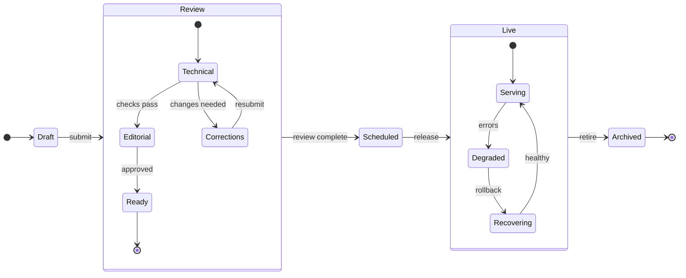

## ER Diagram

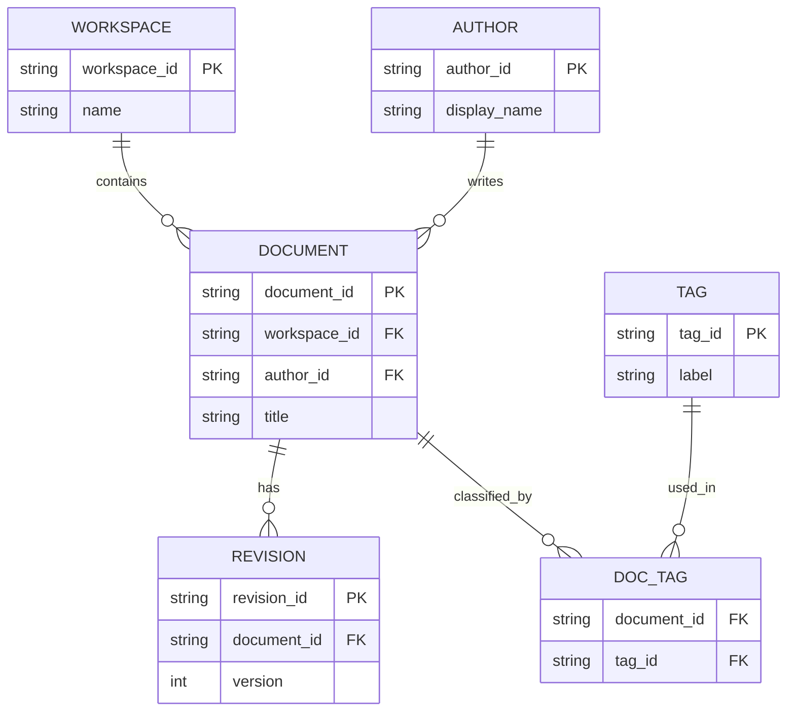

## Markdown Process

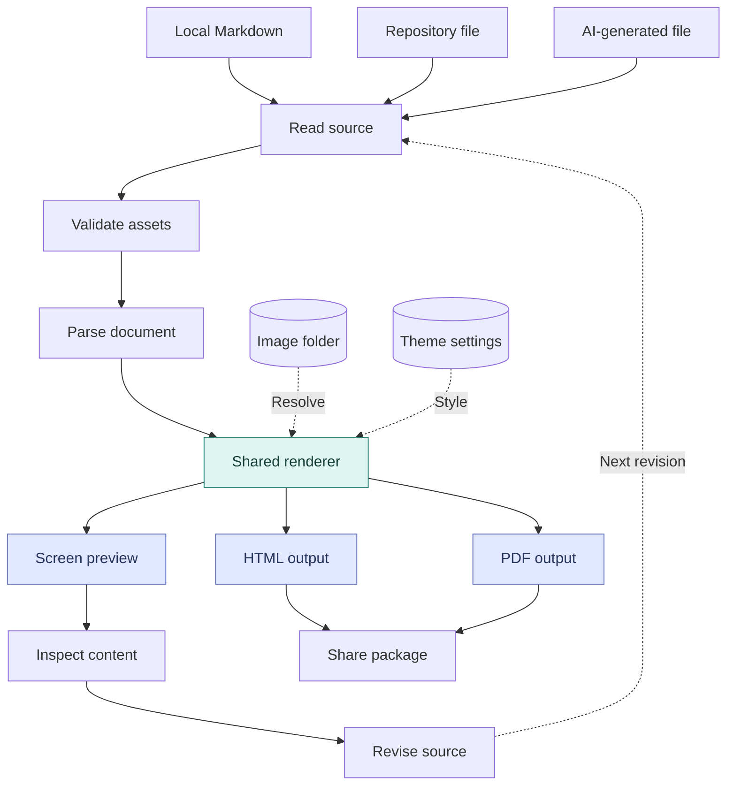

## Mind Map (unsupported)

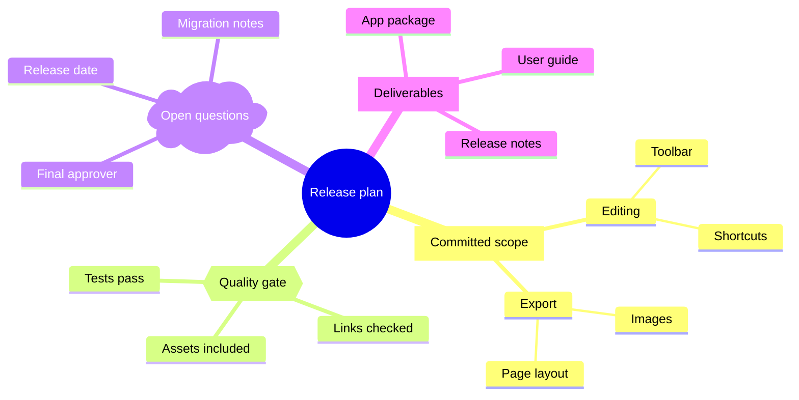

## Documentation Release Plan (unsupported)

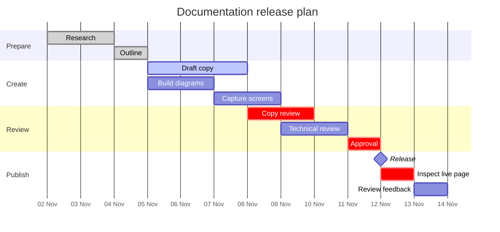

