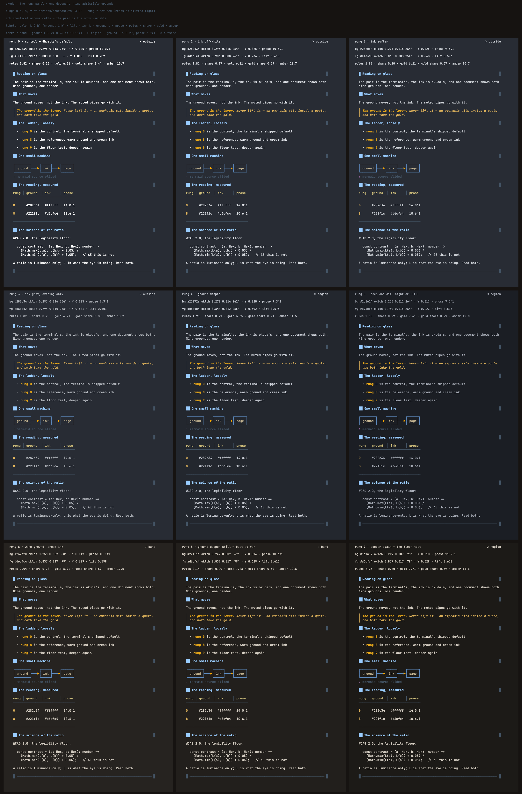
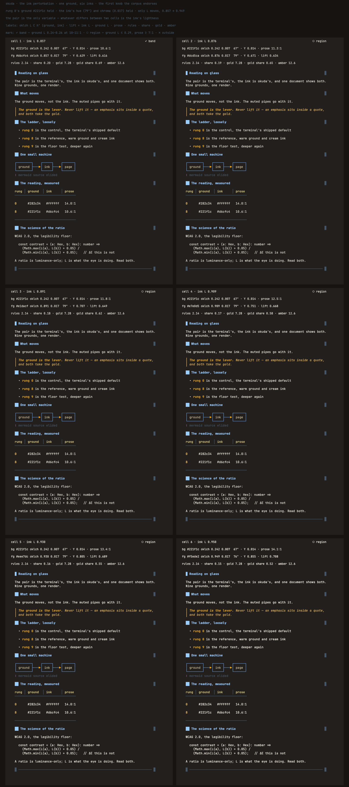

# The rung panel — one document, nine grounds

**Created:** 2026-11-15
**Contract:** [`briefs/2026-11-15-brief-rung-panel.md`](../briefs/2026-11-15-brief-rung-panel.md) (BRF-RUNG-PANEL)
**Derived from:** `scripts/contrast.ts` `PAIRS` by `scripts/surface-panel.ts` — the script is the source, the PNG is derived (`just`-less: `bun scripts/surface-panel.ts`)
**Companion:** [`docs/2026-10-28-the-ground-you-read-on.md`](2026-10-28-the-ground-you-read-on.md) — the arithmetic; this page is the eyeball on it.
**Checked by:** `tests/rung-panel.test.ts` — every measurement below is the instrument's rendering, and the PNG's label strips call the same function. Neither can drift from `rows()` without failing.

The same specimen — heading, ladder, loose list, diagram, table, and the
contrast function — rendered **once** by okuda (the ink is absolute; the pair
is the terminal's default fg/bg) and painted onto each of the nine admissible
grounds. **Rung 7 is refused and excluded** ("reads as emitted light"). The
pair is the only variable: whatever differs between two cells is the pair.

## How the grid is laid

Row-major, ladder order:

| row | rungs | what the row holds |
|---|---|---|
| top | 0, 1, 2 | the control ground, the ink ladder — separation falls, light does not |
| middle | 3, 4, 5 | the evening ink (3), then the cool grounds deepen (4, 5) |
| bottom | 6, 8, 9 | the warm walk — ground deepens at held ink, contrast *rises* |

## The axes, measured

Every cell's label carries these, and so does the list below: the pair's
**OKLCH** on both sides, the **lift** between them, and the four ratios the
arithmetic already had.

- **oklch** `L C h°` — `L` is perceptual lightness, `C` chroma, `h` the hue
  angle. An achromatic colour prints `—` for hue, because white's angle is
  arithmetic noise and a number with no referent reads as meaning something.
- **lift** — ink `L` − ground `L`. The ratio conflates separation with the
  pair's absolute light; `lift` is the separation alone, and it is the axis the
  eye actually resolves.
- **prose** — ink:ground contrast (WCAG), the legibility floor.
- **rules** — the `muted` role against the ground (the pipes and table rules).
- **share** — rules ÷ prose; above 1.00 a rule out-shouts what it divides.
- **amber** — `state-todo` against the ground, the early-warning channel (below).

- **0 · control — Ghostty's default** — ✗ outside
  - bg #282c34 oklch 0.293 0.016 264° · Y 0.025 · prose 14.0:1
  - fg #ffffff oklch 1.000 0.000   — · Y 1.000 · lift 0.707
  - rules 1.82 · share 0.13 · gold 6.21 · gold share 0.44 · amber 10.7

- **1 · ink off-white** — ✗ outside
  - bg #282c34 oklch 0.293 0.016 264° · Y 0.025 · prose 10.5:1
  - fg #dcdfe4 oklch 0.903 0.008 261° · Y 0.736 · lift 0.610
  - rules 1.82 · share 0.17 · gold 6.21 · gold share 0.59 · amber 10.7

- **2 · ink softer** — ✗ outside
  - bg #282c34 oklch 0.293 0.016 264° · Y 0.025 · prose 9.3:1
  - fg #cfd3d8 oklch 0.865 0.008 254° · Y 0.648 · lift 0.573
  - rules 1.82 · share 0.20 · gold 6.21 · gold share 0.67 · amber 10.7

- **3 · ink grey, evening only** — ✗ outside
  - bg #282c34 oklch 0.293 0.016 264° · Y 0.025 · prose 7.3:1
  - fg #b8bcc2 oklch 0.794 0.010 258° · Y 0.501 · lift 0.501
  - rules 1.82 · share 0.25 · gold 6.21 · gold share 0.85 · amber 10.7

- **4 · ground deeper** — ○ region
  - bg #23272e oklch 0.272 0.014 262° · Y 0.020 · prose 9.3:1
  - fg #c8ccd4 oklch 0.844 0.012 265° · Y 0.602 · lift 0.573
  - rules 1.95 · share 0.21 · gold 6.65 · gold share 0.71 · amber 11.5

- **5 · deep and dim, night or OLED** — ○ region
  - bg #1b1e24 oklch 0.235 0.012 264° · Y 0.013 · prose 7.5:1
  - fg #a9aeb8 oklch 0.750 0.015 264° · Y 0.422 · lift 0.515
  - rules 2.18 · share 0.29 · gold 7.41 · gold share 0.99 · amber 12.8

- **6 · warm ground, cream ink** — ✓ band
  - bg #262320 oklch 0.258 0.007  68° · Y 0.017 · prose 10.1:1
  - fg #d6cfc4 oklch 0.857 0.017  79° · Y 0.629 · lift 0.599
  - rules 2.04 · share 0.20 · gold 6.94 · gold share 0.69 · amber 12.0

- **8 · ground deeper still — best so far** — ✓ band
  - bg #221f1c oklch 0.242 0.007  67° · Y 0.014 · prose 10.6:1
  - fg #d6cfc4 oklch 0.857 0.017  79° · Y 0.629 · lift 0.616
  - rules 2.14 · share 0.20 · gold 7.28 · gold share 0.69 · amber 12.6

- **9 · deeper again — the floor test** — ○ region
  - bg #1c1a17 oklch 0.219 0.007  78° · Y 0.010 · prose 11.2:1
  - fg #d6cfc4 oklch 0.857 0.017  79° · Y 0.629 · lift 0.638
  - rules 2.26 · share 0.20 · gold 7.71 · gold share 0.69 · amber 13.3

## The ranges — where the band is

Four numbers, three of them on the ground. A rung stands in exactly one tier;
the tiers nest, but a rung is not counted twice.

- **✓ band** — ground L 0.24–0.26 **and** prose 10–11:1 · rungs **6, 8**
- **○ region** — ground L ≤ 0.29 **and** prose ≥ 7:1, kept but not comfortable · rungs **4, 5, 9**
- **✗ outside** — a ground above the ceiling or prose under the floor · rungs **0, 1, 2, 3**

Read it as **two guards and one interval**, and the guards are not the same
kind of thing:

- **The ceiling — ground L ≤ 0.29.** The only guard that has fired. Above it
  the ground is a lit rectangle competing with the room rather than an absence
  of light: the control (0.293) and rung 7 (0.347), rejected by the same reader
  for the same reason. This is the guard that catches, and it catches the
  *lifted* move — the one the eye finds intuitive and the arithmetic rewards.
- **The floor — prose ≥ 7:1.** Has never fired in this set. The nearest is
  rung 3 at 7.3:1, and it was rejected on its ground. Kept anyway, because it
  fires on a different mistake — a ground too light for the ink, an ink too dim
  for the ground — and it costs one comparison.
- **The band — ground L 0.24–0.26 at 10–11:1.** Narrow on purpose: 6 and 8, and
  nothing else. It is a *preference*, not a limit, and 4 and 5 sit outside it
  having been kept.
- **Ink L — a constant, not a range.** The reference holds 0.857. This set has
  one point at 0.750 (rung 5, "evening") and one at 1.000 (the control,
  "harsh"), so it can bound the ink from both sides but cannot give a band
  between them. That is a limit of the instrument, stated rather than papered
  over: a band needs several points at different ink values on one ground, and
  the ladder never varies ink at constant ground except in the top row, where
  it fails for a reason that is not the ink's lightness.

Which is the whole answer to *where are we happy*: **one interval, two guards,
and a setting.** The interval is a taste; the guards are not; the setting is a
decision that belongs to the palette, not to the walk.

## Reading the numbers — what each one is, and which way hurts

Each line is a comment on one field of the measurement, in the form *what it is
· the set's range · the direction that hurts*.

- **`oklch L`** — perceptual lightness. Grounds span 0.219–0.347, inks 0.750–1.000.
  Hurts **up** on the ground (glare, rung 7) and **down** on the ink (demotion,
  rungs 1–3). The comfort axis, and the only one that separates the verdicts.
- **`Y`** — physical luminance: the light the surface emits. Grounds 0.010–0.042,
  inks 0.422–1.000. Hurts **up**, and this is the number glare is a function of.
  Not monotone with `L` across a hue change: two grounds at one `L` can differ in
  emitted light by a third, which is why a hue perturbation has to be read on
  this column and not the one above.
- **`prose`** — the WCAG ratio: the legibility floor. 7.3–14.0 across the set.
  Hurts **down** past 7, and past 12 for the opposite reason — a ground that is
  merely darker keeps raising it, which is the U.
- **`lift`** — the ink's perceptual separation from its ground. 0.501–0.707, and
  0.515–0.638 among the rungs that were kept. Hurts **down**; the whole top row
  is what a falling lift looks like, and it was rejected as "too dim" before
  anyone measured it.
- **`rules`** — the structural ink (`muted`, h 249, a cool blue) against the ground.
  1.49–2.26. Hurts **down** below ~1.8 (the pipes vanish and the page loses its
  grid) and **up** past ~2.3 (the structure starts competing); the refused rung
  has the weakest at 1.49.
- **`share`** — rules ÷ prose: the hierarchy. 0.13–0.29. Hurts **at or above
  1.00**, where a divider is louder than the text it divides.
- **`gold`** and **`gold share`** — the bold/quote colour (`strong` #dfa21a)
  against the ground, and its share of the prose. 5.07–7.71, share 0.44–0.99.
  Hurts **up**: at 0.99 (rung 5) a bold lead is as loud as the paragraph beside
  it, and a lead that out-shouts its own body text is a heading, not a lead.
- **`amber`** — `state-todo` against the ground. 10.7–13.3. Hurts **up**: it
  crosses 13 only at rung 9, and the first reader's early-warning rule was
  written from that channel before the band existed.

Three of these are properties of the ground alone (`L`, `Y`, and the buried
`Y` inside `prose`); two are the ink's (`L`, `Y`); four are *relations* between a
role and the ground. The relations are what a page actually shows, but they move
together when the ground moves — only `L`/`Y` are levers.

## Where to perturb — the directions, before any are tried

Four knobs, and for each one the expected sign of every measure. A proposal, not
a reading: nothing here has been rendered yet.

- **Deepen the ground** (`L`↓, `Y`↓↓, hue held). prose↑, lift↑, rules↑, gold↑,
  share flat, amber↑↑. *Promising* — it is the move the reader liked four times —
  until `amber` passes 13, `L` passes 0.20, or prose passes 12. Rung 9 is the
  last admissible step, so the forces left are hue and chroma, not depth.
- **Warm the ground** (h 264 → 67, `L` held). `C` falls 0.016 → 0.007, `L` and
  `Y` barely move, `lift` unchanged. *Promising and unexplored*: both band members
  are warm, and warmth costs no guard. This is the cheapest untried direction.
- **Dim the ink** (`L`↓, `Y`↓↓, ground held). prose↓, lift↓, gold share↑↑ toward
  inversion. *Refused*, three times, and the arithmetic says why: it buys nothing
  the ground cannot buy and it spends the hierarchy to do it.
- **Raise the ink** (`L` 0.857 → 0.894, ground held). `Y_fg`↑ (0.629 → ~0.71),
  lift↑, gold share↓. *Open*: it is the one number where the two corpora
  disagree — Gruvbox ships an ink at `L` 0.894 where okuda holds 0.857 — and it
  trades separation for emitted light, which is the halation question this set
  cannot answer.

One knob is not on the list because it is not the pair's: `muted`'s hue (249°,
blue, against a warm walk). It is the last variable the palette still has, and
the companion page parks it here deliberately — decide it at the ground you
settle on, not before.

## The first perturbation, run — the ink raised

The direction the corpus endorsed, taken: rung 8's ground `#221f1c` held, the
ink's hue (79°) and chroma (0.017) held, only `L` moved. Six inks, one variable,
which is what makes each column readable as a cause rather than a coincidence.

Columns: **ink asked** the OKLCH `L` requested · **hex** what sRGB could paint ·
**Y_fg** the light the ink emits · **prose** WCAG ratio · **lift** · **gold** and
**gold share** · **ours** the tier.

Hue and chroma are held **in the request, not exactly in the artefact**: at
`C` 0.017 a single 8-bit step is worth up to 3.2° of hue, so the sixth row's ink
is 76° where 79° was asked. `fromOklch` reports the achieved triple and
`just contrast --perturb` prints the drift — the hex is the referent, the request
is the intent.

| ink asked | hex | Y_fg | prose | lift | gold | gold share | ours |
|---|---|---|---|---|---|---|---|
| 0.857 | #d6cfc4 | 0.629 | 10.6:1 | 0.616 | 7.28 | 0.69 | ✓ band |
| 0.876 | #dcd5ca | 0.671 | 11.3:1 | 0.634 | 7.28 | 0.65 | ○ region |
| 0.891 | #e1dacf | 0.707 | 11.8:1 | 0.649 | 7.28 | 0.62 | ○ region |
| 0.909 | #e7e0d5 | 0.751 | 12.5:1 | 0.668 | 7.28 | 0.58 | ○ region |
| 0.930 | #eee7dc | 0.805 | 13.4:1 | 0.689 | 7.28 | 0.55 | ○ region |
| 0.950 | #f5ede2 | 0.855 | 14.1:1 | 0.708 | 7.28 | 0.52 | ○ region |

**Two columns move and one is measured against the wrong thing.**

- **The hierarchy improves, monotonically.** `gold share` falls 0.69 → 0.52 as
  the ink rises. The gold's own ratio does not move at all (7.28 — it is measured
  against the ground, and the ground is held), so the effect is purely relative:
  a brighter body makes the bold lead *quieter*. A bold lead that is 0.52 of the
  prose is more of a lead than one at 0.69, and rung 5's 0.99 was the canary.
- **Separation improves.** `lift` 0.616 → 0.708, which is the whole point of the
  direction: more ink does not just add light, it adds distance.
- **The cost is emitted light, and only that.** `Y_fg` 0.629 → 0.855 (+36%). This
  is the halation axis, and no instrument here can rank it — the panel exists
  because the eye can.
- **`rules` and `amber` are unmoved** (2.14, 12.6 on every row): both are measured
  against the ground, and the ground is held. A perturbation that moved them
  would not be one knob.

**And the band refuses all five candidates on a number that got better.** Every
step past 0.876 leaves `✓ band`, because the band requires prose ≤ 11:1 — yet the
thing that pushed prose up here is *more separation*, which is the good. The
prose ceiling was read off the two winners (10.1 and 10.6) and written as an
interval; the perturbation shows it is a **description of where the winners
happened to sit**, not a guard.

◆ **The stop rule — "stop when prose re-passes about 12:1" — is route-blind.** It
was written for the *ground* route, where passing 12:1 means a ground darker than
anything the reader liked. On the *ink* route, 12:1 is reached by adding
separation and light, and the corpus median ink (0.912) sits at prose 12.5. So the
rule describes the ground and mis-describes the ink, which is why step 4 is
`○ region` and step 1 is not `✓ band`.

Two honest consequences, and neither is a palette decision:

- **The band's prose interval is a description; the guards are the ceiling and the
  floor.** If the interval is kept as a guard it will refuse the one move that
  improves the hierarchy. That is a decision to take (an ADR), not a sentence to
  quietly rewrite.
- **What bounds the ink route is `Y_fg`, not prose.** The control's ink is 1.000
  and was called *harsh*; rung 8's is 0.629; the corpus median is ≈0.76. A
  plausible guard is `Y_fg ≤ 0.80`, which admits steps 1–5 and refuses the last —
  a number from the halation axis, which is the axis the eye actually complains
  on.

The candidate this leaves standing is **step 3, ink `#e1dacf` at `L` 0.891**
(prose 11.8, lift 0.649, gold share 0.62, `Y_fg` 0.707). It is inside the corpus
median, inside the `Y_fg ≤ 0.80` guard, and it improves two columns while costing
one. No eye has judged it yet — that is the next walk, one rung a day, against a
fixed reference.

## The dimensions that are significant — the opinion

What the grid actually varies, in order of how much it buys:

1. **Ground L (the comfort axis).** The one variable the first reader's
   verdicts tracked: 0.293 glared (rung 7 at 0.347 read as *emitted light*),
   0.24–0.26 reads as absence. The ink ladder (top row) never touches it —
   and every top-row cell was rejected as "too dim" while every bottom-row
   cell passed. **The ground is the lever, never lift it.** And it is the only
   axis that separates the two verdicts, which the next item is about.
2. **The lift — and why a second ratio is not the answer.** The two rows are
   *opposite trades*, and only one of them was liked. Top row: the ground is
   held at 0.293 and the lift falls 0.707 → 0.501 — same light emitted, the ink
   pulled toward the ground. Bottom row: the ink is held at 0.857 and the
   ground falls 0.258 → 0.219, so the lift *rises* 0.599 → 0.638 — less light,
   more separation. Rejected, kept.
   The useful part is the negative: the ground separates every rejected rung
   from every kept one (the deepest kept ground, 0.272, is above the shallowest
   rejected, 0.293), and the lift does not (kept 0.515–0.638, rejected
   0.501–0.610 — overlapping, with rung 4 kept at 0.573 and rung 1 rejected at
   0.610). So adding a separation measure to a ratio does not repair what the
   ratio could not do. The companion page says the ratio could not rank the
   set; this says why — the ranking lives on the ground, and every measure of
   the *ink against* the ground inherits the ground's ambiguity.
3. **Ground hue.** Cool (`#282c34`, h 264°) vs warm (`#262320`→`#1c1a17`, h 67–78°).
   The ink `#d6cfc4` is warm (h 79); a cool ground sits *under* it, a warm
   ground *with* it — rungs 6/8/9 look softer than 4/5 at equal depth, and
   chroma says why: the warm grounds carry a third of the cool ones' (C 0.007
   against 0.012–0.016). The only remaining okuda variable, `muted`'s cool 249°,
   shows as a faint blue cast in the pipes on warm grounds.
4. **Muted structure.** The pipes and table rules (`#445566`) ride every
   ground at 1.82→2.26: they *gain* contrast as the ground deepens — the
   structure gets louder exactly when the prose does. Visible in the grid:
   the table and ladder pipes sharpen cell by cell down the warm walk.
5. **Accents vs prose (the inversion axis).** `just surface --gate`'s
   finding: on rung 3 three roles invert (out-rank the ink), rung 4 one,
   rung 5 twelve — amber hotter than headings is the *blown out* signature.
   The grid shows it as accents that pop harder than the paragraph they
   annotate. And it is the third instrument to agree about the far edge: amber
   crosses 13:1 only at rung 9 (13.3), which is also the only rung whose prose
   passes 11:1 — two independent boundaries meeting on the last step before the
   stop rule. The ground alone would have flagged rung 5 as well (0.235), and 5
   was kept as the evening rung — which is why the band has two guards and not
   one.
6. **Ink L.** Real but secondary past the floor: 0.75 (rung 5) reads evening,
   1.00 (control) reads harsh. Held at 0.857 in the reference, deliberately —
   and see the ranges above for what this set cannot tell you about it.
7. **The cursor** is the one pin the grid cannot show: `bright_foreground`
   is spent twice (cursor and slot 15) and takes the ink — a static image
   has no cursor. Named here so its absence in the cells is a stated
   exclusion, not an oversight (`ADR-LEGIBILITY-SURFACE-090`).

The ratio is the **floor**, `L` is the **comfort**, lift is the **explanation**,
hue and structure are the **character**. The grid exists so those can be judged
by eye in one glance instead of one arithmetic at a time — and the labels exist
so the glance can be checked against the number that produced it.
