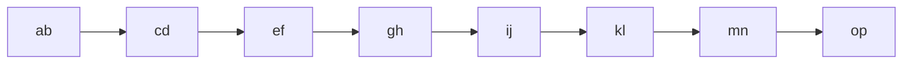
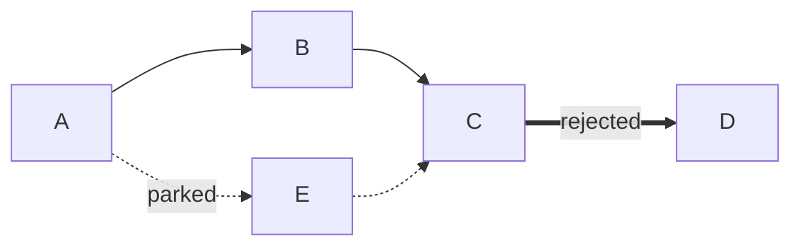
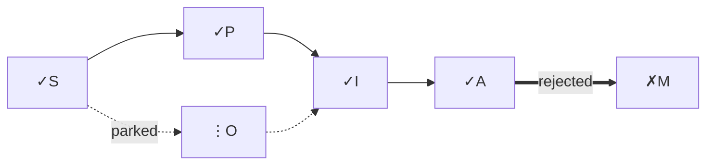
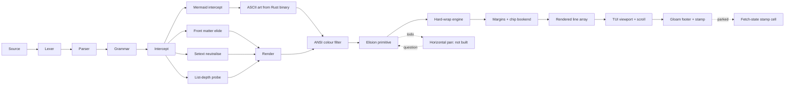

# Monster Diagrams — the elision + horizontal-pan surface

**Kind:** monster document. The diagram end of the stress spectrum —
mermaid graphs wide enough to exceed a reasonable terminal, forcing
okuda to *decide* what happens at the right edge. `docs/showcase.md`
shows the grammar; this doc pushes the grammar past the viewport.

**What it tests:** the mermaid intercept + ASCII colour filter at the
right edge, today (overflow / terminal soft-wrap) and after the elision
brief (`td-b81597`).

**What it surfaces — and this is the bigger half:** okuda has **no
horizontal pan**. `src/tui.ts` scrolls a line index into pre-rendered
lines; there is no column offset, no zoom. A diagram wider than the
terminal overflows the right edge, and today the terminal soft-wraps it
(the same lie ADR-004 refused for prose). After elision, it would be
chopped with `…` at the boundary — the scratchpad's "elision as
invitation: widen the matrix, or page within the panel." But "page
within the panel" is a capability okuda does not have. So this doc is a
**gates-firing artifact**, not a stress test of an existing capability:
it makes the horizontal-pan question undeniable. The Derrida question —
*should horizontal pan even be in the consideration set?* — and the
scratchpad's stance is "elision is enough; widen the matrix, don't pan
within it." The monster diagram is the evidence that makes that stance
earn its keep or fire its reversal.

**Path classes via edge style** (free, in-grammar, no okuda parsing):
`-->` solid `─▶` = happy path; `-.->` dotted `╌▶` = indifferent / parked;
`==>` thick `━▶` = would-rather-not / rejected. Three classes by shape
alone — the Rust binary maps edge style to distinct ASCII glyphs before
okuda ever sees them. **Node state via label glyph** (also free): `✓`
shipped, `⋮` parked, `☐` todo, `✗` rejected, passed through as node
label text. Two orthogonal layers, one job each: line style = path
desirability, node glyph = node state. No edge glyphs — edge style is
the edge's marker; a glyph on top duplicates structure (the scratchpad's
named sin).

**How to read it:** `okuda docs/diagram-monster.md --tui` at two
widths. At narrow, the wide diagrams overflow; at wide, they breathe.
The gap is the question. Glyphs follow the lexicon (`☐ ✓ ✗ ⋮`); edge
style carries the path axis. See the showcase's "one glyph, one job"
doctrine.

---

## 1. The happy path — linear pipeline, all solid edges

The baseline: a wide linear pipeline that reads left-to-right, every
edge a happy `-->`. Eight nodes in a row — wide enough to overflow 80
cols, breathing at 140. The honest question: does the right edge elide
(`…`, the reader knows there's more) or soft-wrap (the terminal lies
that the line broke)?

All `-->` solid. This is the shape the showcase already shows; the
monster is *width*, not topology.

---

## 2. The three-path exhibit — happy / indifferent / would-rather-not

The path-class exhibit. Three edge styles on one diagram: the happy
pipeline runs solid, the parked detour runs dotted, the rejected path
runs thick. Each shape is distinct by glyph alone, before any colour
filter runs — and the colour filter today classes all of `─` `╌` `━` as
"box/grid rails" → same cyan, so the distinction is *by shape*, not by
colour. (If you want paths to differ by colour too, that's a classifier
change — decision/005 territory; this doc surfaces the gap.)

`-->` happy (solid `─▶`), `-.->` indifferent/parked (dotted `╌▶`), `==>`
would-rather-not/rejected (thick `━▶`). Two detours and one rejection,
all on one graph — the topology carries the project's actual history
of parking and refusing, not just its happy path.

---

## 3. The node-state exhibit — glyphs on every node

Every node carries a state glyph in its label: `✓` shipped, `⋮` parked,
`☐` todo, `✗` rejected. The path axis is edge style; the state axis is
node glyph. Two independent axes, one diagram — the test is whether the
eye can read both without collision. If `✗` on a node reads as "this
edge is bad" rather than "this node is rejected," the axes have leaked
into each other and the lexicon has failed.

The pipeline's real state: four nodes shipped (`✓S ✓P ✓I ✓A`), one
rejected (`✗M` — the chip-stack minimap), one parked (`⋮O` — OSC 8).
The elision primitive (`☐`) is the one node not on this graph — it's
what `td-b81597` will add. The diagram says what the project is today,
not what it hopes to be.

---

## 4. The wide stinker — a graph that refuses to fit

Deliberately hostile: a wide `flowchart LR` with enough nodes and labels
that it exceeds the mermaid renderer's own width guard, which emits the
source as a fallback instead of ASCII art. This is the honest limit —
beyond a certain width, the Rust binary itself refuses to render and
hands okuda the source in a box. So this stinker surfaces **two** layers
of elision: the binary's own refusal (upstream), and okuda's handling of
whatever the binary emits (downstream). The question this doc exists to
fire: when the binary gives up, what does okuda do with the fallback?
Today: nothing special (it's a code fence, soft-wrapped by the terminal).
The scratchpad's "elision as invitation" applies here too — the source
box is itself a kind of elision (the art was elided; the source is the
invitation). Is that enough, or does this demand a real horizontal pan?

The pipeline's own self-reference: the elision node is `☐` todo, the
horizontal-pan node is `⋮` parked, and the question loops back to
elide. A diagram that contains its own open decisions — the honest
shape of the work, not the aspirational one. And the binary's guard
firing on it is itself the exhibit: the stinker is too wide even for
the renderer that's supposed to render it.

---

## What to judge

After reading all four at both widths:

1. **Does the happy pipeline elide or soft-wrap at the right edge?**
   Section 1. Today: soft-wrap (the lie). After `td-b81597`: elide with
   `…`. The gap is the elision's job.
2. **Do the three edge styles read as distinct without colour?**
   Section 2. `─` `╌` `━` are distinct by shape; the colour filter makes
   them the same cyan. Is shape enough, or does the path axis need colour
   too? If the latter, that's a classifier brief.
3. **Do node glyphs and edge styles stay on separate axes?** Section 3.
   If `✗` on a node reads as an edge judgement, the lexicon has leaked.
4. **Does the wide stinker demand horizontal pan?** Section 4. The
   gates-firing question. The scratchpad says elision is enough; this
   stinker is the evidence. If you find yourself wanting to pan, that's
   a brief. If you find yourself widening the terminal and accepting the
   binary's source-fallback as the invitation, the scratchpad's stance
   holds. Note that the stinker hits the *binary's* guard before it hits
   okuda's — the elision surface starts upstream.

Where the answers surprise, that's a brief.