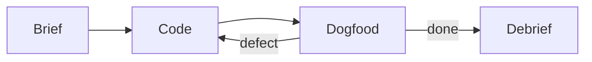

# Glow vs okuda — why a restricted viewer is calmer

> Named for Michael Okuda: high-contrast, functional, uncluttered. The terminal is the
> display, not a browser in denial. Colour is *functional* — it signals structure, not mood.

This document is a comparison and an argument. It is rendered by okuda, and it argues for
okuda — which is either a neat trick or circular reasoning, depending on your generosity.
Read it as both: a real document you might actually read, and a dogfood test of whether the
grammar composes into something pleasing rather than something merely present.

The thesis is simple. A terminal document does not need to be ugly, and it does not need to
be dense. Discrete blocks — a list, a table, a diagram, a paragraph — placed with vertical
rhythm form a structure that reads as *intentional*. The alternative is the wall: every line
full, every cell crammed, the reader tense before they have even decided whether the table is
useful. Glow is the incumbent and the reference. okuda is the bet that the wall is not the
only option.

---

## The two viewers

| Property | Glow | okuda |
| --- | --- | --- |
| Engine | glamour (ANSI-256 palette) | hand-translated Dracula truecolor |
| Lists | tight (CommonMark) | loose (blank line between items) |
| Tables | box-drawing grid, all near-white | grid header + loose body, semantic colour |
| Soft returns | soft break (joined) | stripped (reflow to width) |
| Mermaid | raw code fence | piped to ASCII, three-channel colour |
| Finish | last line lingers (pager artefact) | Gloam footer badge (deliberate sign-off) |
| Grammar | full CommonMark | closed subset (the agent workflow's output) |

The table is the comparison in miniature. Glow's grid is tighter; okuda's colour carries
more signal. Glow's near-white table is hard to scan for the *important* cell; okuda's amber
first column anchors the eye and lets it walk key to value.

---

## The development loop

The viewer is built the way it argues documents should be built: discrete blocks, vertical
rhythm, and a loop that returns to fix what the eye finds. The diagram below is the loop
this branch actually ran — brief, code, dogfood, fix, debrief — with the dogfood step
feeding back to code whenever a defect surfaces.

The dogfood step is the valve. A document is rendered; the eye reads it against the
reference; a defect is named; the code is fixed; the document is re-rendered. This is not
optimising a benchmark score. It is the Edinburgh method in the terminal: evidence over
inherited authority (Hume), improvement by shedding what does not serve (Watt), and a
system watched by an impartial spectator before it ships (Smith).

---

## Why a restricted grammar

Glow handles everything CommonMark permits: embedded HTML, footnotes, task lists, arbitrary
stylesheets, indented code, images. That breadth is the source of its complexity and its
tension — every edge case is a fork the renderer must anticipate, and the user must mentally
rule out.

okuda's bet is the opposite. The agent workflow generates a closed subset of markdown:
headers, loose lists, tables, code fences, mermaid blocks, prose with inline emphasis. It
does not generate images, footnotes, or raw HTML. A viewer that *only* renders that subset
is smaller, faster, and — crucially — its output is *predictable*. There are no surprise
forks. The reader never wonders "will this render weirdly?" because the grammar does not
admit the cases that render weirdly.

The trade is explicit:

1. **Breadth for predictability.** You cannot render everything, so you must render *the
   right things* — the things the workflow actually produces. Scope is a feature, not a
   limitation.
2. **Density for rhythm.** A loose list is taller than a tight one. The cost is vertical
   space; the return is that each item is a discrete block the eye can land on, not a line
   in a wall.
3. **Colour for signal.** Where glow uses near-white and lets the grid carry the structure,
   okuda uses purple headers, amber keys, green code, rose links. The colour is not
   decoration — it is the scan path, and the whitespace lets it breathe.

---

## The lower-stress layout

This is the finding the dogfood surfaced, and it was not designed in — it emerged. okuda's
loose layout is *calming* where glow's density is *tense*. The words are an operator's, not a
benchmark's:

- A crowded glow table is so dense you cannot scan to decide whether it is useful; the
  crowding itself prevents the assessment.
- okuda's loose rows separate the records, and the amber first column anchors the scan. You
  can tell at a glance whether the table is worth reading.
- The looseness makes defects *visible* — an orphaned wrap fragment jumps out because the
  surrounding whitespace gives it nowhere to hide. Density buries the same fault in a full
  line. A map that shows its own errors is more useful than one that hides them.

The same property holds at the document boundary. Glow's last line lingers — the alternate
screen's pager state collides with the terminal's final write, and the document ends on a
doubled line that reads as a glitch. okuda ends on the Gloam footer, deliberately: a badge
and an identity that say *the document ends here, on purpose*. A deliberate finish is
calming; an accidental one is tension.

The building blocks are simple. A list is a list. A table is a grid and a rule. A diagram is
ASCII art with three colours. A paragraph is wrapped prose. None of these is clever. Placed
discretely, with vertical rhythm between them, they form a structure that reads as composed.
Placed densely, they form a wall. The viewer's job is the placement.

---

## What this document tests

If you are reading this in `okuda --tui`, every element above is live:

- **Headers** — purple bold, uniform across levels, the scan path.
- **Lists** — ordered (the trade list) and unordered (this list), loose, each item a block.
- **Tables** — grid header with `│` separators, full-width rules, amber first column,
  columns that hold through wraps.
- **Diagrams** — the development loop, piped to ASCII, borders receding, arrows leading.
- **Prose** — reflowed to your terminal width, no soft-return fragments, inline emphasis in
  Dracula colours.
- **The finish** — the Gloam badge below, a deliberate sign-off.

If any block above reads wrong, the regression is localised here. If the document reads as
pleasing, the bet holds: a terminal document does not need to be ugly, and discrete blocks
placed with rhythm form a structure that is calming to read.
