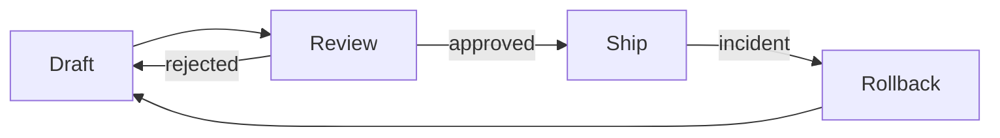
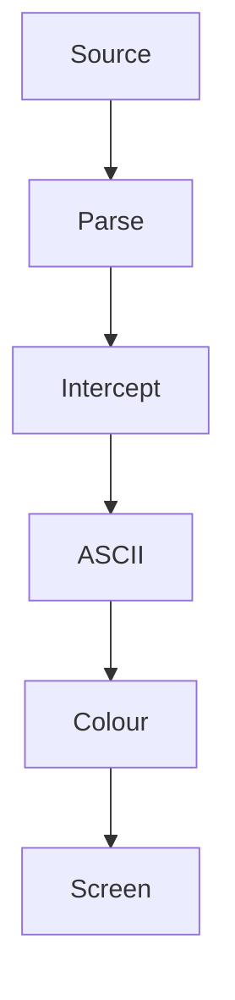

# okuda — Grammar Showcase

A single document that exercises every element of the closed Okuda Markdown grammar. Render it with `./okuda docs/showcase.md` and read it as a smoke test: if any block below renders wrong, the regression is localised here.

> Named for Michael Okuda: high-contrast, functional, uncluttered. The terminal is
> the display, not a browser in denial. Colour is *functional* — it signals structure,
> not mood.

> We are not just opinioned; we are attitudinal. The moat is a stance, not a feature
> list — and a stance can't be copied without understanding it.

> No light mode. Dark is the only mode, because the terminal emits signal, not
> background noise. Light is a palette file we don't ship; the override is the light
> mode, if someone wants it.

> If the author didn't structure it for the eye, the eye has no reason to stay. Bad
> framing is a signal of bad authoring, and the crowd rejects the document before the
> critic gets a hearing.

---

## Structure: headings

### H1, H2, H3 are styled and bold
#### H4 and deeper now render the same way (ADR-007)

The viewer owns the layout. Under ADR-007, okuda matches Glow's heading rendering at every level — the marker count signals depth, and the blue bold is uniform across H1–H6. There is no collapse; a deep heading is still a heading.

---

## Prose: paragraphs and soft returns

This is a single paragraph split across two source lines. The soft return between them becomes a hard break — no trailing double-space tax.

Inline styles carry the semantic load: **bold for emphasis**, *italic for asides*, ~~strikethrough for the discarded~~, and `` `inline code` `` for the literal. A [hyperlink to the origin](https://example.com/origin) renders as rose link text plus a visible cyan-underlined URL — the URL is always on screen (see *Links: browser invocation* below). An image `` becomes `[image: rejected alt]`; the viewer renders text, not pixels.

---

## Links: browser invocation

okuda emits no OSC 8 hyperlink markup — the URL is displayed as text, so
browser invocation is the terminal's job. These probes test URL
detection and click-to-browser handoff:

- **Labelled link.** [the origin doc](https://example.com) — the common case; the target is the cyan URL, not the rose label.
- **Bare URL.** In prose, https://example.com/plain is plain text to okuda; detection is entirely the terminal's heuristic.
- **Query string.** https://example.com/search?q=okuda&lang=en — a picker that stops at `?` truncates the target.
- **List context.** [a link inside a list](https://example.com/list) must survive the bullet prefix and the adjacent bold lead intact.

Ctrl/Cmd+Click (or plain click, terminal-dependent) on any URL above
should hand off to the browser.

---

## Code: fences are verbatim

```typescript
// Fenced code is never wrapped — long lines overflow, on purpose. // Wrapping code mangles it. The reader scrolls; the bytes stay honest. function render(source: string): string { return source .split("\n") .map((line) => line.trimEnd()) .join("\n"); }
```

---

## Diagrams: mermaid → ASCII



The fence is intercepted pre-render, piped to the `mermaid-to-md` Rust binary, and the returned ASCII is coloured by channel: borders recede, arrows lead the eye, text sits in the foreground. The diagram never wraps — a wrapped state machine is a lie about the system's topology.

Orientation is a semantic choice, not a preference. The lifecycle above is a cycle — it reads across. The pipeline below is one-way — it reads down. Same renderer, same intercept, two shapes:



That is the viewer's own path, top to bottom: markdown in, coloured ASCII out. A diagram is not a one-off ornament — it earns column space wherever the prose would otherwise be describing a shape.

And beneath each diagram, the muted source: the invitation. Here is your
art; here is the source if you want to give it a go yourself. Nothing is
hidden — just presented at the volume each layer has earned: art in the
foreground, structure receding, source waiting quietly underneath.

---

## Quotes: single-level, muted

> The map is not the territory. A viewer that pretends otherwise — rendering images,
> embedding HTML, chasing full CommonMark — has confused decoration for fidelity.
> okuda renders what your workflow generates, and refuses what it doesn't.

Nested blockquotes collapse to a single pipe; the grammar refuses to draw a staircase of `>` glyphs that no one reads.

---

## Lists: loose, nested, capped

Unordered lists breathe — an empty line between items regardless of source tightness:

- First item, with a soft return
inside it that honours the break.
- Second item, wrapping across a wide terminal to demonstrate that continuation
indentation aligns under the text, not the marker.
- Third item.

House style is the **bold lead**: each item opens with a bolded key followed
by prose. The keys render as an amber column the eye scans without reading —
the table's first column, rotated vertical:

- **Count.** The eye sees how many items there are before reading any.
- **Keys.** The bold leads scan like a table's first column; each key promises what its item covers.
- **Detail on demand.** Drop into the items that interest you; skip the rest, unread.

Ordered lists get the same breathing room:

1. Brief before build.
2. Branch before commit.
3. Check before merge.

Nesting is capped at two levels — beyond that, the outline is broken and the child flattens to continuation text:

- Top-level item.
  - Nested child, level one.
    - A third level would be a smell; it renders as continuation prose, not a tree.

Task lists are rejected — the checkbox markup stays literal text:

- [ ] this is not a task list, it is an unordered item
- [x] and this is too

---

## Tables: loose rows, semantic colour

| Element | Behaviour | Channel |
| ---: | :--- | :---: |
| Header | bold cyan, rule beneath | structure |
| Key column | bold amber | identity |
| Data cell | high-contrast text | payload |
| Wide table | elides to terminal width, `…` marker, invites widening | truth |

Alignment is honoured per-column: right, left, centre. A table that would overflow the terminal elides to the edge with `…` rather than shrink-wrapping — the table keeps its columns, the reader widens or pages. (Reverses the prior in-cell shrink-wrap; see `decisions/014-table-elision-over-shrink-wrap.md`.)

---

## Glyphs: joy with a job

Glyphs are author content, not grammar — okuda imposes none and
interprets none. But a document that uses them well reads faster than
one that uses them never. The rule: **one glyph, one job** — a mark that
duplicates an existing structure is noise; a mark that distinguishes what
structure alone cannot is perception for free.

◆ **Load-bearing.** A diamond before the bold lead marks the note that
changes how you read everything after it. The eye catches it at three
times the distance of italic — a priority flag, not a flourish.

Elision in prose — item one ⋮ item nine — says "intervening items
omitted" without lying that they were listed.

Flow in prose: source → parse → render → screen. Arrows carry topology
inline, no diagram required.

Yes/no pairs: ✓ works, ✓ verified, ✗ rejected, ✗ out of scope — plain
text colour, one cell each, no emoji presentation to disagree with the
width engine.

A glyph column in a table compresses state to a glance — each row is
assessed before it is read, and the key beneath teaches the dialect in
one line:

| Subsystem | State | Note |
| --- | --- | --- |
| Wrap engine | ✓ | grapheme-true; CJK and emoji widths verified |
| Mermaid intercept | ✓ | art plus muted source, both on show |
| Autolink pass | ✗ | rejected — URL detection is the terminal's job |
| OSC 8 hyperlinks | ⋮ | parked under Pass C; reopen on terminal evidence |
| Lexer EAW audit | ☐ | next: token widths against the width table |

Key: ☐ to do · ✓ done · ✗ rejected · ⋮ parked — elided into a further question.

The same flags lead a list, carrying state the bullet cannot — ☐ to do,
✓ done, ✗ rejected, and ⋮ elided: parked pending a question. The irony
is the point — the elided item has not vanished, it has elided into a
further question:

- ☐ **Lexer audit.** Token widths against the EAW table — not yet checked.
- ✓ **Wrap engine.** Grapheme segmentation verified on CJK, emoji, combining marks.
- ✗ **Autolink pass.** Rejected — URL detection is the terminal's job.
- ⋮ **OSC 8.** Parked under Pass C; reopen only if a terminal test demands clickability.

Declare the legend once, trust it after. And note the boundary: an item
with an owner or a date belongs in the task tracker — glyphs carry
document-state, not workflow.

Inside a quote, the diamond marks the load-bearing sentence, not the
block:

> ◆ The quote keeps its pipe; the diamond inside marks the sentence that
> matters, so the skim finds it before the read does.

What this section does *not* do: use a glyph to re-say what the bullet
already says — the reader pays twice for one meaning — or reach for
astral-plane emoji whose width terminals disagree on. The status-led
list above is the exception that proves the rule: its glyphs carry state
no other marker holds, one job each. Joy that costs alignment is not joy.

---

## Rejected elements

The grammar is closed. Indented code is not code — it is a paragraph:

this looks like indented code but okuda treats it as prose, because four-space fences are a footgun.

Inline `<em>HTML</em>` is stripped silently; the tags vanish, the text remains. Footnotes and raw HTML blocks produce nothing. No error, no raw markup — the viewer degrades to text, never to noise.

---

## Width: wrap and bypass

Body text wraps at the terminal column count. Raw blocks — code fences, mermaid ASCII — bypass wrapping entirely, because wrapping a diagram or a diff destroys its meaning. Resize the terminal and re-render; the prose reflows, the art holds.

---

## Closing rule

---

That is the whole grammar. Nothing more is promised; nothing more is wanted.

How the document itself should end is the open question. The header opens
the okudagram — badge left, title, chip right, spanning the width — but a
bare rule cannot close it: the rule already has a job, separating
sections, and a terminator that doubles as a separator closes nothing.
The closer mirrors the header's anchors on both sides — a muted chip at
the badge's column (left), a muted chip at the heading chip's column
(right), a rule between:

```text
  ## Grammar Showcase                                     █

    … the document …

  █ ──────────────────────────────────────────────────── █
```

Two chips bookend the rail. The eye, trained by the H1 badge on the
left, lands on the muted LHS chip on scroll and reads "closed" — no
false promise of more to read, no asymmetry that reads as a broken
frame. The LHS chip is subdued (muted, not heading-coloured): the badge
encodes level, the terminator encodes exit. The closing is quieter than
the opening (muted chips for bold badge, muted rule for bold title),
which is the correct direction: openings announce, closings release. And
the bare rule keeps its old job unambiguously, because the terminator now
looks like nothing else.
