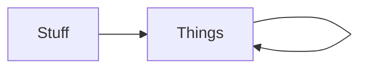

# okuda — Style Guide

The inverse of the [grammar showcase](showcase.md). The showcase answers *"what does okuda do with my markdown?"* — the renderer's reference. This answers *"what markdown do I write to get the okuda look?"* — the author's guide. One read, the vocabulary internalised; the patterns reachable. Not a spec; a palette of moves.

The okuda look is **structured colour the eye scans before reading**. A wall of white text is what an agent emits when it treats markdown as a plain-text dump. A cool sophisticate treats it as a *layout brief* — the renderer supplies the colour, the author supplies the structure that earns it.

Ephemeral docs — a menu, an index, a status page — are the canonical test: they have no content depth to hide behind, so their look *is* their legibility. Render this document with `just style-guide` and read it as the demo of itself.

## The house move: the bold-lead list

The single pattern that most separates an okuda document from a wall of white. Each item opens with a bolded key followed by prose; the keys render as an amber column the eye scans without reading — the table's first column, rotated vertical:

- **Count.** The eye sees how many items there are before reading any.
- **Keys.** The bold leads scan like a table's first column; each key promises what its item covers.
- **Detail on demand.** Drop into the items that interest you; skip the rest, unread.

The bold lead does the work a colon or a heading would, without the ceremony. Reach for it whenever a list's items each have a name and a payload.

**A blank line is an assertion of a boundary, not a spacer.** In prose it separates thoughts and costs nothing. In a list it starts a **new item** — so splitting a bullet where a sentence turns gives you two items, and the second one has no bold lead for the eye to scan. Air inside a list is bought with a lead, or not at all: name the new item, or leave the sentence where it was.

## State glyphs: assess before you read

The closed lexicon carries document-state the bullet cannot. **One glyph, one job** — a mark that duplicates an existing structure is noise; a mark that distinguishes what structure alone cannot is perception for free. The lexicon, coloured by the renderer:

- ☐ **Open.** Pending, draft, ready to start — not yet landed.
- ✓ **Done.** Accepted, shipped, verified — closed.
- ⸮ **Parked.** Gated, deferred, elided into a further question. The irony
  mark, not the vertical ellipsis: `⋮` means *continues below*, which is
  elision's meaning, and it is reserved for the fold.
- ✗ **Rejected.** Out of scope, declined, failed — closed negative.

A glyph only earns its place where there is real variance. A column where every row is ✓ is decoration, not signal — leave it off. Declare the legend once, trust it after. The glyphs colour in prose, lists, and tables alike — the lexicon is consistent everywhere.

## The ◆ diamond: the load-bearing line

◆ marks the one sentence that changes how you read everything after it. The eye catches a diamond at three times the distance of italic — a priority flag, not a flourish. Use it once, at most twice, per section; a diamond on every line is a diamond on none.

> ◆ Inside a quote, the diamond marks the sentence that matters, so the skim finds it before the read does.

◆ is **not** a state glyph — it has no colour role of its own, riding the strong channel. Priority is a separate axis from lifecycle.

## Tables: the structured glance

Tables earn their place when the eye needs to compare across rows. The key column is bold amber (the bold lead, tabulated); the header is cyan; alignment is honoured per-column.

Overflow splits by surface kind (ADR-022): jump-wired menus lay out right-anchored by role — number at the far edge, callsign its stable home, slug truncates with `…` then suppresses; prose tables wrap in-cell and the operator widens.

| Pattern | Channel | When |
| --- | :--- | :--- |
| Bold-lead list | amber key | items each have a name + payload |
| State glyph | traffic-lamp | rows carry lifecycle variance |
| ◆ diamond | strong | one line changes the read |
| Muted path | far | an index or menu line — provenance, not content |

## Near and far: the gloaming register

The colour register has one principle: *is this near or far?* **Near** is the content you're reading — bold, bright, the core. **Far** is provenance and chrome — muted, receding, like the status bar's folder/file text.

The gloaming is the gradient between, and the okuda palette *is* the gloaming: blues (heading), browns (strong), yellows (emphasis, state-todo) — near dark when still light. Every colour decision asks one question: is this near or far?

A bare `.md` path in prose — `decisions/010-bounded-anchor-proportional-fallback.md` — lifts to the doc-ref gold (amended 2026-09-12: it receded to muted for one day too many — 2026-08-28 wired the gold, 2026-08-28 dimmed it, both same afternoon). The recession was by location, and location is the wrong test.

The path is an affordance before it is provenance: in a silo where the filesystem is the message bus, a filename is an act — type it in the search and it resolves.

So the near/far question gains its third term, answered by *what the text does*, not where it sits: content is near, provenance is far, and affordances — actable paths, keybinding hints — lift out of the gloaming into a register of their own: visible, subordinate to the rose vector paint (the silcrow is the actuation point; the path is the address).

Put it last on a line, where the eye lands after the title has done its work.

**The address is the path; the line is prose.** `src/render.ts` lifts to the
`doc-ref` gold and `:1396` after it does not — the gold stops at the extension
because the file is what can be reached. A line number is a copy of a fact that
lives in the file, and code is edited far more often than prose, so the copy rots
first: measured 2026-10-30, three citations written in one session were stale within
the hour, and of the corpus's line hints that name a symbol, 11% still land on it.
So the coordinate is dereferenced, never rendered, and never *promised*
(`ADR-LINE-IS-PROSE-078`; no gutters on code, in any mode, `ADR-074`).

**A wired path jumps; a bare one is a mark.** Two digits is the actuator — `12` —
and the jump takes you to the **file**, at its top. Reading the code from there is
`88` (the editor has a symbol index and a language server; this renderer never
will) or plain reading. The renderer resolves nothing from prose: a path with no
silcrow is a well-formed marker and one keystroke short of a jump, and that is the
compositor's half of the work, not the author's to fake.

Three authoring consequences, and they are the whole of the rule:

- **Write a line hint if it helps, and expect it to rot.** `src/render.ts:1396` is
  a fine thing to write — it is the author pointing at a row, and it saves a reader
  scrolling a 2,000-line file. What it is *not* is an address: the gold ignores it,
  the silcrow lands after it, and the jump goes to the top of the file. Write the
  hint as a courtesy, never as a coordinate the tool will honour.
- **Name the referent before the address.** `wrapWholeFile` (`src/render.ts:1164`)
  is checkable — a finder can see whether that line still holds the symbol — where
  an address alone is a claim the reader must take on trust. This is the direction
  the address problem points: **a line is a copy, a token is the fact.** The
  renderer cannot resolve a token yet, so name the token and let the line be the
  hint. A token-addressed citation is **deferred**, not decided — it arrives when
  the drift is measured against it, not when it looks tidier.
- **`.md` carries no line like any other file**, and for one reason more: prose
  wraps, so a rendered row is the renderer's invention. `docs/x.md:42` is a hint
  about a place in a document; the jump goes to the document.

The renderer cannot show the line for you and does not pretend to; it makes the
path one thing you can select, search, jump, or hand to the host. If the gold
shouts against the emphasis register, dim by lightness (OKLCH L down, hue and
chroma held) — never by guessing a new hue.

### Cheap precision is a licence to spend it — and prose still has to be worth reading

Once an address costs the reader two keystrokes instead of a trip, citations get
cheap, and cheap things get overused. A paragraph that is mostly gold is a
paragraph with no sentences in it: the register that *earns* attention by being
rare stops meaning anything the moment it is everywhere.

So the rules that were already here become load-bearing rather than decorative:

- **The address goes last on the line**, after the claim has done its work. An
  address that interrupts a sentence is a footnote placed mid-clause.
- **One address per claim.** Two citations for one assertion usually means the
  assertion is doing two jobs.
- **The prose must stand without the gold.** Check it: render with `--no-color`,
  or read the paragraph aloud. If it stops making sense when the addresses are
  plain text, the sentence was carried by the colour rather than by its argument.
  This is the same test the state glyphs get — *the state is in the glyph, the
  colour is the glance* — and the same failure it names: a signal that only exists
  in a channel a reader may not have.

- **A reference carries its claim in text; the address is optional.** A path or a
  URL is *where* the thing lives, never *what it says*, and an address on its own is
  an audit surface with nothing behind it: a bare link looks like evidence and
  carries no claim at all, which makes it the reference register's one form of
  decorated Stuff. So the sentence does the work and the address follows it.

- **No address is not no reference.** Some references have no address whatever — a
  book, a conversation, a thing on a shelf — and the honest form is then the
  narrative plus the fact that there is no address.
  That is worth more to a reader than a link that will rot into a 404, and it is
  worth more than a citation that would only *look* dereferenceable. **Test: strike
  the address out.** If the sentence still carries the claim, the reference was the
  URL and you have written a pointer. (The derived reference list lifts only what
  resolves, so an addressless reference stays a mention — by design, not by
  omission.)

A document dense with addresses should read as **prose with its evidence
attached**, not as an index with prose in the gaps. The gold is not the point; it
is what lets the point be checked.

## The frame that wraps

Information is framed by a shoulder or an elbow, not by a box.

A box closes. It draws a perimeter and declares the contents complete — a claim
about the material that the author is rarely entitled to make. A shoulder turns
one corner and a rule runs from it; an elbow turns and the information sits
under the turn. Either way the frame **wraps**: it gathers the block and holds
it as one thing while leaving it open at the far end. Extensible, not sealed.

The distinction is the one the guide makes everywhere else. A frame that wraps
is a gesture; a box is furniture. It costs a glyph and a rule instead of a
perimeter, so it survives narrowing — which is what makes it compatible with
**progressive engagement** rather than merely cheaper than a box.

Reach for it when a block is one thing but not a finished thing: a section that
continues, a set of items that will grow, a group whose boundary is the point
and whose closure is not.

## Wrap is for prose

Wrapping is a claim that the break is insignificant. In prose the claim is
true — a paragraph is a flow, and where its lines stop is the renderer's
business. In a code line, a box edge, a table row or a diagram rank it is
false: the newline **is** structure, so a break asserts a shape the author
never wrote. A wrapped code line reads as two lines. A wrapped state machine
reads as a different topology.

So the renderer does one or the other and never both. **Prose wraps;
structure elides.** A preformatted block that outruns the glass is cut at the
right edge, marked `…`, and — where the block can say how wide it wanted to
be — the receipt carries the number (`art elided · needs 241 cols`). Nothing
is re-flowed into a shape it did not have.

**A cap is not the remedy.** A paragraph running 296 columns is as unread as one
cut at 40, and the renderer is not the party to fix it. Where the text sits and
how wide the page is belongs to the host's pane, or to a boot value the reader
chose — a width the renderer imposes on prose is compositing inside the
renderer, which the three-owner rule forbids (`ADR-PROSE-MEASURE-071`).

The test for any new block type: *does the output contain a line break the
source did not?* For prose, that is the point. For anything else, the block
is wrong. (`ADR-PANE-NOT-CANVAS-069`.)

## Diagrams: shape the eye can trace

A diagram is not a one-off ornament — it earns column space wherever prose would otherwise be describing a shape. The fence is intercepted pre-render, piped to `mermaid-to-md`, and the ASCII is coloured by channel: borders recede, arrows lead, text sits in the foreground.

The diagram never wraps — a wrapped state machine is a lie about the topology. It elides instead: past the glass the art is cut with `…`, and the receipt names the columns it would need. Widening the pane shows more of the *same* diagram; it never changes the diagram. That is the difference between resizing a window and rewriting a file.

Orientation is a semantic choice. A cycle reads across; a pipeline reads down. Same renderer, two shapes — pick the one that matches the system.

## Maths: what renders, and what you write instead

An inline `$…$` span is **transliterated, not typeset**: a closed table of 38
entries maps LaTeX to the Unicode character it denotes, and a span holding even
one unknown command is left **exactly as written**, `$` and all
(`ADR-MATH-GRAMMAR-076`). Nothing is half-translated, no engine is involved, and
the literal fallback is the renderer declining rather than a rendering fault.

**What renders.** Greek (`\pi \mu \sigma \rho \tau \theta \Omega \zeta`),
the common relations and operators (`\le \ge \neq \in \approx \gg \propto
\pm \cdot \sum \circ \%`), the arrows, `\sin`, the accents (`\vec{v}` →
**v** in bold — ISO 80000-2, not an arrow: the combining arrow is absent from
almost every monospaced face and cannot be borrowed from a fallback — and
`\dot{m}` → `ṁ`), digits as scripts (`T^4` → `T⁴`, `H_2O` → `H₂O`),
fractions with their grouping restored (`\frac{3\mu}{2R^3}` → `3μ/(2R³)`), and
`^{\circ}` as the degree sign rather than a superscript.

**What does not, and the linear form to write instead.**

| you want | write |
|---|---|
| display maths (`$$…$$`) | inline spans, one relation per span, each on its own line |
| a letter as a *typographic* script | it renders linearly: `I_{max}` → `I_max`, `x^{n}` → `x^n`. Unicode has no subscript `max` — `ₘ ₐ ₓ` exist and `b c d f g j q w y z` do not — and a partial alphabet works once and fails on the fourth equation, so letters keep their size on purpose |
| a root, a limit, an integral | the linear form: `√2` is a character, `√(x+1)` is bracketed; `∑ i=1..n x_i` reads without a limit stack |
| composition (`f \circ g`) | keep it out of a span; `\circ` renders the degree sign here, and the two meanings must not collapse |
| a matrix, a case split, an aligned system | a `mermaid` fence, or prose. Two dimensions is the diagram door, and there is only one of them |

**Four things an author gets wrong by default.**

- **An equation does not belong in a table cell.** At 80 columns the cell wraps
  mid-relation and the elision ladder cuts the tokens that carried the meaning.
  A governing relation gets its own line, in prose, with the implementation
  beside it as a sentence.
- **Whitespace inside a span is syntax, not content.** It closes up; a gap
  survives only beside a relation or operator (`α ∈ [0.2, 1.2]`, `M ≫ M`), and
  a gap is never invented (`μ+Q` stays tight). Where you need a real space — the
  one between a value and its unit — write it inside a text group:
  `$65\text{ m}^3$` renders `65 m³`, and `$65m^3$` renders `65m³`.
- **A command-free span is left alone.** `$T^4$` shows its dollars, because the
  currency guard fires on evidence (`\`) and not on a guess about intent — the
  same guard that keeps `costs $5 and $10` from becoming `costs ⁵ and ¹⁰`. In
  prose, write `T⁴` directly.
- **The literal fallback is honest, not broken.** `$\oint$` renders as
  `$\oint$`, painted in the **source register** — the same draw an inline
  codespan gets — so the decline is read at a glance instead of inferred from
  the delimiters. It says *I declined*, not *this is broken*: do not work
  around it by hand-transliterating inside the span, which produces decorated
  Stuff that no gate can check. A span with **no** command is never marked —
  `costs $5 and $10` is prose, not a failure.

## The closing bookends

The header opens the render — badge left, title, chip right, spanning the width. The closer mirrors it: a muted chip at the badge's column, a muted chip at the heading chip's column, a rule between. Openings announce; closings release. A document that doesn't know it's done reads as a broken frame.

## Authoring contract

> **Free in prose, careful in art, never lying in a state.** Three clauses, three
> readers: the human reading for meaning, the human reading for shape, and both of
> them plus the machine reading the codepoint. Every rule below is one of these
> three, and each states its own failure — which is the only reason it is a rule
> rather than a preference.

The numbers and rules the guide states nowhere else — the ones an author, human
or agent, gets wrong by default.

- **Width.** Author to **79 columns**, the top rung of the squint ladder
  (`docs/2026-10-12-the-squint-test.md`). The ceiling above which the operator
  stops widening is a policy number and is currently unstated; 120 is the
  proposal, not a measurement. Past the ceiling the diagram stops being read as
  a whole, and a diagram read in halves has lost the thing it was for.
  **What you will see if you exceed it:** not a refusal and not a wrapped
  shape, but a cut one — `…` at the glass and `needs N cols` on the receipt.
  That receipt is the diagram telling you its size; believe it and reshape, or
  widen and read the rest.
- **Split by view, not by scissors.** Two halves of one graph contradict each
  other within a month. A context view and a sequence view of the same system
  do not, because they answer different questions.
- **Labels ASCII, prose free.** Diagram and table labels stay in ASCII; prose
  takes any script. Column alignment depends on the reader's font covering the
  glyphs, and the font is the one input the renderer cannot see. Prose needs no
  alignment, so prose is free.
- **BiDi is the second input the renderer cannot see.** okuda emits *logical*
  order and never reorders; the terminal's UAX #9 pass decides the visual result.
  That is not a gap — a renderer that reordered would be reversed a second time by
  every bidi-capable emulator.

- **The author's consequence.** A right-to-left
  paragraph mirrors its inset and ragged edge on its own, so write it plainly; but
  **a right-to-left label inside art is not safe**, because art is laid out by
  visual column and a bidi terminal reorders the run while the box stays put —
  which is the rule above, with the reason stated.
- **Never tidy the right edge.** In a wide pane the ragged edge and the line
  count are the *scan channel*: one-line blocks read short, three-line blocks read
  long, and the eye runs down the left rail instead of along the text. A ragged
  right edge is the document telling you how long each thing is.

- **Equalising destroys the scan.** Anything that equalises line lengths —
  justification, uniform padding, a fixed measure, a reflowed table that pads every
  cell to the longest — destroys the signal the ragged edge was carrying.
- **Never fake a fit.** No hand-wrapping, no hand-padding to simulate a width
  the renderer would have elided. Elision is marked with `…`; a faked fit is
  marked with nothing, which is the difference between a reader who widens and
  a reader who is misled.

## The anti-pattern

Everything above is a refusal of the wall of white — the undifferentiated paragraph
dump that signals "I had thoughts and no layout."

The okuda author asks, before each block: *what is this block's structure, and which
pattern earns it?* A list with a name on each item is a bold-lead list. A list with
state on each item is a status-led list. A comparison across rows is a table. A shape
is a diagram. A menu is the menu pattern. Prose with no structure is prose — and prose
is fine, where prose is what's earned. The wall of white is prose where structure was
available and refused.
