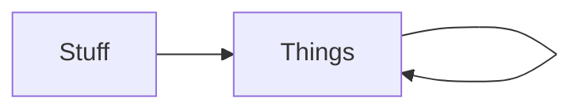

# okuda — Style Guide

The inverse of the [grammar showcase](showcase.md). The showcase answers *"what does okuda do with my markdown?"* — the renderer's reference. This answers *"what markdown do I write to get the okuda look?"* — the author's guide. One read, the vocabulary internalised; the patterns reachable. Not a spec; a palette of moves.

The okuda look is **structured colour the eye scans before reading**. A wall of white text is what an agent emits when it treats markdown as a plain-text dump. A cool sophisticate treats it as a *layout brief* — the renderer supplies the colour, the author supplies the structure that earns it. Ephemeral docs — a menu, an index, a status page — are the canonical test: they have no content depth to hide behind, so their look *is* their legibility. Render this with `just style-guide` and read it as the demo of itself.

---

## The house move: the bold-lead list

The single pattern that most separates an okuda document from a wall of white. Each item opens with a bolded key followed by prose; the keys render as an amber column the eye scans without reading — the table's first column, rotated vertical:

- **Count.** The eye sees how many items there are before reading any.
- **Keys.** The bold leads scan like a table's first column; each key promises what its item covers.
- **Detail on demand.** Drop into the items that interest you; skip the rest, unread.

The bold lead does the work a colon or a heading would, without the ceremony. Reach for it whenever a list's items each have a name and a payload.

---

## State glyphs: assess before you read

The closed lexicon carries document-state the bullet cannot. **One glyph, one job** — a mark that duplicates an existing structure is noise; a mark that distinguishes what structure alone cannot is perception for free. The lexicon, coloured by the renderer:

- ☐ **Open.** Pending, draft, ready to start — not yet landed.
- ✓ **Done.** Accepted, shipped, verified — closed.
- ⋮ **Parked.** Gated, deferred, elided into a further question.
- ✗ **Rejected.** Out of scope, declined, failed — closed negative.

A glyph only earns its place where there is real variance. A column where every row is ✓ is decoration, not signal — leave it off. Declare the legend once, trust it after. The glyphs colour in prose, lists, and tables alike — the lexicon is consistent everywhere.

---

## The ◆ diamond: the load-bearing line

◆ marks the one sentence that changes how you read everything after it. The eye catches a diamond at three times the distance of italic — a priority flag, not a flourish. Use it once, at most twice, per section; a diamond on every line is a diamond on none.

> ◆ Inside a quote, the diamond marks the sentence that matters, so the skim finds it before the read does.

◆ is **not** a state glyph — it has no colour role of its own, riding the strong channel. Priority is a separate axis from lifecycle.

---

## Tables: the structured glance

Tables earn their place when the eye needs to compare across rows. The key column is bold amber (the bold lead, tabulated); the header is cyan; alignment is honoured per-column. A table that would overflow elides to the edge with `…` rather than shrink-wrapping — the table keeps its columns, the reader widens.

| Pattern | Channel | When |
| --- | :--- | :--- |
| Bold-lead list | amber key | items each have a name + payload |
| State glyph | traffic-lamp | rows carry lifecycle variance |
| ◆ diamond | strong | one line changes the read |
| Muted path | far | an index or menu line — provenance, not content |

---

## Near and far: the gloaming register

The colour register has one principle: *is this near or far?* **Near** is the content you're reading — bold, bright, the core. **Far** is provenance and chrome — muted, receding, like the status bar's folder/file text. The gloaming is the gradient between, and the okuda palette *is* the gloaming: blues (heading), browns (strong), yellows (emphasis, state-todo) — near dark when still light. Every colour decision asks one question: is this near or far?

A bare `.md` path in prose — `decisions/010-bounded-anchor-proportional-fallback.md` — recedes to muted (far). The filename reads as provenance: where the thing lives, not what it says. Put it last on a line, where the eye lands after the title has done its work. Far things don't compete with near things; they anchor them.

---

## Diagrams: shape the eye can trace

A diagram is not a one-off ornament — it earns column space wherever prose would otherwise be describing a shape. The fence is intercepted pre-render, piped to `mermaid-to-md`, and the ASCII is coloured by channel: borders recede, arrows lead, text sits in the foreground. The diagram never wraps — a wrapped state machine is a lie about the topology.

Orientation is a semantic choice. A cycle reads across; a pipeline reads down. Same renderer, two shapes — pick the one that matches the system.

---

## The menu pattern: ephemeral documents

The pattern for the menu, the index, the status page — the docs an agent composes on demand and that have no depth to hide behind. The look *is* the legibility.

☐ 01 Ephemeral index generation — briefs/2026-08-28-brief-index-and-jump.md

⋮ 02 Rooted gloam, silo badge and callsigns — briefs/2026-08-28-silo-mnemonics.md

✓ 03 Zero-notification stillness — decisions/020-zero-notification-stillness.md

The moves, in order on each line — state → chip → slug → path:

- **State glyph.** The status, from the closed lexicon, coloured (warm, alerts). Scanned first, before reading. Only where there is real variance.
- **Number chip.** A solid block — the action indicator. You type the number to jump. No brackets: the chip *is* the indicator, and brackets are decoration on top of an affordance the block already provides. The compositor emits a private-use token; the renderer paints it as a solid block (markdown has no "solid colour" semantic, so the chip is a renderer primitive, the mermaid precedent).
- **Slug, bold.** The descriptive title — the one near thing, the core content. Date-first, greppable, registry-indexed. Everything else on the line exists to frame it.
- **Muted path, last.** Where it lives, in the far register. Last, because the eye lands there after the title.

Then a **status key at the bottom** — the legend, once:

☐ open · ⋮ parked · ✗ rejected · ✓ accepted

The menu is bulletless, coloured, scannable, and self-documenting. The slug is near; the path is far; the chip is the action. An agent that emits this is a cool sophisticate; an agent that emits a flat numbered list is a wall of white with numbers on it.

---

## The closing bookends

The header opens the okudagram — badge left, title, chip right, spanning the width. The closer mirrors it: a muted chip at the badge's column, a muted chip at the heading chip's column, a rule between. Openings announce; closings release. A document that doesn't know it's done reads as a broken frame.

---

## The anti-pattern

Everything above is a refusal of the wall of white — the undifferentiated paragraph dump that signals "I had thoughts and no layout." The okuda author asks, before each block: *what is this block's structure, and which pattern earns it?* A list with a name on each item is a bold-lead list. A list with state on each item is a status-led list. A comparison across rows is a table. A shape is a diagram. A menu is the menu pattern. Prose with no structure is prose — and prose is fine, where prose is what's earned. The wall of white is prose where structure was available and refused.

---

That is the whole vocabulary. Render it, copy it, reach for it. The moat is a stance, not a feature list.