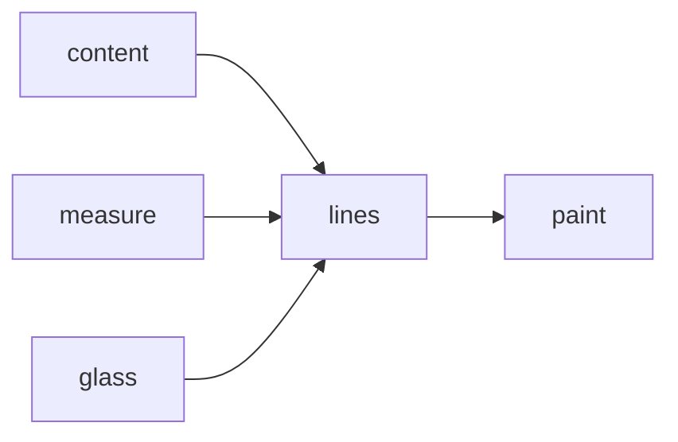
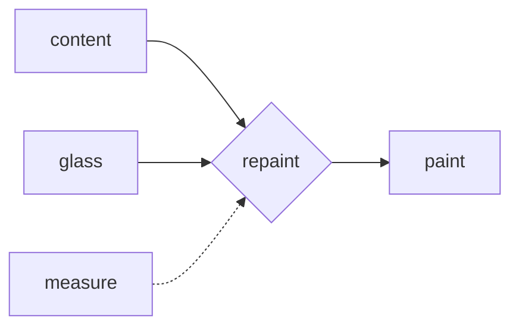
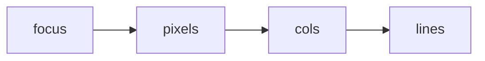

# Causation, indoors — the ladder where you can check the walls

> Status: **aligned**. Human-facing explainer — plain names, no callsign
> (explainers/ is unregistered by design). Written 2026-10-26, after a
> session that banded the prose and then spent an hour arguing about what
> a rendered line actually measures.

Most debugging arguments are association wearing a cause's coat. *"It
breaks when I resize"* is a correlation. *"Resizing re-wraps the lines, the
re-wrap moves the anchored paragraph, and the footer's cursor address goes
with it"* is a causal claim — and only the second tells you which change to
make. Judea Pearl's *The Book of Why* gives that difference a ladder, and
the ladder has a property indoors that it does not have in the field it was
written for.

**The silo is closed.** Pearl's discipline costs a scientist a supplied
graph: you assert which arrows exist, and no quantity of data will tell you
whether you were right. Ours are checkable. Every arrow in our world has a
*writer* — a line of code — and every arrow we say is absent is the claim
*"nothing else writes this variable"*, which is a `grep`, not an act of
faith. That is the plunder: causal diagrams are expensive in the open and
cheap indoors, and this silo has been drawing them for years without
calling them that.

## The three rungs, in our own work

| rung | the question | here |
|---|---|---|
| 1 · seeing | what goes with what? | the frame log: 65 KB a repaint, 30 ms a render |
| 2 · doing | what if I *change* it? | `needs 241 cols` — widen and the art is whole |
| 3 · imagining | what would have happened? | `bun test`; an ADR's rejected options |

These are not rungs of quality. They are rungs of **what you are permitted
to say**, and a rung-1 sentence dressed as rung 2 is the most expensive
mistake in software: it is how a fix ships that was never tested against
the mechanism it claims to address.

## First approximation: what makes a frame

The control plane of a viewer is small enough to draw. The document becomes
lines; the lines become a frame; and only some of the parents read the
glass.

Read it as writers, not as boxes:

- **`content → lines`** — the file's bytes, through the renderer:
  `renderLines(fetch.text, …)` (`src/tui.ts:1117`).
- **`measure → lines`** — the prose band, `Ctx.measure` (`src/render.ts`).
- **`glass → lines`** — the same call site, `dims().cols`.
- **`lines → paint`** — `paint()` lays the viewport out (`src/tui.ts:917`).

And the missing arrow, declared rather than left out: **`glass → paint`**
is real, because `paint()` reads the glass for its own geometry. It was
drawn in the first version of this graph, and at eighty columns the
skip-level edge laid out as a loop around the bottom of the picture —
which reads as a cycle, and a cycle reads as a bug. The drawing is the
graph minus that one edge; the *omission is stated here* because an
undeclared omission is exactly the defect this page is about. A diagram may
be an approximation. It may not be an approximation it does not mention.

## The gate, and the arrow we refused

Whether any of that happens is decided by one node with two parents:

`needsRepaint(contentChanged, geometry, paintedGeometry)` — content, and
the glass, and nothing else (`src/tui.ts:444`). The dotted edge is the
arrow we **refused**: a live measure control would have added a third
parent, and the frame could then be stamped as current while holding lines
composed for a measure it no longer had.

Dotted, not deleted. The refusal is a decision, and a decision removed from
the record is a decision that gets re-litigated — which is why this page
draws the arrow it declined.

## Where the diagram fails — which is the point

**It fails at the boundary.** The arrows inside the silo are not the ones
that move the frame. The pane's *pixel box* changes when the host draws a
focus outline; `cols` follows from pixels over cell width; and the reader
sees text re-flow having asked for nothing:

`focus` is outside the silo. No arrow drawn from in here will ever include
it, and the remedy is not a bigger diagram — it is a **declared frame**:
say which deviations you are conditioning on, so a reader can see whether
the derivation is adjusted for the right thing. The silo's seam *is* its
confounding set. Every confounder we have met lives on the far side of a
boundary we do not control, which is why the host's behaviour keeps
arriving as a surprise.

**It fails at the clock.** A diagram has no time axis. The frame trace is a
*sequence*, and half of our diagnoses needed the order: render before
paint, paint before resize, coalesce before re-render. A chain in time is
not a graph of causes, and the two can disagree.

**It fails at the aggregate.** Cells are not causes. A paint costs pixels ×
rows, but no useful diagram carries a node per cell; the arrow from frame
bytes to lag is a statement about a sum, and sums hide distributions.

Draw the first approximation anyway. The value of a wrong diagram is that
it names *which axis it is missing* — boundary, clock, or scale — and that
is the next diagram's brief. A diagram that has never failed has never been
tested.

## The conventions here

- **Solid is a writer; dotted is a refusal.** A dotted edge records an arrow
  we decided *not* to add, with the date and the reason beside it.
- **A diagram is dated**, so a reader can ask what was known when it was
  drawn.
- **Supersede by annotation, never by editing.** When a diagram stops being
  true it gets a dated note saying what replaced it and why; the old drawing
  stays, because it is the evidence for the old decision.
- **Declare every omission.** A dropped edge that the prose admits is an
  approximation; a dropped edge the prose ignores is a lie with a caption.
- **Delete it if removing it changes no sentence.** Ornament is a diagram
  that decides nothing.

## The date is a coordinate

A decision is only judgeable in its own temporal neighbourhood. Reading a
year-old ADR against today's code is a specific error, and Pearl's
vocabulary names it: you are conditioning on a descendant. Today's
knowledge is downstream of yesterday's decision — the decision caused the
exploration that produced the knowledge, so using it to grade the decision
is grading a cause by its effect.

Judge the decision by what was known at its date. Then it either holds, or
an arrow was wrong — and *which* arrow is answerable, because the date says
where to look: what was in the same week, what the frame log said that day,
what had not been tried yet.

That is what the dates are for, and why every document here carries one.
The sequence of decisions is itself a causal graph, and the date is the one
axis no single diagram can carry.
