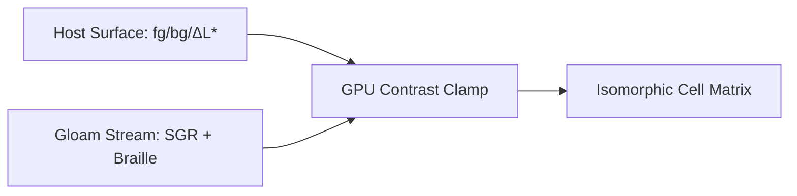

Here are the two deliverables ready to drop straight into your working directory: **`invariants-test-card.md`** (to test the Gloam compositor and your restricted Markdown pipeline) and **`tty-audit.sh`** (a zero-dependency raw ANSI/Unicode generator that stress-tests the host terminal shader and `libghostty` atlas directly, bypassing all parsers).

### Deliverable 1: The Gloam Markdown Artifact (`invariants-test-card.md`)

Save this and run `cat invariants-test-card.md | gloam` inside both Ghostty and `herdr-app`. It tests figure-ground survival, vertical rhythm, sub-cell Braille/block registration, and the exact column where your elision mark bites.

```markdown
# OPTICAL INSTRUMENT TEST CARD // GLOAM CONFORMANCE [80x24]

This artifact verifies **Host-Stream Orthogonality** ($\Delta L^*$ contrast clamping, cell isomorphism, and polarity invariance). Flip your terminal between dark and light polarity while viewing this frame.

## I1 & I3. Relative Figure-Ground Hierarchy

A compliant stream expresses hierarchy via **structural weight** and **relative luminance**, never assuming canvas polarity:

▍ PRIMARY SIGNAL   ████████████████  100%  [SGR 1: BOLD EMPHASIS]
▍ NOMINAL SIGNAL   ████████████░░░░   75%  [SGR 0: BASE FOREGROUND]
▍ SECONDARY GROUND ████████░░░░░░░░   50%  [SGR 2: DIM / RECEDED]
▍ SHADE TEXTURE    ████▓▓▓▓▒▒▒▒░░░░   25%  [U+2591..2593 DITHER]

## I4. Sub-Cell Geometry & Font-Atlas Registration

Every vertical tick (`│`, `┼`) below must align to the exact pixel column across ASCII, fractional eighths (`U+2588..258F`), and $2 \times 4$ Braille (`U+2800..28FF`):

▍ SCALE   0%        25%       50%       75%       100%
▍ RULER   ├─────────┼─────────┼─────────┼─────────┤
▍ EIGHTH  ██████████▌░░░░░░░░░│░░░░░░░░░│░░░░░░░░░│  26.25% (██▌)
▍SPARK    ▂▃▅▇█▆▄▂▁▂▃▅▇█▆▄▂▁▂▃┼▅▇█▆▄▂▁▂▃▅▇█▆▄▂▁▂▃▅┤  Inline 1x8
▍BRAILLE  ⣿⣿⣿⣿⣿⡇⠀⠀⠀⠀⠀⢸⠀⠀⠀⠀⠀⢸⠀⠀⠀⠀⠀⢸  Dot-Col Parity
▍HORIZON  ▀▀▀▀▀▀▀▀▀▀▄▄▄▄▄▄▄▄▄▄▀▀▀▀▀▀▀▀▀▀▄▄▄▄▄▄▄▄▄▄┤  Half-Block 1x2

## I2. Boundary Elision Invariant ($W_{\text{max}} = 80$)

Resize the pane narrower than 80 columns. The calibration bus below must trigger deterministic right-edge elision without soft-wrapping into vertical line noise:

▍ BUS-80: [C10]═════[C20]═════[C30]═════[C40]═════[C50]═════[C60]═════[C70]═════[C80-END]



```

---

### Deliverable 2: The Raw Host Shader Probe (`tty-audit.sh`)

Markdown cannot emit intentional low-contrast 24-bit RGB traps to test whether the host terminal's GPU shader is actually clamping minimum contrast (**Invariant I2**). This POSIX shell script emits a synchronized, raw 80×24 escape-sequence frame that directly probes **Failure Modes A, B, C, and D**.

Run `sh tty-audit.sh` (or pipe it) inside Ghostty and `herdr-app`:

```sh
#!/bin/sh
# tty-audit.sh — Optical Instrument & Invariant Conformance Probe (80x24)
# Wraps frame in DEC Mode 2026 synchronized output for tear-free atomic swap.

printf '\033[?2026h'
cat << 'EOF'
▍ TTY-AUDIT // OPTICAL INSTRUMENT CONFORMANCE CARD [80x24]                      
▍ Invariants: I1(Polarity)  I2(Contrast Clamp)  I3(Relative SGR)  I4(Cell Grid) 
────────────────────────────────────────────────────────────────────────────────
[I1/I3] RELATIVE FIGURE-GROUND VECTOR (Must survive Dark <-> Light flip)
▍ SGR-00 Base      : The quick brown fox jumps over the lazy dog [0123456789]
▍ SGR-01 Bold      : The quick brown fox jumps over the lazy dog [0123456789]
▍ SGR-02 Dim       : The quick brown fox jumps over the lazy dog [0123456789]
▍ SGR-07 Pill Caps :  LCARS-PRIMARY    LCARS-MUTED    [STATUS: NOMINAL] 

[I2] SHADER MINIMUM-CONTRAST CLAMP TRAP (Failure Mode B: Hardcoded Hex)
▍ Dark-Trap (#242424) : ██ CAN YOU READ THIS ON A DARK BACKGROUND?  (ΔL* -> 0)
▍ Lite-Trap (#EBEBEB) : ██ CAN YOU READ THIS ON A LIGHT BACKGROUND? (ΔL* -> 0)
▍ Pass Criterion      : Both lines above stay legible if Host enforces min-contrast.

[I4] SUB-CELL GEOMETRY & SPRITE REGISTRATION (Failure Mode D: Atlas Drift)
▍ Ruler  (40c) : 0%──────20%───────40%───────60%───────80%──────100%
▍ 1/8th Gauge  : ████████████████████▌░░░░░░░░░░░░░░░░░░░░░░░░░░░░░ 41.25%
▍ Spark (1x8)  : ▁▂▃▄▅▆▇█▇▆▅▄▃▂▁▁▂▃▄▅▆▇█▇▆▅▄▃▂▁▁▂▃▄▅▆▇█▇▆▅▄▃▂▁▁▂▃▄▅│<-Col 51
▍ Braille(2x4) : ⣿⣿⣿⣿⣿⣿⣿⣿⣿⣿⣿⣿⣿⣿⣿⣿⣿⣿⣿⣿⣿⣿⣿⣿⣿⣿⣿⣿⣿⣿⣿⣿⣿⣿⣿⣿⣿⣿⣿⣿⡇⠀⠀⠀⠀⠀│<-Col 51
▍ Seam Check   : █▀█▄█▀█▄█▀█▄█▀█▄█▀█▄  ░▒▓█▓▒░▒▓█▓▒░  ╭──────────╮ │<-Col 51
▍ Box vs Text  : │ASCII_BASELINE_TEST│  │⣿⡇Braille│   ╰──────────╯ │<-Col 51
────────────────────────────────────────────────────────────────────────────────
▍ BOUNDARY-80  : 123456789012345678901234567890123456789012345678901234567890[80]
EOF
printf '\033[?2026l'

```

### How to Read the Smoke Test Results

* **The `I2` Hex Trap (`#242424` and `#EBEBEB`):** In a default terminal with no shader clamp, one of those two lines will be almost invisible depending on whether your canvas is dark or light. Now set `minimum-contrast = 3.0` (or higher) in your Ghostty config and compare it against `herdr-app`. If `herdr-app` doesn't expose or inherit `libghostty`'s contrast clamp, the trap line disappears—proving **Failure Mode B** on the spot.
* **The `Col 51` Vertical Alignment Line:** Look at the right-hand `│<-Col 51` marker across the Sparkline, Braille, Seam Check, and Box rows. In a true `libghostty` sprite pipeline, those four `│` characters form an unbroken, laser-straight vertical line and the `█▀█▄` blocks have zero horizontal hairline cracks.
* **The Compositor Survival Check (`invariants-test-card.md`):** When you pipe the Markdown file into `gloam`, watch what happens to the `▍` spine and the `├─────────┼` ruler. If Gloam preserves the exact column alignment and elides `BUS-80` cleanly when you shrink the pane, your compositor's instrument pass is already 90% there.