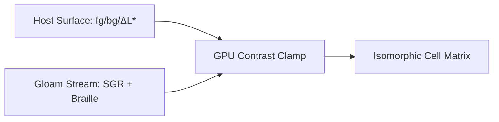

# OPTICAL INSTRUMENT TEST CARD // GLOAM CONFORMANCE [80x24]

This artifact verifies **Host-Stream Orthogonality** ($\Delta L^*$ contrast clamping, cell isomorphism, and polarity invariance). Flip your terminal between dark and light polarity while viewing this frame.

## I1 & I3. Relative Figure-Ground Hierarchy

A compliant stream expresses hierarchy via **structural weight** and **relative luminance**, never assuming canvas polarity:


```text
▍ PRIMARY SIGNAL   ████████████████  100%  [SGR 1: BOLD EMPHASIS]
▍ NOMINAL SIGNAL   ████████████░░░░   75%  [SGR 0: BASE FOREGROUND]
▍ SECONDARY GROUND ████████░░░░░░░░   50%  [SGR 2: DIM / RECEDED]
▍ SHADE TEXTURE    ████▓▓▓▓▒▒▒▒░░░░   25%  [U+2591..2593 DITHER]
```

## I4. Sub-Cell Geometry & Font-Atlas Registration

Every vertical tick (`│`, `┼`) below must align to the exact pixel column across ASCII, fractional eighths (`U+2588..258F`), and $2 \times 4$ Braille (`U+2800..28FF`):

```text
▍ SCALE   0%        25%       50%       75%       100%
▍ RULER   ├─────────┼─────────┼─────────┼─────────┤
▍ EIGHTH  ██████████▌░░░░░░░░░│░░░░░░░░░│░░░░░░░░░│  26.25% (██▌)
▍SPARK    ▂▃▅▇█▆▄▂▁▂▃▅▇█▆▄▂▁▂▃┼▅▇█▆▄▂▁▂▃▅▇█▆▄▂▁▂▃▅┤  Inline 1x8
▍BRAILLE  ⣿⣿⣿⣿⣿⡇⠀⠀⠀⠀⠀⢸⠀⠀⠀⠀⠀⢸⠀⠀⠀⠀⠀⢸  Dot-Col Parity
▍HORIZON  ▀▀▀▀▀▀▀▀▀▀▄▄▄▄▄▄▄▄▄▄▀▀▀▀▀▀▀▀▀▀▄▄▄▄▄▄▄▄▄▄┤  Half-Block 1x2
```

## I2. Boundary Elision Invariant ($W_{\text{max}} = 80$)

Resize the pane narrower than 80 columns. The calibration bus below must trigger deterministic right-edge elision without soft-wrapping into vertical line noise:

▍ BUS-80: [C10]═════[C20]═════[C30]═════[C40]═════[C50]═════[C60]═════[C70]═════[C80-END]

